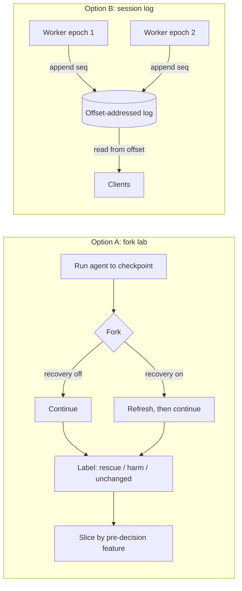
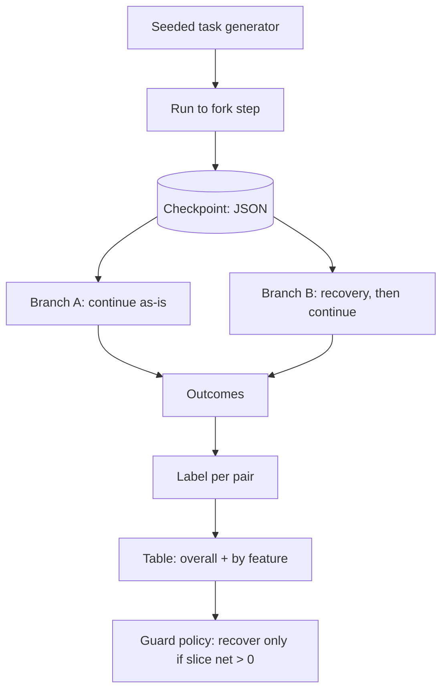
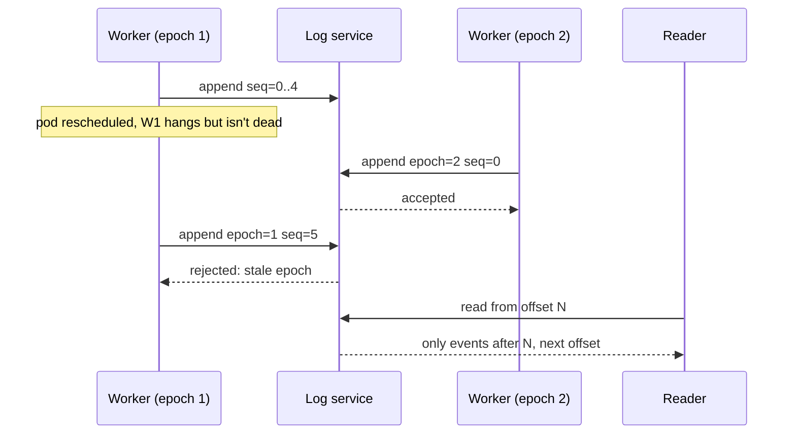

Here's a table from a toy simulator I'll show you below. 300 agent runs, a "recovery" step that re-reads the world when something looks off. Net effect of turning it on: **minus 8 runs**. Looks like a small, boring loss.

Underneath: 75 runs rescued and 83 runs harmed. Same net, completely different product. One of those is a feature you should keep on a narrow trigger. The other is a coin flip you're paying tokens for.

This week had four ideas that fit together better than they looked on their own days. Counterfactual evaluation of recovery (Tuesday). Durable execution and its history limits (Wednesday). Resumable logs as the agent session (Friday). And on Monday, the agent loop itself, now that forced tool calls are gone on the newest models. This weekend, build something small where the numbers can move.

## The 5-minute version

Both options run on a laptop with a scripted fake model. No GPU, no API key.

**Option A's insight:** a recovery step is a decision made at a state, so evaluate it per state. The [paper from 30 September](https://arxiv.org/abs/2610.00372) (Xiao et al., arXiv:2610.00372) forks a run from one checkpoint, applies the intervention on one branch only, and labels the pair. I read the abstract on arXiv: ALFWorld, Qwen3-14B, success 70.33% to 73.33% with their router. The per-state counts I quoted in Tuesday's post came from a third-party summary, so check the paper before quoting them. The method is the part worth stealing, and the method needs one thing most agents don't have: state you can copy.

**Option B's insight:** a session log is only as good as its write protocol. Reading from an offset is the easy half. The hard half is that a restarted worker and its zombie predecessor are both writing to the same session. The [Durable Streams protocol](https://github.com/durable-streams/durable-streams) (Beta, per its README) answers that with producer id, epoch and sequence headers. You'll build the same three rules.

Why a senior architect should care: the first is how you stop shipping reflexes because they feel safe. The second is how you stop a deploy from corrupting a live conversation.



Pick one. Doing both in three hours means doing neither properly.

---

## Option A: the fork lab

### Goal

Build a harness that takes checkpointed agent runs, forks each one at a chosen step into "recovery off" and "recovery on", and reports **rescued, harmed, unchanged** overall and by slice. Then use the slice to write a trigger that fires recovery only where harms don't outnumber rescues.

### Why it's worth building

Most teams evaluate recovery logic by comparing two averages. That's a comparison of two populations, and it hides cancellation. Once you've built this once, you'll be uncomfortable reading a single "+3 points" again. Also, the build forces the durability question: can you actually copy your agent's state?

### Requirements

- A deterministic fake agent and environment, so a fork is exactly reproducible. (At temperature above zero you'd need several forks per checkpoint and a majority vote; the paper notes its setup relied on greedy decoding.)
- A checkpoint is a plain dict you can `deepcopy` or serialise to JSON: history, environment state, step counter, budget.
- A recovery step that isn't free: it burns an action from a budget.
- At least one feature visible *before* the decision, used for slicing.
- A report with the three counts, the net, and a per-slice table.

### Architecture



### Stack

Python 3, standard library only. If you want to scale it up afterwards, PySpark is a reasonable place to run ten thousand forks and group the labels by feature, since each pair is independent.

### Milestones

**1. The toy world (30 min).** A counter that has to reach 6 within a step budget. The agent reads an observation, increments, and declares done when the observation says 6. Give each run a budget of 7 plus a random slack of 0 to 2 steps, and, for some runs, a stuck sensor: after a certain value the observation stops updating. A stuck observation makes the agent overshoot, and overshooting can't be undone. Success means the agent *declared done* with the true value at 6.

**2. Recovery (15 min).** `refresh` costs one action, un-sticks the sensor and re-reads the true value. Note what you've built: it helps when the sensor is stuck and costs budget when the sensor is fine.

**3. The fork (30 min).** Run to step 3, deep-copy the state, apply recovery to one copy, finish both, label the pair.

**4. The table (30 min).** Run 300 seeds. Print the three counts and the net.

**5. Slice (30 min).** Record a pre-decision feature at the fork: "did the last action leave the observation unchanged?" Group labels by it.

**6. Policy and write-up (45 min).** Write `should_recover(state)` from your slice, rerun, and confirm harms drop. Write the two-paragraph result.

A reference core, about 45 lines. I ran this and it gave the numbers below, but treat it as a starting point and change the world to match your own idea of a failure.

```python
import copy, random
from collections import Counter, defaultdict

TARGET = 6

def new_run(seed):
    r = random.Random(seed)
    return {"v": 0, "obs": 0, "steps": 0, "done": False, "declared": False,
            "frozen": False, "same_obs": False,
            "budget": 7 + r.choice([0, 0, 1, 2]),       # some runs have slack
            "freeze_at": r.choice([None, None, 1, 2])}  # sensor sticks here

def step(s):
    if s["done"] or s["steps"] >= s["budget"]: s["done"] = True; return
    s["steps"] += 1
    if s["obs"] >= TARGET: s["done"] = s["declared"] = True; return
    s["v"] += 1
    if s["freeze_at"] == s["v"]: s["frozen"] = True
    prev = s["obs"]
    if not s["frozen"]: s["obs"] = s["v"]
    s["same_obs"] = s["obs"] == prev

def refresh(s):
    s["steps"] += 1            # recovery burns an action
    s["frozen"] = False
    s["obs"] = s["v"]

def finish(s):
    while not s["done"]: step(s)
    return s["declared"] and s["v"] == TARGET

def pair(seed, fork_at=3):
    s = new_run(seed)
    while s["steps"] < fork_at and not s["done"]: step(s)
    feat = s["same_obs"]                         # visible before deciding
    a, b = copy.deepcopy(s), copy.deepcopy(s)    # the fork
    refresh(b)
    off, on = finish(a), finish(b)
    return feat, ("rescue" if on and not off else "harm" if off and not on else "unchanged")

total, by = Counter(), defaultdict(Counter)
for seed in range(300):
    feat, label = pair(seed)
    total[label] += 1; by[feat][label] += 1
print(dict(total), "net", total["rescue"] - total["harm"])
for feat, c in sorted(by.items()): print("obs repeated =", feat, dict(c))
```

With those parameters it printed:

```
{'rescue': 75, 'harm': 83, 'unchanged': 142} net -8
obs repeated = False {'harm': 83, 'unchanged': 72}
obs repeated = True {'rescue': 75, 'unchanged': 70}
```

The toy is built so the feature separates cleanly, which real systems never do. The point is the shape of the report. Your job in milestone 6 is to see how far a single imperfect signal gets you before the table stops cooperating.

### Stretch goals

- Add noise to the fake model and use five forks per checkpoint with a majority vote. Watch how fast the counts get noisy at small sample sizes.
- Add a content-free variant (the refresh consumes a step but returns nothing). The paper's mechanism control suggests part of the gain comes from interrupting the run rather than from new information; see whether your toy can show the same thing, and don't assume it will.
- Persist checkpoints as JSON and fork from disk in a separate process. If that's painful, you've found your real durability gap.
- Cap harm explicitly: choose the trigger that maximises rescues subject to harms on clean runs staying at zero.

---

## Option B: a session log that survives zombie workers

### Goal

Build a small append-only log server and a worker client where a restarted worker can't corrupt the session, and any reader can resume from any offset.

### Why it's worth building

Wednesday's post said the workflow engine owns progress. Friday's said the stream owns what the user can see. This is the second half. Writing the protocol yourself shows why "just append to a table" breaks on the first retry.

### Requirements

Modelled on the rules in the Durable Streams `PROTOCOL.md`. I read the spec for Friday's post, but I haven't verified every header detail, so treat this as a design exercise, not a conformance test.

- Streams are named and append-only. Reads take an offset and return the data after it plus the next offset.
- Producers send `producer_id`, `epoch` and `seq` with each append.
- Same `seq` as the last accepted one: duplicate, ignore it, return success.
- The next expected `seq`: accept.
- A gap: reject, and tell the producer what you expected.
- A lower `epoch` than the highest seen: reject. That's your fence against a zombie.
- A higher `epoch`: accept and reset the expected `seq`.
- A reader that reconnects with a stale offset gets exactly the missing tail.

### Architecture



### Stack

Python. A dict of lists behind `http.server` or FastAPI is enough, with SQLite if you want the log to survive a restart. Tests with `pytest`.

### Milestones

1. **Log and offsets (30 min).** Append and read, with an opaque offset (a base64 of the index is fine; the point is that clients don't do arithmetic on it).
2. **Idempotent append (30 min).** Add producer id and seq, with duplicate and gap handling.
3. **Epoch fencing (30 min).** Add epoch rules and the zombie test above.
4. **Resume test (30 min).** Start a reader, kill it mid-stream, reconnect from its last offset, assert no loss and no duplicates.
5. **The decision (30 min).** Write down what an epoch means in your system: a deploy, a pod, a retry of the whole run? Run the zombie test under that definition.
6. **Write-up (30 min).**

### Stretch goals

- A long-poll read that blocks until new data arrives.
- A retention rule: reads before the retained range return a clear "gone" response.
- Put a real agent loop behind the writer, with the fake model scripted, and kill the worker at random.

---

## Build your own

Copy this and fill it in. If you can't fill in the last line, the project is too vague.

```
Goal (one sentence):
Which of this week's ideas it uses (loop / counterfactual eval / durable execution / resumable log):
Inputs and outputs:
Must-have (3 bullets max):
Nice-to-have:
Milestone 1 (done by hour 1):
Milestone 2 (done by hour 2):
Milestone 3 (done by hour 3):
How I'll know it works (a number or a test, not a feeling):
```

## What to check before you trust any of this

- The toy in Option A is designed so one feature separates rescues from harms. Real failure modes won't be that cooperative, and the paper's authors note several confidence intervals crossing zero and simple baselines landing close to their router, on one environment and one model.
- Temporal's [limits page](https://docs.temporal.io/workflow-execution/limits) says event history is capped at 51,200 events or 50 MB, with warnings at 10,240 events or 10 MB. That's the number behind why long agent loops need a plan for history size; it's relevant if you take Option A's checkpoints into a workflow engine.
- Anthropic's [define-tools docs](https://platform.claude.com/docs/en/agents-and-tools/tool-use/define-tools) say forced `tool_choice` returns a 400 on Opus 5.5, Sonnet 5.5, Fable 5.1 and Mythos 5.1. If you swap a real model into Option A's agent, your loop has to handle a turn with no tool call, because you can't force one any more.
- Durable Streams is labelled Beta, and I haven't verified what its production deployment guarantees about fsync or failover.

Three hours is plenty for a small, finished thing. If you reach the first table or the first rejected zombie write, that's a good Saturday, and the rest can wait for a quieter one.
