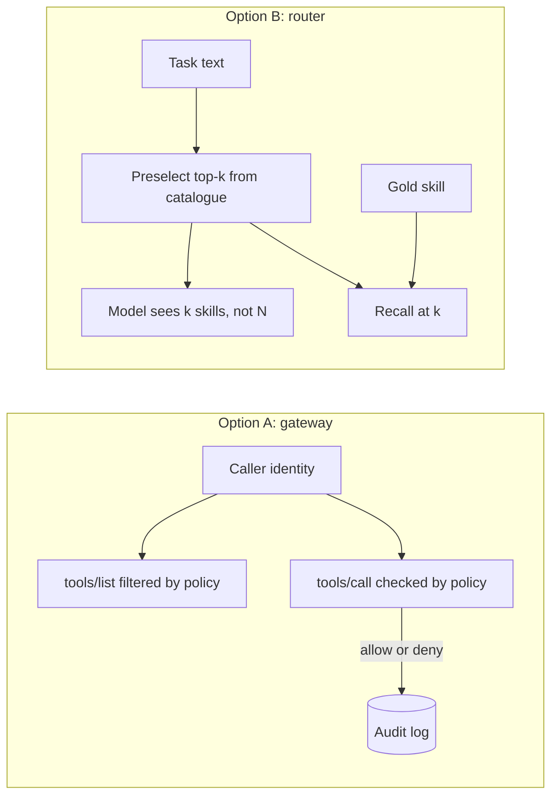
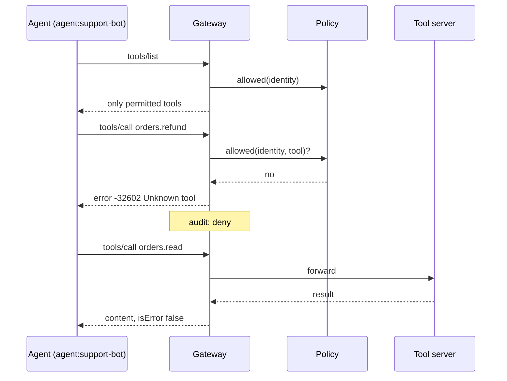
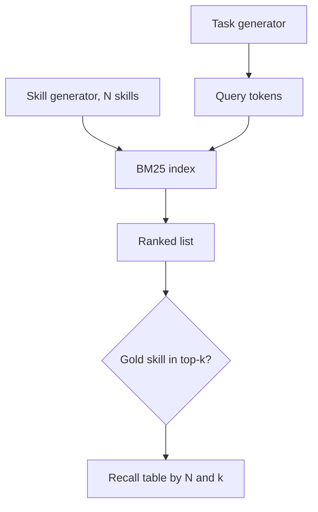

Two tests that almost no agent project has. One: when the agent asks for a tool it shouldn't have, does the system say no, and does anyone find out? Two: when the skill library grows tenfold, does the right skill still get loaded?

Both were this week's threads. Tuesday's paper put a number on the second (recall of the right skill falling from 73.6% to 27.4% with 1,000 irrelevant skills installed). Wednesday's post argued for the first (one gateway that owns identity, policy and audit). This Saturday, build a small version of either and watch the numbers move.

## The 5-minute version

Both options run on a laptop with the Python standard library. No GPU, no API key.

**The frame.** Anthropic's [Building effective agents](https://www.anthropic.com/engineering/building-effective-agents) defines workflows as "systems where LLMs and tools are orchestrated through predefined code paths" and agents as "systems where LLMs dynamically direct their own processes and tool usage". Monday's post covered a model that writes its own workflow, which blurs the line. The practical split hasn't changed: if you can write the steps down, write them down. What both options protect is the layer underneath, whichever you choose.

**Option A's insight:** the [MCP tools spec](https://modelcontextprotocol.io/specification/2025-06-18/server/tools) (revision 2025-06-18) gives you `tools/list`, `tools/call`, and two error channels: JSON-RPC protocol errors for things like unknown tools, and `isError: true` results for tool execution failures. It also says servers MUST "implement proper access controls" and clients SHOULD log tool usage for audit. A gateway is where those sentences become code. AWS's AgentCore Gateway documents the same shape, and adds a built-in search tool, `x_amz_bedrock_agentcore_search`, when semantic search is enabled for large catalogues.

**Option B's insight:** if listing every skill or tool in the prompt stops working at scale, something has to preselect. The [paper](https://arxiv.org/abs/2610.18522) (Liu, Chen, Zhang, arXiv:2610.18522, 13 October) reports explicit preselection keeps recall at 73.9% from the same library where implicit loading falls to 27.4%. You'll build the measuring stick: how good can a cheap retriever be, at what k, as the catalogue grows?

Why a senior architect should care: both are cheap to build, and both turn "we think it's governed" and "we think it finds the right skill" into a test that fails.



Pick one. Doing both in three hours means doing neither properly.

---

## Option A: the gateway that says no

### Goal

A function (or tiny HTTP server) that speaks the two MCP tool methods, scopes `tools/list` and `tools/call` by caller identity, denies by default, and writes an audit record for every decision.

### Why it's worth building

Wednesday's design put policy in the gateway rather than in each server. Writing the 40-line version shows you what the pattern actually requires, and the tests are the interesting part: they're the ones you'd want in a design review.

### Requirements

- Identity comes with the request. In production it's a verified token; here it's a string. Give agents their own identity, separate from the human they act for.
- `tools/list` returns only tools the identity may call.
- `tools/call` is checked on every call, not just at connection time.
- Anything not explicitly allowed is denied, including unknown identities.
- Unknown and forbidden tools return the same protocol error, so probing can't map the catalogue.
- Every decision, allow or deny, is logged with identity and tool name.

### Architecture



### Stack

Python 3 standard library. Call it as a function first; wrap it in `http.server` only if you have time. Tests with `pytest`, or plain asserts.

### Milestones

1. **The shape (30 min).** `handle(identity, request)` for `tools/list` and `tools/call`, returning JSON-RPC-shaped dicts.
2. **Policy (30 min).** A dict from identity to allowed tool names. Start with two identities and three tools.
3. **Deny by default (20 min).** Unknown identity gets an empty list and denied calls.
4. **Audit (20 min).** Append `(identity, tool, decision)` on every call path.
5. **Tests (45 min).** Write the five tests below before moving on.
6. **Write-up (35 min).** Which identity would you give a scheduled agent that acts for a person? Write down what could go wrong with each answer.

A reference core, about 40 lines. The output below is from running it; treat it as a starting point.

```python
import json

TOOLS = {
    "orders.read":   {"description": "Look up an order by id", "write": False},
    "orders.refund": {"description": "Refund an order", "write": True},
    "crm.read":      {"description": "Read a customer record", "write": False},
}
POLICY = {  # identity -> allowed tools; anything missing is denied
    "human:ana":        {"orders.read", "orders.refund", "crm.read"},
    "agent:support-bot": {"orders.read", "crm.read"},   # narrower than the human
}
AUDIT = []

def handle(identity, req):
    method, p = req["method"], req.get("params", {})
    allowed = POLICY.get(identity, set())
    if method == "tools/list":
        tools = [{"name": n, "description": t["description"]}
                 for n, t in TOOLS.items() if n in allowed]
        return {"result": {"tools": tools}}
    if method == "tools/call":
        name = p.get("name")
        if name not in TOOLS or name not in allowed:      # same answer for both
            AUDIT.append((identity, name, "deny"))
            return {"error": {"code": -32602, "message": f"Unknown tool: {name}"}}
        AUDIT.append((identity, name, "allow"))
        try:
            out = f"{name} ok {json.dumps(p.get('arguments', {}))}"
            return {"result": {"content": [{"type": "text", "text": out}], "isError": False}}
        except Exception as e:
            return {"result": {"content": [{"type": "text", "text": str(e)}], "isError": True}}
    return {"error": {"code": -32601, "message": "Method not found"}}
```

Running the demo calls gives:

```
['orders.read', 'crm.read']
{'error': {'code': -32602, 'message': 'Unknown tool: orders.refund'}}
{'error': {'code': -32602, 'message': 'Unknown tool: nope.nothing'}}
{'result': {'content': [{'type': 'text', 'text': 'orders.refund ok {"id": 7}'}], 'isError': False}}
{'error': {'code': -32602, 'message': 'Unknown tool: orders.read'}}
```

The five tests: the bot's list excludes `orders.refund`; the bot's call to it is denied; the bot's denial is byte-identical to a call to a tool that doesn't exist; the human can still refund; an unknown identity sees nothing and is logged.

> [!WATCH] Watch out for
> Hiding a tool from `tools/list` is not authorization. A model can still emit a call to a name it guessed or saw earlier, so the check on `tools/call` is the one that counts. The list filter is for context cost and tidiness.

### Stretch goals

- Move policy into a file reviewed in pull requests, and add a test that fails if a new tool has no policy entry.
- Add `x_amz_bedrock_agentcore_search`-style search: when the allowed set is over about 30 tools, `tools/list` returns only a search tool and pinned tools, and the search runs over the caller's allowed set.
- Return an `isError: true` result when a permitted tool fails, and confirm your audit log tells the two failure kinds apart.
- Add a rate limit per identity; the spec says servers MUST rate limit invocations.

---

## Option B: a skill router you can measure

### Goal

A harness that generates a synthetic skill catalogue of growing size, preselects the top-k candidates for each task with a cheap retriever, and reports how often the right skill is in the shortlist.

### Why it's worth building

The paper's headline is about implicit routing by a model, which you can only test with a model. What you can build today, free, is the other half: how good the preselection step is, and what k you need. It's the number that decides whether "preselect, then let the model choose" can work for your catalogue. Don't read the toy numbers below as a result about real skills: they come from synthetic text designed for the exercise.

### Requirements

- A generator for N skills, each with a name-ish domain word, a couple of its own jargon terms and some filler words.
- A query generator that shares the domain and one jargon term with its target skill, plus noise. This is deliberately loose, like a user's paraphrase.
- A ranker: BM25 from scratch (about 15 lines).
- Recall@k for k = 1, 5, 20 at N = 10, 100, 1,000 and 5,000.
- A fixed random seed, so a run is reproducible.

### Architecture



### Stack

Python 3 standard library. For stretch goals: `sentence-transformers` or any embedding API for a hybrid ranker.

### Milestones

1. **Generator (30 min).** Skills and queries, with a seed.
2. **BM25 (30 min).** Write it from the formula; sanity-check on N = 10.
3. **Recall table (30 min).** Loop over N and k.
4. **Read the table (30 min).** Where does top-1 stop being usable? How much does k = 5 buy?
5. **Break it (30 min).** Make descriptions of different skills overlap more (shared domains) and watch recall move.
6. **Write-up (30 min).** State the k you would use for a catalogue of your size, and what the model would see.

A reference core:

```python
import math, random
from collections import Counter

R = random.Random(7)
DOMAINS = [f"d{i}" for i in range(60)]                 # topics, e.g. "invoice", "k8s"
VERBS = ["parse", "audit", "convert", "summarise", "validate", "migrate", "diff", "plan"]
FILLER = [f"w{i}" for i in range(400)]                 # generic description words

def make_skill(i):
    d = R.choice(DOMAINS)
    own = [f"{d}x{R.randrange(40)}" for _ in range(2)]  # the skill's own jargon
    words = [R.choice(VERBS), d] + own + R.sample(FILLER, 8)
    return {"id": i, "domain": d, "jargon": own, "text": words}

def query_for(s):  # user paraphrases: shares the domain and one jargon term, plus noise
    return [R.choice(VERBS), s["domain"], R.choice(s["jargon"])] + R.sample(FILLER, 4)

def bm25_rank(q, skills, k1=1.2, b=0.75):
    N = len(skills); avg = sum(len(s["text"]) for s in skills) / N
    df = Counter(w for s in skills for w in set(s["text"]))
    def score(s):
        tf = Counter(s["text"]); L = len(s["text"])
        return sum(math.log(1 + (N - df[w] + .5) / (df[w] + .5)) * tf[w] * (k1 + 1)
                   / (tf[w] + k1 * (1 - b + b * L / avg)) for w in q if w in tf)
    return sorted(skills, key=score, reverse=True)

def recall_at(n, k, trials=300):
    skills = [make_skill(i) for i in range(n)]
    hit = 0
    for _ in range(trials):
        gold = R.choice(skills)
        hit += gold in bm25_rank(query_for(gold), skills)[:k]
    return hit / trials

for n in (10, 100, 1000, 5000):
    print(n, [f"k={k}: {recall_at(n, k):.1%}" for k in (1, 5, 20)])
```

With seed 7 it printed (identically on a second run):

```
10 ['k=1: 98.3%', 'k=5: 100.0%', 'k=20: 100.0%']
100 ['k=1: 87.3%', 'k=5: 100.0%', 'k=20: 100.0%']
1000 ['k=1: 65.7%', 'k=5: 99.7%', 'k=20: 100.0%']
5000 ['k=1: 21.7%', 'k=5: 87.0%', 'k=20: 100.0%']
```

```chart
{"title": "Toy catalogue: BM25 recall of the right skill by shortlist size (synthetic data)", "type": "line", "x": ["10", "100", "1000", "5000"], "series": [{"name": "top-1", "values": [98.3, 87.3, 65.7, 21.7]}, {"name": "top-5", "values": [100, 100, 99.7, 87.0]}, {"name": "top-20", "values": [100, 100, 100, 100]}], "unit": "%", "xLabel": "Skills in the catalogue", "yLabel": "Recall", "note": "Synthetic skills and queries from the reference script, 300 trials per cell, seed 7. Not a measurement of real skills."}
```

Two readings, both modest. A shortlist of five holds up far better than a single pick as the catalogue grows. And the 1,000-skill row looks fine at k = 5 only because the queries share a rare jargon term with their target; real tasks rarely do. Run your own catalogue's descriptions through this to see.

### Stretch goals

- Swap in embeddings, then a hybrid (BM25 plus vectors, merged by reciprocal rank fusion), and compare at N = 5,000.
- Add distractors that are near-duplicates of the gold skill (same domain, different jargon) and measure the drop. The paper's finding that wrong loads were rare is about a model; yours is about a retriever.
- Plug a real model in as the implicit baseline: give it all N descriptions and count how often it loads the gold skill versus zero skills. That's the paper's experiment in miniature.
- Log "skills that should have loaded versus skills that did" in your own agent traces. It's the cheapest production version of this build.

---

## Build your own

Copy this and fill it in. If you can't fill in the last line, the project is too vague.

```
Goal (one sentence):
Which of this week's ideas it uses (workflow vs agent / tool gateway / skill routing):
Inputs and outputs:
Must-have (3 bullets max):
Nice-to-have:
Milestone 1 (done by hour 1):
Milestone 2 (done by hour 2):
Milestone 3 (done by hour 3):
How I'll know it works (a number or a test, not a feeling):
```

## What to check before you trust any of this

- Option A's policy is a dict and its identity is a string. A real gateway verifies tokens, and AWS documents inbound authorization for AgentCore Gateway on a separate page that this post doesn't cover.
- The MCP revision quoted here is 2025-06-18. AWS's page mentions versions 2025-11-25 and 2026-07-28 (with new request headers), so check the current spec before copying message shapes.
- Option B's numbers are from synthetic text. The paper's figures (73.6% to 27.4% recall, 9.3% to 51.6% zero-load runs, 73.9% with explicit selection) come from its abstract on arXiv; they haven't been reproduced here, and its code wasn't checked.
- The paper compares a model's implicit loading to preselection. Your BM25 harness measures only the shortlist step, not what the model does afterwards.

Three hours is plenty for a small, finished thing. If you get to your first denied call or your first recall table, that's a good Saturday, and the other option will keep for a quieter weekend.
