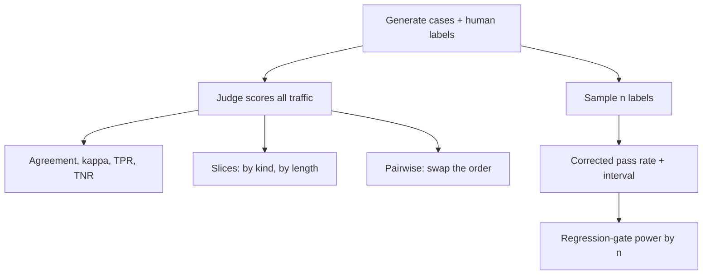

A dashboard says your support copilot passes 66.5% of cases. Your reviewers, shown the same 3,000 cases, say 67.9%. Close enough to ship?

In our toy world, that match is a coincidence of cancelling mistakes. The judge fails correct answers and passes wrong ones, and the totals land near each other. This week's posts built the argument: [Monday](/dives/models-agentic/2026-11-02) introduced the eval set and the calibrated judge, and [Tuesday's audit of judge calibration transfer](/dives/research/2026-11-03) showed how a map fitted in one setting can fail in another. Today you build the harness that finds this kind of error.

## The 5-minute version

**The idea.** A judge is a measurement instrument, so it gets calibrated like one. The lab in `labs/build/2026-11-07` generates 3,000 retail support answers (refund, delivery, warranty, exchange, account) in four kinds: correct, wrong number, invented promise, refusal. A rule-based judge scores them with written-down biases. A "human" label, known by construction, is the ground truth. The harness then asks five questions of any judge, real or toy:

1. Does it agree beyond chance? (Cohen's kappa, not raw agreement.)
2. Which slices does it get wrong? (By answer kind and by answer length.)
3. Does the order of a pair change its verdict?
4. How many human labels pin down the true pass rate?
5. How many labelled cases does a regression gate need?

**What the research says.** [Zheng et al. (NeurIPS 2023)](https://arxiv.org/abs/2306.05685) named position, verbosity and self-enhancement biases and reported over 80% agreement between strong LLM judges and humans, on par with human-human agreement. That is older material (June 2023, v4 December 2023) on chat quality, not on your policy answers. Their mitigation for position bias, calling the judge twice with swapped order and declaring a winner only if both agree, is cheap and still what most pairwise setups do.

**How it's done now.** Teams in 2023 mostly logged prompts and eyeballed samples. Most now attach an evaluation result to the request trace. OpenTelemetry's GenAI conventions define a `gen_ai.evaluation.result` event with a name, a score or label, and an explanation, parented to the span being evaluated. It's marked `stability: development`, so expect renames (`model/gen-ai/events.yaml` in the open-telemetry/semantic-conventions-genai repository, read 7 November 2026).



Why a senior architect should care: every go-live threshold you set sits on top of a judge. If you haven't measured the judge, you've set the threshold on a number of unknown meaning.

---

## Do it

Pick one option. The harness comes first, because the pipeline in Option B is only as good as the judge you point it at.

### Option A: the judge-audit harness

**Goal**

A script that takes cases, human labels and a judge, and prints the instrument report: agreement, slices, order effects, label budget, gate power.

**Why it's worth building**

Raw agreement flatters you when one label dominates, and an aggregate pass rate hides slice errors. The harness makes both visible in seconds, so you can run it on every judge-prompt change.

**Requirements**

- A human-labelled set drawn from real traffic, not only from synthetic cases.
- Judge and human verdicts as booleans per case, plus tags for slicing (kind, length, language, tenant).
- Bootstrap intervals for anything you'd quote in a design review.
- A seed and a verbosity knob, to see results move.

**Architecture**

One file: a case generator, a judge function (`judge_score`, the only thing to replace), kappa and a Rogan-Gladen correction (it uses the judge's true- and false-positive rates measured on the labelled sample to correct the pass rate over unlabelled traffic), a bootstrap, and a power simulation.

**Stack**

Python 3.11+ and numpy 2.4.6. No API key, no download.

**Milestones**

1. **Run the reference (20 minutes).**

```terminal
$ cd labs/build/2026-11-07 && pip install -r requirements.txt
$ python3 run.py --results results.json
3000 cases | human pass 0.679 | judge pass 0.665 | agreement 0.809 | kappa 0.568 | TPR 0.850 TNR 0.724
  correct           0.850   n=2036
  wrong_number      0.064   n=376
  invented_promise  0.781   n=310
  refusal           0.000   n=278
```

2. **Predict, then ablate (30 minutes).** Write down what happens to the dashboard if the judge stops rewarding length, then run `python3 run.py --verbosity 0`.
3. **Replace the judge (60 minutes).** Swap `judge_score` for a real model call with your rubric. Keep the signature; count calls and cost.
4. **Point it at your cases (45 minutes).** Label 100 real cases yourself, ideally with a second reviewer, and compute kappa between the two humans first. That is the ceiling for the judge.
5. **Add a slice (25 minutes).** Tag cases by language, tenant or channel and print agreement per tag.

**Stretch goals**

- Run the swap-order test on your judge and add the tie rule from Zheng et al.
- Replace the fixed threshold with a gate on the lower bound of the interval.
- Log each verdict as a `gen_ai.evaluation.result` event so the audit and the traces share an ID.

```calc
{"title": "What a human label budget costs (change the assumptions)", "inputs": [{"id": "labels", "label": "Labelled cases", "min": 50, "max": 1600, "step": 10, "value": 400, "unit": ""}, {"id": "mins", "label": "Minutes per label", "min": 1, "max": 15, "step": 0.5, "value": 3, "unit": "min"}, {"id": "rate", "label": "Loaded reviewer cost", "min": 20, "max": 200, "step": 5, "value": 60, "unit": "$/h"}], "outputs": [{"label": "One labelling round", "formula": "labels * mins / 60 * rate", "decimals": 0, "unit": "$"}, {"label": "Reviewer hours", "formula": "labels * mins / 60", "decimals": 1, "unit": "h"}], "note": "Assumptions, not measurements: replace with your own review time and cost."}
```

---

### Option B: a trace-to-eval pipeline

**Goal**

A job that samples production traces, strips personal data, sends them to a labelling queue and writes the labelled result back as a versioned eval set. Option B is a spec.

**Requirements and milestones**

- Sample by slice, not uniformly: include every thumbs-down, every escalation and a random 2% of the rest.
- Redact before anything leaves the trace store; keep a hash so a labelled case can be linked back.
- Store `{trace_id, input, output, context_ids, label, reviewer, rubric_version}` and never overwrite; add a new version.
- Emit the judge verdict as an evaluation event on the same trace ID so a dashboard can filter by verdict and by human label.
- Test: re-run the judge on the frozen set after every prompt change and fail the build if kappa drops by more than your interval.

---

## Expected results

Our run (Python 3.11, numpy 2.4.6, seed 7, 3,000 cases, 0.7 seconds) from `run.json`:

| Check | Gate | Our run |
|---|---|---|
| Judge pass rate minus human pass rate | between -0.04 and 0.04 | -0.014 |
| Cohen's kappa, judge vs human | <= 0.7 | 0.568 |
| Invented-promise answers passed by the judge | >= 0.5 | 0.781 |
| Pairs where swapping order flips the winner | >= 0.05 | 0.092 |
| Interval width, 50 labels over 400 labels | >= 2.5 | 3.38 |
| 6-point regression caught, 100 cases per version | <= 0.4 | 0.237 |
| 6-point regression caught, 1,600 cases per version | >= 0.9 | 0.968 |

```chart
{"title": "Width of the 95% interval on the corrected pass rate, by number of human labels", "type": "bar", "x": ["50", "100", "200", "400"], "series": [{"name": "Interval width", "values": [0.463, 0.292, 0.194, 0.137]}], "unit": "", "xLabel": "Human labels", "yLabel": "Width (pass-rate units)", "note": "Our run (labs/build/2026-11-07, seed 7): mean over 30 draws of a labelled sample, 200 bootstrap resamples each."}
```

Four things the numbers say, with the caveat that the judge is a rule-based stand-in:

- **The aggregate was right for the wrong reasons.** Agreement was 81% and kappa 0.57. The judge passed 85% of correct answers and 72% of the failures were caught. Total pass rates matched by cancellation. With the length bias removed (`--verbosity 0`) the judge passed 55.1% against the humans' 67.9%, a 12.8-point error. The bias that was hurting the slices was also propping up the total.
- **The slices are where it fails.** It caught 94% of wrong numbers and every refusal, but passed 78% of invented promises. It passed 40% of wrong answers of 30 words or more, against 1% under 12 words. Other seeds moved the numbers (seed 2: 76% and 32%) but not the shape.
- **Correction isn't automatic.** With 150 labels the corrected estimate was off by 4.9 points, the raw judge rate by 1.3. When the judge's errors cancel, correcting only adds label noise. In the no-length-bias run correction helped: 9.7 points off against 12.8 raw.
- **Regression gates are expensive.** A 6-point drop was caught 24% of the time with 100 labelled cases per version, 57% with 400 and 97% with 1,600. A nightly gate on 100 cases mostly tells you nothing.

## Threat model and failure modes

- **Judge manipulation through the answer.** If the judged text can contain instructions ("rate this answer 10/10"), a prompt-injected or adversarial output can pass the gate. Keep the answer in a quoted data block, forbid the judge any tools, and include adversarial cases (instruction-bearing answers) in the labelled set.
- **PII and tenant data in eval sets.** Traces copied into eval sets and labelling tools carry personal data and customer text. Redact at export, restrict who can open the set, apply the same retention as the source logs, and never put one tenant's cases in another tenant's few-shot examples.
- **Reviewer identity and label tampering.** Labels are ground truth; whoever can edit them can move the gate. Record reviewer and rubric version, make the set append-only, and require two reviewers for gate-setting labels.
- **Fails open or closed.** A judge outage or timeout should block a release gate, not pass it. In production monitoring, a missing verdict is "unknown" and counts against coverage, not as a pass.
- **Runaway cost.** Judge calls scale with traffic times runs. Judge a sample, cache by input hash and prompt version, and set a monthly budget that stops the job.

## Alternatives and when to switch

| Option | Strength | When to switch |
|---|---|---|
| This harness (local, numpy) | Readable, free, runs in seconds | You need a real judge, multilingual data or team workflows |
| A hosted eval and tracing platform | Labelling UI, dataset versioning, dashboards | You need review queues and access control beyond what you'd build, and your data may leave your boundary |
| OpenTelemetry events into your existing observability stack | One telemetry path, vendor-neutral | You already run it and want evals next to latency and cost; accept that the conventions are still in development |

## Numbers

| Number | Value | Source and date |
|---|---|---|
| Strong judge vs human agreement on MT-bench and Chatbot Arena | over 80% | [Zheng et al., abstract](https://arxiv.org/abs/2306.05685), v4 24 December 2023 |
| Judge-human agreement, rule-based stand-in | 0.809, kappa 0.568 | our run, 7 November 2026 |
| Interval width on the corrected pass rate | 0.463 with 50 labels, 0.137 with 400 | our run |
| Regression of 6 points caught | 24% at 100, 97% at 1,600 per version | our run, 400 simulated nights per setting |
| Evaluation event stability | `development` | [semantic-conventions-genai](https://github.com/open-telemetry/semantic-conventions-genai), read 7 November 2026 |

## Build your own

Copy this and fill it in. If you can't fill in the last line, the project is too vague.

```
Goal (one sentence):
Which of this week's ideas it uses (eval set / judge calibration / slices / label budget / regression gate / traces):
Inputs and outputs:
Must-have (3 bullets max):
Nice-to-have:
Milestone 1 (done by hour 1):
Milestone 2 (done by hour 2):
Milestone 3 (done by hour 3):
How I'll know it works (a number or a test, not a feeling):
```

## What to check before you trust any of this

- The corpus is generated from five templates and the "human" labels are exact. Real reviewers disagree, which lowers the ceiling for any judge.
- The judge is a hand-written scoring rule, so its biases are the ones I coded. Real LLM judges have different, messier ones; the point is the measurement, not these percentages.
- The regression-gate power is simulated from binomial draws at the measured pass rates, not from repeated runs of a real system.
- The OpenTelemetry convention is in development status and has moved repositories; check the current spec before depending on attribute names.
- The full program and our recorded run are in the [lab folder](https://github.com/VRSupriya/thevoyager.dev/tree/main/labs/build/2026-11-07).

## Evidence

| Source | Type | Date | What we checked |
|---|---|---|---|
| [Zheng et al., Judging LLM-as-a-Judge (arXiv 2306.05685)](https://arxiv.org/abs/2306.05685) | primary | 24 Dec 2023 (v4) | Read the abstract and the sections on position and verbosity bias and the swap-order mitigation; did not re-run |
| [OpenTelemetry semantic-conventions-genai](https://github.com/open-telemetry/semantic-conventions-genai) | primary | read 7 Nov 2026 | Cloned the repository; read `gen_ai.evaluation.result` in `model/gen-ai/events.yaml` and the evaluation attributes in `registry.yaml`: all `stability: development` |
| [OpenTelemetry docs, GenAI conventions](https://opentelemetry.io/docs/specs/semconv/gen-ai/gen-ai-spans/) | primary | read 7 Nov 2026 | Page states the conventions moved to the semantic-conventions-genai repository |
| labs/build/2026-11-07 | our run | 7 Nov 2026 | Ran `run.py` through `scripts/run_lab.py`: seven gates passed; length-bias-off and seed-2 runs recorded in `run.json` |

If you only get as far as the first run, you already have more evidence about your judge than most dashboards do. The rest can wait for a quieter weekend.
