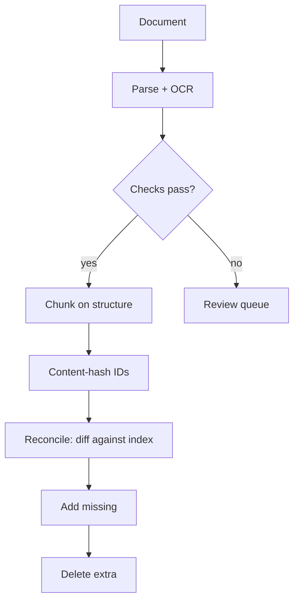

A parser that scores 100% on your digital PDFs and 4.4% wrong on your scans is a common shape. The part nobody budgets for is what happens to the other 95.6%: they're correct, and you can't tell which ones.

In our toy world the fix is boring. Five lines of arithmetic and a pattern check stop most of the bad extractions, and the ones that get through are in the field you forgot to check. This week's [Monday post](/dives/models-agentic/2026-11-16) set out the pipeline: route by page type, gate quality, chunk on structure, diff by hash. Today you build the checks and break the re-index on purpose.

## The 5-minute version

**The idea.** An ingestion pipeline is two machines. One turns files into fields, and it's wrong some of the time. The other keeps an index in step with the source, and it fails halfway sometimes. The lab in `labs/build/2026-11-21` measures both, with the standard library only, in about a second.

- **Part 1, extraction.** 3,000 generated invoices; 40% are "scanned", with 2% of digits damaged by OCR-style confusions (some become letters, some become other digits). A regex extractor reads the invoice number and total. Checks: invoice number matches `INV-` plus six digits, every amount is a number, line items sum to the total.
- **Part 2, re-index.** 400 documents of 12 paragraphs, 5% edited. Three schemes: fixed 3-paragraph windows with positional IDs, the same windows with content-hash IDs, and one chunk per paragraph with content-hash IDs.
- **Part 3, crash.** The update worker dies partway through 20% of the documents and the same queue message is retried. Three write orders: delete then insert, insert then delete with fresh IDs, and a diff of desired against current state.

**How it's done now.** In 2023 most teams ran a PDF-to-text library, chunked by character count and re-embedded the corpus on every change. Most now parse with a layout-aware tool, send scans to OCR or a vision model, chunk on structure and diff by content hash. Docling, one common open-source parser, ships a `document_timeout` option: when exceeded, conversion stops and returns partial results with a `PARTIAL_SUCCESS` status, and its field description recommends 90–120 seconds for production (`docling/datamodel/pipeline_options.py:1456`, `docling/pipeline/base_pipeline.py:408`, repository read 21 November 2026). A pipeline that treats that status as success will index half a document.



Why a senior architect should care: the gate decides what your retrieval and eval numbers are made of, and the write order decides what users see during every deploy and every worker restart.

---

## Do it

Pick one option. Option A comes first, because Option B's indexer is only as safe as the write order it uses.

### Option A: the self-checking ingestion lab

**Goal**

A script you can point at your own documents that reports parser error with and without a gate, re-embed cost by chunking scheme, and what a crash leaves behind.

**Why it's worth building**

Parser accuracy is usually reported as one number on one corpus. The lab splits it by field and by page type, which is where decisions live. And the crash test turns "is our re-index idempotent?" from an opinion into a count.

**Requirements**

- Per-field ground truth for at least 100 of your own documents, ideally including 20 you expect to be hard.
- A list of checks, each stating which fields it covers. A field covered by no check is flagged in the report.
- A re-index that is safe to replay: the same message twice leaves the same index.
- A seed and a noise knob, to see the numbers move.

**Architecture**

One file, three parts: `part1` (generate, damage, extract, check), `part2` (chunk, edit, count embeds and deletes), `part3` (an in-memory index that can die after N operations, and three update functions). Replace `extract` with your parser and `Index` with your vector store client.

**Stack**

Python 3.11+, standard library only. No API key, no download.

**Milestones**

1. **Run the reference (15 minutes).**

```terminal
$ cd labs/build/2026-11-21
$ python3 run.py --results results.json
[1] 3000 invoices, 40% scanned, noise 0.02
    trust the parser: 4.43% wrong (0.00% on digital PDFs)
    with checks: 8.67% to review, 1.60% wrong and accepted (100% of those in the invoice number)
[2] 20 of 400 documents edited; chunks re-embedded (share of the edited documents' chunks)
    fixed/position/insert      embeds   71 deletes    0 share 71%
    para/hash/insert           embeds   20 deletes    0 share 8%
[3] worker dies mid-update on 20% of documents, restarts and retries the same message
    insert_first {'crashed_docs': 80, ..., 'extra_chunks_after_retry': 740}
    reconcile  {'crashed_docs': 80, ..., 'extra_chunks_after_retry': 0}
```

2. **Find the unchecked field (30 minutes).** Before looking at the output, write down which field the checks can't see. Then add a check digit or a cross-reference (the invoice number must exist in the purchase-order table) and watch the silent errors move.
3. **Plug in your parser (60 minutes).** Replace `extract` with a call to your parser on your documents. Keep the return shape so the checks still run. Record the review rate; it is a staffing number.
4. **Break the re-index (45 minutes).** Change the crash range in `part3` and add a second crash during the retry. Confirm that `reconcile` still ends clean.
5. **Swap the chunker (30 minutes).** Replace the paragraph chunker with the one you use today and read the embed share for an inserted paragraph.

**Stretch goals**

- Route only the review queue to a vision model and compute cost per accepted invoice.
- Add a tombstone for deleted documents so a replayed "delete" doesn't resurrect them.
- Emit the review reason (which check failed) as a field, and see which reason dominates.

```calc
{"title": "What the review queue costs (change the assumptions)", "inputs": [{"id": "docs", "label": "Documents per month", "min": 1000, "max": 500000, "step": 1000, "value": 50000, "unit": ""}, {"id": "rev", "label": "Share sent to review", "min": 1, "max": 30, "step": 0.5, "value": 8.7, "unit": "%"}, {"id": "mins", "label": "Minutes per reviewed document", "min": 0.5, "max": 10, "step": 0.5, "value": 2, "unit": "min"}, {"id": "rate", "label": "Loaded reviewer cost", "min": 20, "max": 150, "step": 5, "value": 45, "unit": "$/h"}], "outputs": [{"label": "Reviewer hours per month", "formula": "docs * rev / 100 * mins / 60", "decimals": 0, "unit": "h"}, {"label": "Review cost per month", "formula": "docs * rev / 100 * mins / 60 * rate", "decimals": 0, "unit": "$"}], "note": "The 8.7% default is our run's review rate on synthetic invoices (labs/build/2026-11-21). Everything else is an assumption: replace it with your own volume, review time and cost."}
```

---

### Option B: a change-data-capture indexer

**Goal**

A service that turns row changes in a source database into index updates, with no dual writes. Option B is a spec.

**Requirements and milestones**

- Write the document row and an outbox row in one transaction. A connector tails the outbox and publishes events; Debezium's outbox event router is one implementation, and its docs describe an `id` column you can use to remove duplicate messages (documentation read 21 November 2026).
- Treat delivery as at-least-once. The consumer keys on `(document_id, version)` and ignores anything at or below the version it already applied.
- Apply each event with the `reconcile` function from Option A, so a replay is harmless.
- Keep a dead-letter queue with the original event and the error, and an alert on its age, not its length.
- Test: kill the consumer at a random operation, 100 times, and diff the index against a fresh full rebuild. The diff must be empty.

---

## Expected results

Our run (Python 3.11, standard library, seed 7, 3,000 invoices, 400 documents, 0.8 seconds) from `run.json`:

| Check | Gate | Our run |
|---|---|---|
| Wrong invoice number or total, trusting the parser | >= 0.02 | 0.0443 |
| Invoices sent to review by the checks | between 0.04 and 0.15 | 0.0867 |
| Wrong extractions the checks stop | >= 0.5 | 0.639 |
| Accepted-but-wrong errors in the invoice number | >= 0.9 | 1.0 |
| Re-embeds after an inserted paragraph: fixed windows over paragraph chunks | >= 5 | 9.6 |
| Re-embed share after a one-word edit, paragraph chunks with content hashes | <= 0.12 | 0.083 |
| Crashed documents with fewer chunks than before, delete first | >= 1 | 80 |
| Duplicate chunks after retry, insert first | >= 100 | 740 |
| Duplicate chunks after retry, reconcile | == 0 | 0 |
| Crashed documents with fewer chunks than before, reconcile | == 0 | 0 |

```chart
{"title": "Share of an edited document's chunks re-embedded after one inserted paragraph (synthetic documents)", "type": "bar", "x": ["Fixed windows, position IDs", "Fixed windows, content hash", "Paragraph chunks, content hash"], "series": [{"name": "Re-embedded", "values": [71, 74, 8]}], "unit": "%", "xLabel": "Chunking and ID scheme", "yLabel": "Chunks re-embedded (%)", "note": "Our run (labs/build/2026-11-21, seed 7): 20 of 400 documents edited, 12 paragraphs each."}
```

What the numbers say, with the caveat that the damage is simulated:

- **Trust and verify.** On digital PDFs the extractor was never wrong. All 4.43% error came from scans, where the checks sent 8.67% to review. About 3 of those points were genuine errors; the rest had a damaged line amount but a correct invoice number and total, so you pay for some false alarms.
- **The gate protects only what it checks.** Every one of the 1.60% accepted-but-wrong invoices had a wrong invoice number. A digit that turns into another digit (3 to 8, 1 to 7) passes the pattern and doesn't touch the sum. Rerunning with 5% damage gave 11.27% wrong without a gate, 19.13% to review and 3.73% silently wrong: the shape held, the volume more than doubled.
- **Chunk boundaries matter more than the ID scheme.** Content hashes on fixed windows (74%) did no better than positional IDs (71%) after an insertion, because the windows shift and their text changes. Only paragraph chunks (8%) isolated the change. That share moved between seeds (fixed windows with hashes: 54% to 74%); the 9x gap did not.
- **Write order is a product decision.** Delete-first made every crashed document partly unsearchable, and in 2 of 80 cases, empty. Insert-first never lost anything but left 740 extra chunks, because the retry inserted again under fresh IDs. Reconcile did neither, since a replay finds nothing left to add or delete.

## Threat model and failure modes

- **Prompt injection through documents.** Extracted text goes into an index and later into prompts. A scanned page that says "ignore previous instructions" is data until a model reads it. Store the source and page with each chunk, put retrieved text in a delimited block, and give tools no authority that a document can invoke.
- **Cross-tenant leakage in the index.** If one index serves several customers, a missing filter is a data breach. Write the tenant ID into every chunk at ingestion, enforce it in the query layer and not in the prompt, and include a test that queries as tenant A for tenant B's known text.
- **Silent partial parses.** A timeout that returns partial output looks like success unless you read the status. Treat `PARTIAL_SUCCESS`, a page-count mismatch or an empty table as a review reason, never as an ingest.
- **PII in logs and review tools.** Review queues and dead-letter queues hold full invoices. Restrict access, redact fields in logs, and apply the retention the source documents carry.
- **Fails closed or open.** If the checks service is down, accept nothing and queue; a gate that passes on error is the same as no gate. If the index write fails, keep serving the old chunks rather than none.
- **Runaway cost.** A bad deploy that changes the chunker re-embeds the corpus. Put a cap on embeds per hour and a dry-run that prints the expected count before any write.

## Alternatives and when to switch

| Option | Strength | When to switch |
|---|---|---|
| This lab (rule checks, in-memory index) | Readable, free, runs in a second | You need real layouts, languages or a real vector store |
| Open-source layout-aware parser (for example Docling, MIT-licensed) | Local, deterministic, no per-page fee | Your scans or tables defeat it and review volume is the cost driver |
| Managed document-AI service from a cloud provider, or a multimodal model on the review tier | Handles hard layouts and handwriting | Data residency allows it and the review queue costs more than the per-page fee; check prices on the provider's page |
| CDC with an outbox (Option B) | No dual writes, replayable | You have a transactional source; for file drops a bucket event plus the same reconcile is simpler |

## Numbers

| Number | Value | Source and date |
|---|---|---|
| Wrong invoice number or total, trusting the parser | 4.43% (0.00% on digital) | our run, 21 November 2026 |
| Review rate with checks, 2% digit damage on scans | 8.67%; 19.13% at 5% damage | our run |
| Accepted but wrong | 1.60%; 3.73% at 5% damage | our run |
| Re-embed share after an inserted paragraph | 74% fixed windows, 8% paragraph chunks | our run, seed 7 |
| Crash test, 80 of 400 updates | 740 duplicates (insert-first), 0 (reconcile) | our run |
| Recommended parser timeout in production | 90 to 120 seconds | [Docling `pipeline_options.py`](https://github.com/docling-project/docling), read 21 November 2026 |
| Tokens per PDF page in Gemini | 258 | [Document understanding guide](https://ai.google.dev/gemini-api/docs/document-processing), read 16 November 2026 |

## Build your own

Copy this and fill it in. If you can't fill in the last line, the project is too vague.

```
Goal (one sentence):
Which of this week's ideas it uses (parsing / checks / chunking / content-hash IDs / CDC / replay safety):
Inputs and outputs:
Fields that have a check, and fields that don't:
Must-have (3 bullets max):
Nice-to-have:
Milestone 1 (done by hour 1):
Milestone 2 (done by hour 2):
Milestone 3 (done by hour 3):
How I'll know it works (a number or a test, not a feeling):
```

## What to check before you trust any of this

- The invoices are generated from one template, and the damage is a digit-confusion model written for this lab. Real scans fail in more ways: skew, merged cells, dropped lines.
- Ground truth is exact here. Real labels disagree, and a gate tuned against noisy labels is tuned against noise.
- The crash model replays one queue message after one failure. Real queues also deliver concurrent duplicates, so add a per-document lock or version check.
- The index is a dictionary. A real vector store has its own upsert and consistency semantics, which can make some of the naive orders safer, or worse.
- The full program and our recorded run are in the [lab folder](https://github.com/VRSupriya/thevoyager.dev/tree/main/labs/build/2026-11-21).

## Evidence

| Source | Type | Date | What we checked |
|---|---|---|---|
| [Docling repository](https://github.com/docling-project/docling) | primary | last commit 20 Nov 2026, read 21 Nov 2026 | Cloned the repository; read `document_timeout` and its field description in `pipeline_options.py` and the timeout check in `base_pipeline.py`; licence is MIT |
| [Debezium outbox event router](https://debezium.io/documentation/reference/stable/transformations/outbox-event-router.html) | primary | read 21 Nov 2026 | Read the expected outbox table columns; the `id` column description says it can be used to remove duplicate messages |
| [Document understanding guide](https://ai.google.dev/gemini-api/docs/document-processing) | primary | read 16 Nov 2026 | Figure carried over from Monday's post, which read it; not reopened today |
| [Monday's ingestion post](/dives/models-agentic/2026-11-16) | secondary | 16 Nov 2026 | Used for the pipeline outline and the 2023-versus-now comparison |
| labs/build/2026-11-21 | our run | 21 Nov 2026 | Ran `run.py` through `scripts/run_lab.py`: ten gates passed; no-noise, seed-2 and 5%-noise runs recorded in `run.json` |

If you only get as far as the first run, you already know more about your pipeline's blind spots than most dashboards will tell you. The rest can wait for a quieter weekend.
