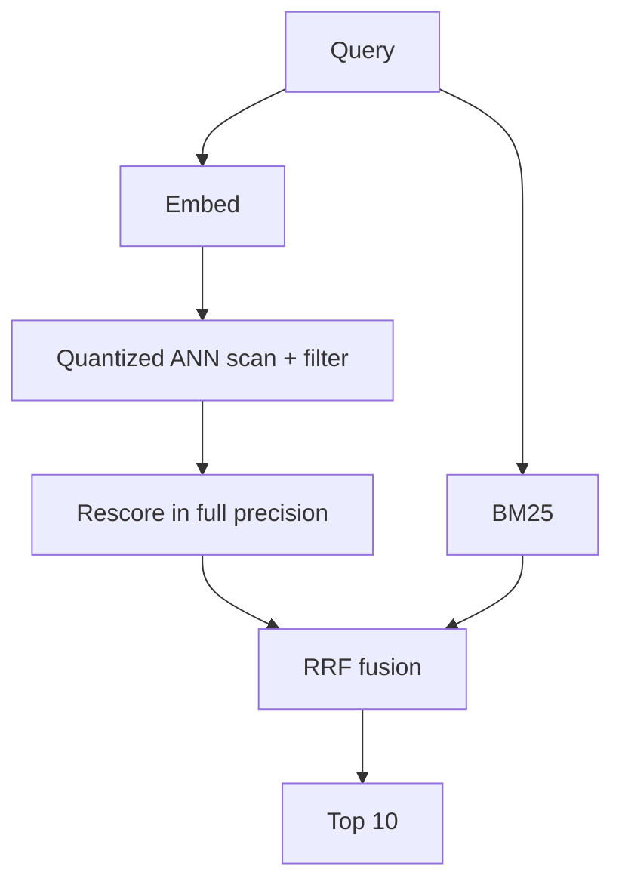

Pick any vector index setting and a benchmark will tell you it's fine. Then someone ticks a filter that matches 1% of the catalogue and the search returns a quarter of a result.

This week's [Monday post](/dives/models-agentic/2026-11-23) gave the memory arithmetic and the filter warning; [Wednesday's design](/dives/system/2026-11-25) and [Thursday's interview question](/dives/interview/2026-11-26) argued that the filter, not the embedding, decides whether product search works. Today you check that with a harness small enough to read in one sitting.

## The 5-minute version

**The idea.** A retrieval design has three knobs that look independent and aren't: how small you make the vectors, how you combine keywords with vectors, and what you do when a filter removes most candidates. The lab in `labs/build/2026-11-28` turns each knob and measures recall, using only the standard library, in about 15 seconds.

- **Part 1, quantization.** 5,000 clustered vectors at 64 dimensions. Compare int8 and 1-bit vectors with exact search, with and without rescoring: fetch 3x the candidates from the compressed index and re-rank them against full-precision vectors.
- **Part 2, hybrid.** 200 queries, half "meaning" (a paraphrase: the vector stays close, one keyword survives) and half "identifier" (an exact SKU the embedding blurs away). Vector-only, BM25-only and reciprocal rank fusion (RRF, constant 60).
- **Part 3, filters.** An IVF index (70 lists, 4 probed) with a filter matching 50%, 10% or 1% of items. One mode filters the top 40 candidates after the search, the way a default HNSW query does; the other tests the filter while scanning the probed lists.

**How it's done now.** In 2023 most teams stored float32 vectors in one vector database and ran top-k cosine. Most now store quantized vectors with a rescoring step, run keyword and vector search together with rank fusion, and test recall under the real filters. Graph retrieval is still a targeted addition, not the default. The newest quantization schemes are early, so int8 or binary with rescoring is the better-understood place to start.



Why a senior architect should care: the three knobs interact, and a design review that sizes memory, picks fusion and sets a filter strategy as separate decisions will meet the interaction in production.

---

## Do it

Pick one option. Option A comes first; it gives Option B a yardstick to beat.

### Option A: the retrieval lab

**Goal**

A harness that reports recall for your own vectors under quantization, fusion and filters, so a design review has numbers instead of defaults.

**Why it's worth building**

Vendor guides report recall for their datasets and their filters. The harness splits it by knob and by filter selectivity, which is where the surprises are, and it is small enough to adapt in an afternoon.

**Requirements**

- A set of at least 1,000 of your own vectors with a held-out query set, and a ground truth from exact search.
- Recall@10 for each setting, never a latency figure alone.
- A filter test at a high, a medium and a very low match rate, including your largest tenant's.
- A seed, so the numbers repeat.

**Architecture**

One file, three parts: `part1` (quantize, search, rescore), `part2` (BM25, vector, RRF), `part3` (k-means IVF with a post-filter and an in-scan filter). Replace `make_world` with a loader for your embeddings and `make_text` with your documents' text.

**Stack**

Python 3.11+, standard library only. No API key, no download.

**Milestones**

1. **Run the reference (15 minutes).**

```terminal
$ cd labs/build/2026-11-28
$ python3 run.py --results results.json
[1] quantization, 5000 vectors x 64 dims, recall@10 vs exact search (100 queries)
    int8    alone 0.982   with rescoring (oversample 3) 1.000   bytes/vector 64 (float32: 256)
    binary  alone 0.317   with rescoring (oversample 3) 0.501   bytes/vector 8 (float32: 256)
[2] hybrid, share of queries whose target is in the top 10
    meaning    vector 0.72  bm25 0.05  rrf 0.70
    identifier vector 0.17  bm25 1.00  rrf 1.00
[3] filters, IVF with 4 probes: results returned (of 10) and recall@10 against exact filtered search
    10pct  post-filter  3.79 rows, recall 0.377   in-scan  9.99 rows, recall 0.763
    1pct   post-filter  0.24 rows, recall 0.024   in-scan  2.13 rows, recall 0.184
```

2. **Predict, then read (20 minutes).** Before looking at part 3, write down the recall you expect at a 1% filter with the filter tested during the scan. Our run's 0.18 surprises most people: the filter is fine, the index just never looks at enough matching items.
3. **Fix the 1% case (60 minutes).** Raise `nprobe` until recall at the 1% filter reaches 0.9, and record the scan size. Then try the other fix: a separate index for the filtered subset (a partition). Compare both on scan cost.
4. **Swap in your embeddings (60 minutes).** Load your vectors in `make_world` and re-run part 1. Binary quantization depends heavily on the embedding model and dimension, so treat our 0.32 as a floor to beat, not a prediction.
5. **Tune the fusion (25 minutes).** Change the RRF constant and add a weight on the BM25 list; watch the meaning-query hit rate against the identifier one.

**Stretch goals**

- Add a second filter correlated with the topic (the category the query already belongs to) and see whether in-scan filtering recovers.
- Replace the IVF with a small HNSW and repeat part 3.
- Report p95 query time next to recall, on a corpus 20x larger.

```calc
{"title": "Index memory for your own corpus (vectors only; links excluded)", "inputs": [{"id": "n", "label": "Vectors", "min": 1, "max": 500, "step": 1, "value": 50, "unit": "million"}, {"id": "d", "label": "Dimensions", "min": 128, "max": 3072, "step": 128, "value": 1024, "unit": ""}, {"id": "over", "label": "Rescoring oversample", "min": 1, "max": 10, "step": 1, "value": 3, "unit": "x"}], "outputs": [{"label": "float32", "formula": "n * 1000000 * d * 4 / 1000000000", "decimals": 1, "unit": "GB"}, {"label": "int8 in RAM", "formula": "n * 1000000 * d / 1000000000", "decimals": 1, "unit": "GB"}, {"label": "binary in RAM", "formula": "n * 1000000 * d / 8 / 1000000000", "decimals": 1, "unit": "GB"}, {"label": "Full-precision vectors read per query for rescoring at k=10", "formula": "10 * over", "decimals": 0, "unit": "vectors"}], "note": "Bytes per component: float32 = 4, int8 = 1, binary = 1/8, from Monday's post. The rescoring line is arithmetic: k times the oversample factor."}
```

---

### Option B: a graph-retrieval spike

**Goal**

Decide with evidence whether an entity graph answers questions your vector index can't. Option B is a spec.

**Requirements and milestones**

- Write 30 questions about your corpus: 10 single-fact, 10 multi-hop ("which suppliers share a parent with the one that failed audit?") and 10 corpus-wide ("what are the main themes?"). Label the expected source documents by hand.
- Baseline: vector plus BM25 with RRF, from Option A. Record hit@10 per question type.
- Extract entities and relations with a model, and store them as edges in any store you have (a table is enough). Cap the extraction at a fixed token budget and record its cost.
- Answer multi-hop questions by walking two edges from entities in the query, then fetching the source chunks. Compare hit@10 with the baseline.
- Decision rule, written before you run it: build the graph into the product only if multi-hop hit@10 improves by at least 15 points and the extraction cost per document is acceptable at your volume.

## Expected results

Our run (Python 3.11, standard library, seed 7, 5,000 items, 64 dimensions, 15 seconds) from `run.json`:

| Check | Gate | Our run |
|---|---|---|
| recall@10, int8 vectors, no rescoring | >= 0.95 | 0.982 |
| recall@10, 1-bit vectors, no rescoring | <= 0.5 | 0.317 |
| recall@10, 1-bit vectors with 3x oversampling and rescoring | > 0.4 | 0.501 |
| Identifier queries found by vector search alone | <= 0.4 | 0.17 |
| Identifier queries found by rank fusion | >= 0.9 | 1.0 |
| Meaning queries found by keyword search alone | <= 0.2 | 0.05 |
| Meaning queries found by rank fusion | >= 0.55 | 0.70 |
| Rows returned of 10, 10% filter applied after search | between 2 and 6 | 3.79 |
| Rows returned of 10, 1% filter applied after search | <= 1 | 0.24 |
| Rows returned of 10, 10% filter tested during the scan | >= 9 | 9.99 |
| recall@10, 1% filter tested during the scan | <= 0.5 | 0.184 |

```chart
{"title": "Filtered recall@10 on an IVF index with 4 probes (synthetic vectors)", "type": "bar", "x": ["50% match", "10% match", "1% match"], "series": [{"name": "Filter after search (top 40)", "values": [94.8, 37.7, 2.4]}, {"name": "Filter during scan", "values": [94.8, 76.3, 18.4]}], "unit": "%", "xLabel": "Share of items the filter keeps", "yLabel": "recall@10 (%)", "note": "Our run (labs/build/2026-11-28, seed 7): 5,000 vectors, 70 lists, 4 probed, 100 queries."}
```

What the numbers say, with the caveat that the vectors are generated:

- **Int8 is almost free; 1-bit isn't.** Int8 lost 1.8 points of recall for a 4x saving. At 64 dimensions, 1-bit vectors found a third of the true neighbours and rescoring 30 candidates raised that to half. At 128 dimensions the 1-bit figure moved to 0.35, and 0.59 with rescoring, so binary needs the high-dimensional embeddings the vendors say it needs.
- **Fusion is a safety net, with a small price.** Keyword search alone found 5% of meaning queries and vectors alone found 17% of identifier queries. RRF found 70% and 100%, against 72% for vectors on meaning queries: two points of cost for covering a class of queries the vector index can't answer. That held across seeds (0.66 to 0.70 for fusion on meaning queries at seed 2, 0.73 for vectors).
- **A filter after the search starves the result.** With 40 candidates and a 10% filter, 3.8 rows come back on average, which matches the arithmetic (about 4). At 1%, a typical query returns nothing. Nobody sees an error.
- **Testing the filter during the scan fixes the count, not the recall.** The row count recovered to 10 at a 10% filter, but recall was 0.76. At 1% the index probed 4 of 70 lists, roughly 285 items, so only about 3 matching items were even visible; recall was 0.18. The fix there is to search more lists, or partition on the filter.

## Threat model and failure modes

- **Prompt injection through retrieved chunks.** Fusion gives keyword-stuffed text a second way to rank: an attacker who can write into the corpus can add a SKU-like token so it ranks first on an identifier query. Treat chunks as data, delimit them in the prompt, and give tools no authority that a retrieved document can invoke.
- **Cross-tenant leakage through filters.** The tenant filter is the most selective filter you have and the one most likely to be post-applied. A starved result is a performance bug; a filter dropped to "fix" it is a breach. Enforce the tenant in the query layer, and test with a canary document per tenant.
- **Recall that fails quietly.** A quantization change or a new filter lowers recall with no error. Keep a labelled query set per filter class and alert when recall@10 falls; when scores fall below a threshold, return "not found" rather than a weak match.
- **Rescoring reads full vectors.** The compressed index is in RAM, the full vectors are on disk, and an oversample of 3 multiplies disk reads by 30 per query. Cap the oversample per request, so a bug can't turn into an I/O storm.
- **Embedding exposure.** Vectors can leak information about their source text. Give the vector store the same access controls, encryption and retention as the documents.
- **Cost under a bad filter.** A fix that raises `nprobe` or the candidate count to rescue a 1% filter multiplies CPU for every query. Apply it only to the filters that need it.

## Alternatives and when to switch

| Option | Strength | When to switch |
|---|---|---|
| This lab (in-memory IVF, synthetic vectors) | Readable, free, repeatable in 15 seconds | You need real embeddings, a real index type or latency numbers |
| pgvector in existing Postgres | One system, transactional with your data, SQL filters | Filtered recall can't be tuned, or vectors outgrow memory |
| Dedicated engine (Qdrant, Milvus, Elasticsearch) | Built-in quantization options, hybrid and filter-aware search | Operating a second system costs more than the gain at your scale, or residency rules require your own database |

## Numbers

| Number | Value | Source and date |
|---|---|---|
| int8 recall@10 against exact search | 0.982 | our run, 28 November 2026 |
| 1-bit recall@10, alone and with 3x rescoring | 0.317 and 0.501 (0.353 and 0.594 at 128 dimensions) | our run |
| Fusion hit@10, meaning and identifier queries | 0.70 and 1.00 (vector alone: 0.72 and 0.17) | our run |
| Rows returned of 10 after a post-filter at 10% and 1% | 3.79 and 0.24 | our run |
| Recall@10 at 1% with the filter tested during the scan | 0.184 (0.227 at seed 2) | our run |
| Scalar and binary compression | 4x and 32x | [Qdrant quantization guide](https://qdrant.tech/documentation/guides/quantization/), as read for Monday's post on 23 November 2026 |
| RRF constant | 60 | [Elasticsearch documentation](https://www.elastic.co/docs/reference/elasticsearch/rest-apis/reciprocal-rank-fusion), as read for Monday's post on 23 November 2026 |
| pgvector HNSW defaults and the 10% filter example | ef_search 40, about 4 rows | [pgvector README](https://github.com/pgvector/pgvector), as read for Monday's post on 23 November 2026 |

## Build your own

Copy this and fill it in. If you can't fill in the last line, the project is too vague.

```
Goal (one sentence):
Which of this week's ideas it uses (quantization / rescoring / BM25 + RRF / filtered search / graph):
Inputs and outputs:
The filters I'll test, with their match rates:
Must-have (3 bullets max):
Nice-to-have:
Milestone 1 (done by hour 1):
Milestone 2 (done by hour 2):
Milestone 3 (done by hour 3):
How I'll know it works (a recall number at a named filter, not a feeling):
```

## What to check before you trust any of this

- The vectors are generated clusters, and the identifier queries model "the embedding blurs the SKU" by adding noise. Real embedding models vary: some handle identifiers better than our 0.17.
- The IVF index is simple k-means with six iterations. HNSW and graph indexes fail on filters in other ways, so rerun part 3 on the engine you'll use.
- Binary quantization results depend on the embedding model. The vendor guidance cited on Monday says it needs high-dimensional vectors, and our 64- and 128-dimension figures say the same, but we didn't test 1,024.
- The filter is random, independent of the vector. Real filters often correlate with the query (a category the query is already in), and then the numbers change.
- The full program and our recorded run are in the [lab folder](https://github.com/VRSupriya/thevoyager.dev/tree/main/labs/build/2026-11-28).

## Evidence

| Source | Type | Date | What we checked |
|---|---|---|---|
| labs/build/2026-11-28 | our run | 28 Nov 2026 | Ran `run.py` through `scripts/run_lab.py`: eleven gates passed; seed-2, 2,000-item and 128-dimension runs recorded in `run.json` |
| [Monday's retrieval post](/dives/models-agentic/2026-11-23) | secondary | 23 Nov 2026 | Used for the memory arithmetic, the quantization ratios, the RRF constant and the filter example; the vendor pages were not reopened today |
| [Qdrant quantization guide](https://qdrant.tech/documentation/guides/quantization/) | primary | read 23 Nov 2026 | Figures carried over from Monday's post, which read it |
| [pgvector README](https://github.com/pgvector/pgvector) | primary | read 23 Nov 2026 | Figures carried over from Monday's post, which read it |

The lab gives the same numbers every time, so if yours differ, that's your data talking. Run the one part you're curious about and leave the rest for another weekend.
