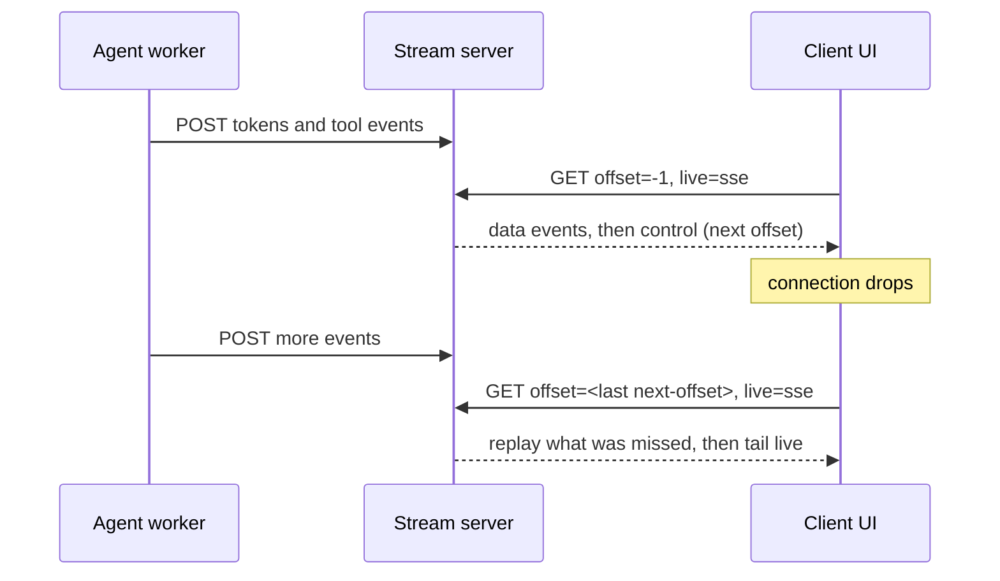

Open a chat UI, ask for something long, then walk into a lift. When the phone reconnects, one of two things happens. The answer is gone and the app regenerates it (you paid twice), or it resumes cleanly because somebody stored the stream somewhere.

The second case is more design work than it looks. [durable-streams](https://github.com/durable-streams/durable-streams) is a small open-source project that tries to make it the default: one HTTP protocol for a stream you can append to, read from any position, and tail live.

## What it is

The project is MIT licensed, carries a Beta badge, and sits under its own GitHub organisation. The README says the protocol is "based on 1.5 years of production use at Electric for real-time Postgres sync", and pitches it as a data primitive for the agent loop. Client libraries exist for TypeScript (the reference), Python, Go and several other languages. There's a Node reference server for development and a Caddy plugin for production.

The model is plain. A stream is a named, append-only byte log. Every position in it is an opaque offset. That's the whole idea.

## How the protocol works

From the spec (`PROTOCOL.md`):

- `PUT` creates a stream. `POST` appends to it (or closes it). `GET` reads. `DELETE` removes. `HEAD` returns metadata.
- Reads take an `offset`. `-1` means the beginning, `now` means the current tail. Real offsets are opaque, and you resume by echoing back the `Stream-Next-Offset` header from your last response.
- Three read modes: plain catch-up, `live=long-poll`, and `live=sse`.
- `Stream-Up-To-Date: true` says you've got everything currently available. The spec is explicit that this isn't end-of-file. EOF is a separate `Stream-Closed: true` signal.



The producer and the consumer never talk to each other. The agent writes to the log. Any number of clients read from it, from wherever they got to.

## What to learn from the design

**1. Make the session a log, not a connection.** Once the output has an address, a reconnect is a read from an offset. A second browser tab, a mobile client and a supervising process can all follow the same session. Collaborative and multi-agent setups get the same property for free, since each reader keeps its own cursor.

**2. Idempotent producers are in the protocol.** An agent worker that crashes and retries an append shouldn't double the text. The spec has `Producer-Id`, `Producer-Epoch` and `Producer-Seq`, sent together. A repeated sequence gets a 204 (duplicate, safely ignored). The next expected one gets 200. A gap gets a 409 that reports what was expected. A stale epoch gets a 403, which is how a restarted worker fences out its zombie predecessor. That's the same fencing idea you'd use with Kafka producers, here over plain HTTP.

**3. Design for the CDN.** Reads are offset-addressed, so a given range of an open stream is cacheable. The spec defines ETags of the form `{stream_id}:{start}:{end}`, a `Stream-Cursor` for collapsing live requests, and a closed-stream marker so a cached 304 can't hide that the stream ended. If you have thousands of viewers on one session (a shared run, a public demo), fan-out lands on the cache layer, not the origin.

**4. Retention is explicit.** `Stream-TTL` is a sliding window, `Stream-Expires-At` an absolute time, and servers may drop data past a retention age. A read before the retained range gets 410. Resuming an old session is a decision you make, not an accident.

## What it isn't

Be careful here. This is a transport and storage primitive. It doesn't run your agent, retry your tools or replay your workflow. If the worker dies mid-run, the log tells clients what happened so far. Something else (a durable execution engine, a queue) still has to restart the work. Treat the two as complementary: the engine owns *progress*, the stream owns *what the user can see*.

Two more things to check before relying on it:

- **Delivery claims.** The README says "exactly-once message delivery over public Internet". The spec's mechanism for that is the idempotent-producer protocol, so it holds when you use it and your writers behave. Plain appends without producer headers don't get that guarantee, as far as the spec reads.
- **Durability of the server.** The Node server is for development and testing. What your production Caddy deployment guarantees about fsync, replication and failover is a question for its docs and your own failure tests. I haven't verified it.

The ~1.7k stars on the repo page tell you it's being looked at, not that it's battle-tested at your scale.

## When to use it, when to skip

Look at it if your agent output must survive client disconnects, be watched from several places, or be replayed for audit and debugging. It's also a clean way to decouple the agent runtime from the UI tier.

Skip it if one request, one response and a retry button are fine. A log server is one more thing to operate, and many internal tools never need it.

## Hands-on (about 40 minutes)

You only need curl. No framework.

**Part 1 (10 min): start a server.** Download the `durable-streams-server` binary from the repo's releases page and run `./durable-streams-server dev`. Per the quickstart it serves in memory on `http://localhost:4437`, with streams under `/v1/stream/*`.

**Part 2 (15 min): create, append, resume.**

```bash
curl -X PUT http://localhost:4437/v1/stream/run-1 -H 'Content-Type: text/plain'
curl -X POST http://localhost:4437/v1/stream/run-1 -H 'Content-Type: text/plain' -d 'step 1: planning'
curl -i "http://localhost:4437/v1/stream/run-1?offset=-1"
```

Note the `Stream-Next-Offset` header in the last response. Append a second line, then read with `offset=<that value>` and confirm you get only the new line.

**Part 3 (10 min): go live.** In one terminal run a long-poll read with `-i` and `live=long-poll` from your saved offset. In another, append a line. Watch the first call return. Then try `live=sse` with `curl -N`.

**Part 4 (5 min, thinking):** sketch where an idempotent `Producer-Id`/`Epoch`/`Seq` would sit in your own agent worker. What would the epoch be: a deploy, a pod, a retry of the whole run? Your answer is the design decision that matters.

Sources: [repo](https://github.com/durable-streams/durable-streams), [PROTOCOL.md](https://raw.githubusercontent.com/durable-streams/durable-streams/main/PROTOCOL.md), [quickstart](https://durablestreams.com/quickstart).

If you got as far as one resumed read, that's a good Friday. Skipping the rest is allowed, and the weekend build is waiting regardless.
