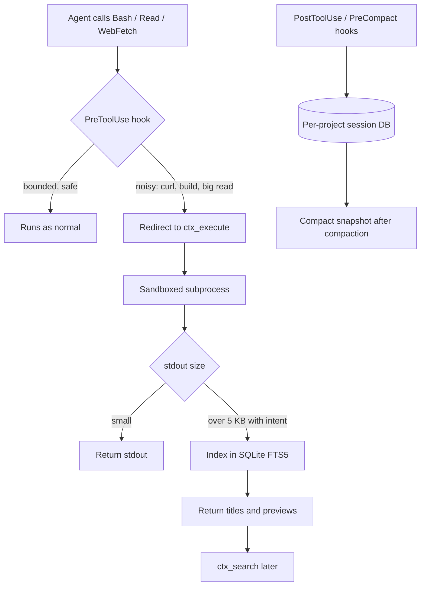

Look at what actually fills an agent's context after twenty minutes of work. It's rarely your prompt. It's a 56 KB browser snapshot, twenty GitHub issues pasted back at 59 KB, and a 45 KB access log the model read to find one line.

[context-mode](https://github.com/mksglu/context-mode) is a project built around that observation. It was on GitHub's weekly trending list this week (about 2,271 stars gained, roughly 31.9k in total as of 23 October 2026). Trending lists reward novelty, so I read the code to see whether there's real design underneath. There is, and some of it is useful whatever you think of the product.

## What it is

It's two things shipped together. An MCP server exposes a handful of sandbox and search tools (`ctx_execute`, `ctx_execute_file`, `ctx_batch_execute`, `ctx_fetch_and_index`, `ctx_search`). A set of hooks for the host agent intercepts built-in tools and nudges or forces the model to use those instead.

The README lists support for 17 platforms, including Claude Code, Gemini CLI, Copilot, Cursor and Codex CLI. Support isn't uniform: some hosts allow full hooks, some partial, and some are MCP-only with routing instructions in a file. It needs Node 22.5 or later and uses `better-sqlite3`. The version I read was 1.0.169, and the source is mostly TypeScript (`src/server.ts` alone is about 5,000 lines).



## How it works

**The sandbox.** `ctx_execute` runs your code in a subprocess (the README lists 12 runtimes) and only stdout enters the conversation. The idea is that the model writes a ten-line script that reads the log and prints the three lines that matter, rather than reading the log. Authenticated CLIs such as `gh` and `kubectl` inherit credentials from the environment without the model seeing them.

**The size gates.** In `server.ts` there are two thresholds. Past 5,000 bytes (`INTENT_SEARCH_THRESHOLD`), if the caller passed an `intent` string, the output is indexed and the model gets section titles and previews. Past 102,400 bytes (`LARGE_OUTPUT_THRESHOLD`) it's auto-indexed and the model gets a pointer. The `intent` parameter is the clever bit: the model says why it wants the data, and that string becomes the query.

**The index.** Retrieval is deliberately boring. Two FTS5 tables hold the same chunks, one with `porter unicode61` tokenisation and one with `trigram`. Both rank with `bm25` and a 5:1 weight on title over content. Results are merged with reciprocal rank fusion using the standard constant of 60, then reranked by how close the query terms sit together in the chunk. If that returns nothing, a Levenshtein fuzzy-correction layer tries to fix typos. No embeddings, no vector store, no service to run. For logs, stack traces and docs full of exact identifiers, that's a defensible choice: lexical search is strong where tokens matter and weak where paraphrase matters.

**The routing layer.** The hook (`hooks/core/routing.mjs`) rewrites commands rather than only advising. Silent `curl` to a file passes. Anything that would dump an HTTP body, inline `requests.get`, and Gradle, Maven or sbt builds get replaced by an `echo` telling the model which `ctx_` tool to call, with a suggestion like `| tail -30` for builds. Structurally bounded commands (`pwd`, `git status`, version probes) pass untouched. The same file enforces the host's `permissions.deny` patterns on the sandboxed tools, so the sandbox doesn't become a way around your own rules.

**Session memory.** Hooks record events (edits, git operations, errors, user corrections) into a per-project SQLite database. Before compaction, a compact snapshot is built (the README says under 2 KB, but the code has ignored that size cap since April 2026, in `src/session/snapshot.ts`, so measure it on your own sessions); afterwards it's injected back, and `ctx_search` can pull older events. One sharp edge from the README: without `--continue`, previous session data is deleted right away.

## What to learn from the design

**1. Redirect, don't prohibit.** There's an ADR (`docs/adr/0003-routing-deny-reasons.md`) worth reading in full. A deny message that said "WebFetch blocked" was reproduced as being read by Opus 4.6 as a network restriction, and the agent gave up and answered from training data. The fix was a rule: a redirect says "redirected to X, X has full network access", and only real security denials are allowed to sound like restrictions. If you write tool wrappers, your error strings are part of your prompt.

**2. Make the model state its intent.** Asking for a reason at call time, and using it as the retrieval query, gets you a relevance filter for free. The same trick works in your own tool layer.

**3. Boring retrieval first.** A small FTS5 index with rank fusion is cheap, local and debuggable. It's a good baseline before you reach for embeddings, and it pairs naturally with the hybrid ideas you'll need next week.

**4. The model needs the hook.** The README claims routing compliance of about 98% with hooks and about 60% with instruction files alone. Treat both as the project's own numbers, but the direction matches experience: an instruction the model can ignore is a suggestion. Hosts without hooks get the weaker version.

## What the docs leave out, and what to check

**The headline number.** The README says 315 KB became 5.4 KB (98%). `BENCHMARK.md` says 315 KB became 5.5 KB for that part, and 376 KB to 16.5 KB (about 96%) once the index-and-search part is included. The benchmark uses 15 fixtures captured from real tool runs, counts bytes, not tokens (the file doesn't name a tokenizer), runs each scenario once, and doesn't measure whether the agent still gets the task right. The same document notes a Playwright network-requests fixture saved only 13%. Smaller savings with more fidelity are the honest part: the index path returns exact chunks and saves 82%.

```stats
315 KB → 5.5 KB | ctx_execute_file part of BENCHMARK.md (98%)
60.3 KB → 11.0 KB | index-and-search part (82%)
5,000 B | output size where intent-driven indexing starts
```

**The licence.** It's Elastic License 2.0, which is source-available, not open source. It forbids offering the software to others as a hosted or managed service and forbids circumventing licence-key functionality. Fine for a developer's own machine; read it before you put it into a platform you sell or operate for other teams.

**The hidden cost.** Rewriting commands changes what the model sees and does. If it chooses to `tail -30` a build, a failure on line 31 of an unusual format stays in the sandbox. You need evals that include "find the real error" tasks before and after, not just a smaller token count.

**Security surface.** You've added a sandbox that runs model-written code in 12 languages with inherited credentials. That's by design, and the deny-pattern enforcement helps, but treat it like any code-execution tool: review it, scope credentials, and don't assume the sandbox is a security boundary until you've tested it as one.

## When to use it, and when not to

Use it when your agents are long-running, tool-heavy (browser, logs, CI, large repos) and you can't change the tools themselves. Skip it if you control the tool contracts: returning paginated, filtered, structured results at the source is cleaner than rescuing a flood later. Skip it where licence or code-execution policy rules it out. And if you only want the idea, a hook that rewrites noisy commands plus a local FTS5 table is a weekend of work.

```calc {"title": "What a noisy session costs in context (illustrative, ~4 bytes per token)", "inputs": [{"id": "calls", "label": "Noisy tool calls per session", "min": 5, "max": 100, "step": 5, "value": 30, "unit": ""}, {"id": "kb", "label": "Average raw output per call", "min": 5, "max": 100, "step": 5, "value": 40, "unit": "KB"}, {"id": "keep", "label": "Share that still reaches the model", "min": 1, "max": 100, "step": 1, "value": 5, "unit": "%"}], "outputs": [{"label": "Tokens without filtering", "formula": "calls * kb * 1000 / 4", "decimals": 0, "unit": "tokens"}, {"label": "Tokens with filtering", "formula": "calls * kb * 1000 / 4 * keep / 100", "decimals": 0, "unit": "tokens"}, {"label": "Fraction of a 200,000-token window saved", "formula": "min(1, calls * kb * 1000 / 4 / 200000) * (1 - keep / 100) * 100", "decimals": 0, "unit": "%"}], "note": "The 4 bytes per token ratio is implied by the project's BENCHMARK.md, which does not name a tokenizer. Replace the inputs with numbers from your own traces."}
```

## Hands-on: 45 minutes

Goal: measure what one noisy command costs with and without the sandbox, on your own project.

1. Pick a command you know is noisy: a full test run, `git log -p -50`, or a `curl` of a long docs page. Count its bytes: `your-command | wc -c`.
2. Install it for Claude Code (or your host's equivalent from the README):

```bash
/plugin marketplace add mksglu/context-mode
/plugin install context-mode@context-mode
# restart, then verify:
/context-mode:ctx-doctor
```

3. Ask the agent to answer one question that needs that output ("which test fails and why?"). Watch which tool it calls, and whether it passed an `intent`.
4. Open `hooks/core/routing.mjs` in the repo and find the branch your command hit. Does the rewrite match what you saw?
5. Open `src/store.ts` and read `#rrfSearch`. Write down, in one sentence each, what the two FTS5 tables are for and what the proximity rerank adds.
6. Verdict: was the answer correct, and how many bytes entered the context? A cleaner answer from fewer bytes is the win; a wrong answer from fewer bytes is the failure mode to watch for.

```quiz {"title": "Check yourself", "questions": [{"q": "Why does context-mode ask the model for an `intent` when running a command?", "a": "Output over 5,000 bytes is indexed and the intent string is used as the search query, so the model gets the relevant sections instead of the raw output."}, {"q": "Which two search methods are fused, and with what constant?", "a": "BM25 over a stemmed FTS5 table and over a trigram FTS5 table, merged with reciprocal rank fusion at k=60, then reranked by term proximity."}, {"q": "Name two reasons the 98% headline figure shouldn't be taken as 98% fewer tokens or equal task success.", "a": "It counts bytes on 15 fixtures from single runs, and it doesn't measure whether the agent still completes the task; the README and BENCHMARK.md also differ slightly (5.4 vs 5.5 KB, 98% vs 96% overall)."}]}
```

If your agent's biggest context cost is what its tools say back, this is a good week to measure it. And if it isn't, closing the tab is also a fine result.
