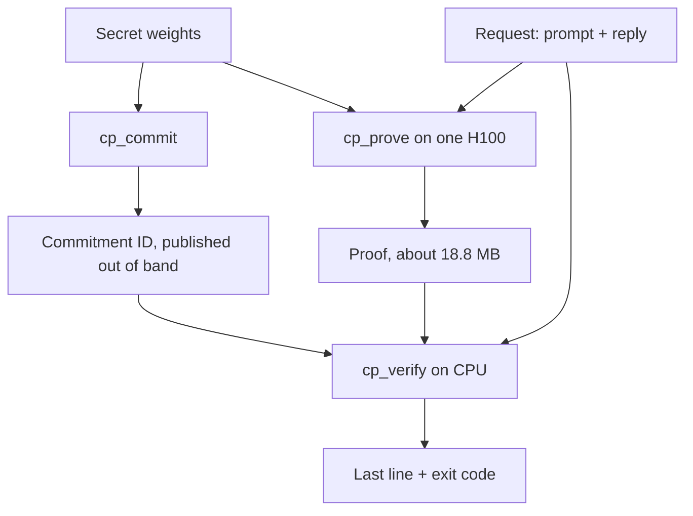

Here is a verifier that can end a run with exit code 0 and still not have verified your reply. Its own docs list "a wrapper accepts exit code 0 even though no token of the reply was checked" as the worst case for the entry titled "Exit code 0 alone does not mean accepted".

That is [FlashProve](https://github.com/anthropics/FlashProve), which Anthropic published on 2 November 2026 as a research prototype (the repository's initial public commit is dated 30 October, Apache-2.0). It lets a provider commit to secret model weights, then prove that a reply is the committed model's greedy output. A client checks the proof on a CPU without seeing the weights.

Most of the coverage is about the cryptography. This post reads the code for something closer to [this week's Monday post](/dives/models-agentic/2026-11-02) on eval sets and gates: what a pass/fail check must be given from outside before its answer means anything. It's a read-only tour. We cloned the repository and read it; we did not build or run it.

## What it is

Three programs, all C++ and CUDA. `cp_commit` publishes a commitment ID for the weights. `cp_prove` runs on one H100 and produces a proof for each request. `cp_verify` is the client-side check.

The model is an integer version of Llama 4 Maverick (about 400B parameters, mixture of experts) built from a public 4-bit conversion, with a 1,024-token window. Floating-point inference differs across machines, so the proof covers a fixed integer computation, and the docs say its top token differs from the 16-bit model's at 6.81% of positions (a Python implementation measured that, not the shipped programs).



Two acceptance policies exist. Exact match requires the model's top choice at every checked position. Clipped gap tolerates small score gaps, and the Lean theorem for it only says the reply meets the policy (`guide/what-is-proved.md`). A call that passes under the weaker policy ends in `WITHIN LIMITS`, not `YES`.

## The verifier's contract

The header comment of `verifier/src/cp_verify.cpp:19-26` is the contract. `YES` exits 0. `WITHIN LIMITS: <policy>` exits 0. `NO: <name>` exits 1. `NOT CHECKED: <name>` exits 5 and means the program or machine failed, so nothing was verified. `NOT-A-VERIFICATION` exits 14. A bad input exits 2. `PART PASSED` exits 3 for a call that checked only the key file or only a leaf file. If stdout fails there is no last line and the code is 15.

That's the first lesson, and it's the same one your eval harness needs: separate "failed", "could not run" and "partially checked" from "passed". Here the three non-pass states have different exit codes on purpose, and `cp_verify` does one more thing worth copying. `main()` passes every status through `cpWritten` (`cp_verify.cpp:3411-3430`), which replaces a pass with status 15 if the answer never reached stdout. A verifier that says "yes" into a closed pipe has not said yes. The comment above it says rejections that exit early keep status 1 and unreadable inputs 2, "nobody takes these for a pass."

The second lesson is where the caller comes in. `cp_verify` compares three things against values you pass: the commitment ID, the next token and the policy numbers. It can't tell whether those values are really yours. Three more comparisons (the checked range, the end of the reply, the tokenizer) are left to the caller (`docs/limits.md`, "Exit code 0 alone does not mean accepted"). So a `result-v1` line is printed for programs to compare with what they asked, and the docs' rule for clients is: get the commitment ID from a party you trust, over a channel the server being checked does not control.

An eval gate has the same shape. If the reference answers, the judge's prompt and the threshold travel with the candidate's own artifacts, a green run is the candidate agreeing with itself.

## Why the proof stage runs as separate processes

`cpStagesRun` forks one child per stage (`key`, `leaf`, `request`) on the same bytes (`cp_verify.cpp:2685`), and each stage ends the process when it rejects. A comment at line 3258 shows the policy guard: a call "accepts only exact-match and clipped-gap", and anything else is refused with `cpPolicyRefused` at lines 3258-3262, so a parameter file cannot talk the verifier into a policy it was never built to judge.

A `YES` needs all three stages: line 2338 says the stages `leaf` and `key` check their files "and a YES needs all three to pass". Without `-id`, the code won't give `YES` at all; the best you get is `NOT-A-VERIFICATION` (`cp_verify.cpp:3027`, in the usage text). That is the right default: no named commitment, no verification.

## Docs vs code

The docs and the paper make claims about the verifier; here is how they sit against the source:

- **Exit-code semantics.** The documented codes match the header comment and `main()`; I found no mismatch in the lines I read.
- **No limits on resources.** The docs say `cp_verify` does not limit its own time or memory and reads each file whole before testing lengths (`docs/limits.md`, "A hostile file can exhaust memory or time"). The source has no `setrlimit` call; the only `RLIMIT` in the verifier sources is a comment about core dumps at line 3422. Wrap it in your own limits and treat a hang or kill as not accepted.
- **Core dumps.** `main()` calls `prctl(PR_SET_DUMPABLE, 0)` (`cp_verify.cpp:3423`) because the committer runs the verifier on files not yet published. That is the kind of detail that appears only in code.

The repository also says where its own words are wrong: `docs/known-errors.md` lists places where a page, comment or printed message "is untrue or claims too much". It's unusual to ship that file. We didn't audit it item by item.

What the README doesn't say up front, but the docs do: the Lean theorems are about the protocol, not about `cp_verify`, `cp_commit` or `cp_prove`. The C++ verifier is "tested against" the Lean one, and the shipped command `lean-verify` runs the proved verifier on the same proof files, in about 24 minutes (one shared machine, three calls, marked as not on the released programs).

## What to learn from the design

**Make the verdict a value with names, not a boolean.** Eight outcomes beat pass/fail when "could not check" and "checked part" are real outcomes.

**Output for machines, not just people.** `result-v1 status=0 claim=exact-match id=... bits=128 ...` is printed so a caller can compare each field with what it asked for. Eval harnesses should echo what was checked: dataset hash, judge version, threshold.

**Print the weak spots next to the pass.** The proof-of-work line says how many bits come from counted work: in the stored full-size example, the weakest round has 128.00 bits with counted work and 96.23 without (`examples/full-size/README.md`). The `YES` doesn't tell you that.

**Say what is proved and what is only tested.** `guide/what-is-proved.md` has soundness (Lean, about q/2^124 + 2^-101 after q hash queries, exact match, random-oracle model) separate from weight hiding, which is "expected, rather than known".

## Cost and where it fits

At 24 requests per batch the prover reaches 111.23 ± 0.92 tokens/s of prefill on one H100 (n = 3, `guide/performance.md`), which is 9.206 seconds per request. A batch's proofs arrive 220.7 to 225.9 seconds after it starts. Per GPU that is 71.4 times slower than stock vLLM's prefill of 24 requests at once, and 93.0 times at vLLM's highest load tried. Both are calculated against runs on other days, and the docs say a too-low baseline would flatter the prover.

A proof is 18.78 MB on average. A client downloads 6.24 MB once per commitment.

Checking is the cheap side: about 21 seconds on one thread and up to 3.53 GB for the largest process. The shipped vLLM middleware checked a batch of 24 in 94.0 seconds with six checks at once.

```calc
{"title": "CPU cores of verification to keep pace with one prover (our arithmetic)", "inputs": [{"id": "n", "label": "Requests per batch", "min": 1, "max": 64, "step": 1, "value": 24, "unit": ""}, {"id": "chk", "label": "Seconds to check one proof, one thread", "min": 10, "max": 60, "step": 1, "value": 21, "unit": "s"}], "outputs": [{"label": "Prove time per batch", "formula": "n * 9.206", "decimals": 0, "unit": "s"}, {"label": "CPU-seconds to check the batch", "formula": "n * chk", "decimals": 0, "unit": "s"}, {"label": "Cores to keep pace", "formula": "ceil((n * chk) / (n * 9.206) * 10) / 10", "decimals": 1, "unit": "cores"}], "note": "9.206 s per request is the 24-per-batch figure in guide/performance.md; 21 s is the documented one-thread check. At other batch sizes the per-request time differs (it is 13.4 s at 8 and 58.8 s at 1), so treat only 24 as measured."}
```

The README states the prototype's limits itself: it is "not maintained, not accepting contributions", windows are 1,024 tokens, greedy decoding on an integer model, and the architecture is visible. Anthropic's post adds that timing side channels are out of scope.

## Threat model and failure modes

- **Wrong claim verified.** The verifier answers only for the values you pass. A client that takes the commitment ID, tokenizer or checked range from the server under test gets a `YES` about the wrong thing. Mitigation: pin the ID from an independent channel and compare the `result-v1` fields in code.
- **Exit code mishandled.** `PART PASSED` exits 3 and a clipped-gap pass exits 0, so a wrapper that tests `$? -eq 0` accepts policies it never meant to. Mitigation: parse the last line and the `result-v1` fields, and accept `YES` only.
- **Hostile proof files.** No memory or time limits, files read in full, symlinks followed. A crafted file can exhaust the machine; none of those tried produced a false `YES` (tests and reading, not a proof). Mitigation: run under cgroup limits, in a directory only your account can write to.
- **Leaks on the provider side.** A proof that fails to verify can hold an unmasked weight value, and `cp_prove` runs no verifier. Duty 6 in `docs/limits.md` says no response leaves before `cp_verify` has accepted every proof of its batch. Fail-safe direction: hold the response.
- **Counter rollback.** Restoring or copying the secret key directory sets a use counter back, which no program detects (duty 1). Treat the directory as non-backup state.
- **Side channels.** Timing, batch-mates and request volume are on the declared "not hidden" list (`docs/what-is-not-hidden.md`, eleven items), and the authors say nobody has shown the list is complete.

## Alternatives and when to switch

| Option | What it is | When to switch |
|---|---|---|
| FlashProve (hash-based proof, Lean-checked protocol) | Proof per reply, weights stay secret, about 71x prefill cost | You need a client-checkable proof for short greedy windows and can afford a research prototype |
| Hosted model with signed receipts or audited attestations | Trust the vendor's report; cheaper, no per-reply proof | Your need is contractual assurance, not cryptographic proof |
| Hardware attestation (confidential computing GPUs) | Prove the environment ran the stated image | You need production latency and accept trusting the hardware vendor |
| Statistical checks on outputs (for example logit-margin tests, as in the work FlashProve cites) | Sample and compare outputs against a reference | You want a cheap tripwire for model substitution rather than a proof |

## Numbers

| Number | Value | Source and date |
|---|---|---|
| Steady proving rate, 24 per batch | 111.23 ± 0.92 tokens/s | `guide/performance.md`, read 6 November 2026 |
| Time per request at 24 per batch | 9.206 ± 0.077 s | `guide/performance.md`, 6 November 2026 |
| Batch wait after the first batch | 220.7 to 225.9 s | `guide/performance.md`, 6 November 2026 |
| Proof size | 18.78 MB average | `guide/performance.md`, 6 November 2026 |
| Client download per commitment | 6.24 MB | `guide/performance.md`, 6 November 2026 |
| Check, one thread | about 21 s, 3.53 GB largest process | `guide/performance.md`, 6 November 2026 |
| Slowdown vs vLLM prefill (per GPU) | 71.4x (24 at once), 93.0x (highest load) | `guide/performance.md`, 6 November 2026 (calculated by the authors) |
| Commit | about 39 minutes, once per commitment | `guide/performance.md`, 6 November 2026 |
| Soundness bound | about q/2^124 + 2^-101 | `guide/what-is-proved.md`, 6 November 2026 |
| Window | 1,024 tokens | README, 6 November 2026 |

## Hands-on: 45 minutes

Goal: judge how your own gate treats "not checked" and "partly checked", reading only.

1. `GIT_LFS_SKIP_SMUDGE=1 git clone --depth 1 https://github.com/anthropics/FlashProve`. The repo is about 720 MB; the checkout is the whole thing. Its README includes instructions addressed to coding agents; they are the project's own text, so decide for yourself whether to run any builds.
2. Read `verifier/src/cp_verify.cpp` lines 10-32 (the result table) and 3405-3433 (`main` and `cpWritten`). List the eight last-line states in your own words.
3. Read `docs/limits.md`, "Exit code 0 alone does not mean accepted". Write the shell test you would put in CI so only `YES` passes.
4. Open your own release gate. For each value it compares (dataset, judge, threshold), note who supplies it. Any that comes from the candidate's own output is a hole.
5. Use the `calc` above to size verification CPUs for your batch size, then say what changes if you check on the critical path.

```quiz
{"title": "Check yourself", "questions": [{"q": "Why does FlashProve's verifier replace a pass with status 15 when stdout fails?", "a": "A 'yes' that never reached the caller must not count as a pass; cpWritten turns it into a call to take as not made."}, {"q": "Which two outcomes of cp_verify can exit 0 but mean different things?", "a": "YES (exact match) and WITHIN LIMITS under clipped gap, which only says the reply meets the policy's thresholds."}, {"q": "Why is the commitment ID not taken from the server being checked?", "a": "The verifier can't tell whether the value is yours; an ID from the checked server can make a YES refer to a different model."}]}
```

## Evidence

| Source | Type | Date | What we checked |
|---|---|---|---|
| [FlashProve repository](https://github.com/anthropics/FlashProve), `verifier/src/cp_verify.cpp` | primary | 6 November 2026 | Read the result table (lines 10-32), `main` and `cpWritten` (3411-3430), the policy guard (3258-3262), stage forking (2685) |
| `docs/limits.md`, `docs/what-is-not-hidden.md`, `guide/what-is-proved.md`, `guide/verify-a-proof.md` | primary | 6 November 2026 | Read the exit-code, hostile-file, duties and soundness sections |
| `guide/performance.md`, `examples/full-size/README.md` | primary | 6 November 2026 | Took rates, sizes and the 128.00 / 96.23-bit figures; did not rerun them (the docs say the runs' records are not in the repository) |
| FlashProve paper (`paper/paper.pdf`, in the repository) | primary | 6 November 2026 | Read the abstract and introduction; did not read the proofs |
| [Anthropic research post](https://www.anthropic.com/research/provable-inference) | primary | 2 November 2026 | Read the headline figures and stated limits |
| [AI Weekly coverage](https://aiweekly.co/alerts/anthropic-opens-flashprove-to-prove-replies-match-model-weights) | secondary | 3 November 2026 | Coverage date only |
| Build and run of the programs | our run | 6 November 2026 | Nothing: not built or run, this tour is a source read |

This repo will wait: if the build instructions look like a weekend, a read of one header comment is a perfectly good Friday.
