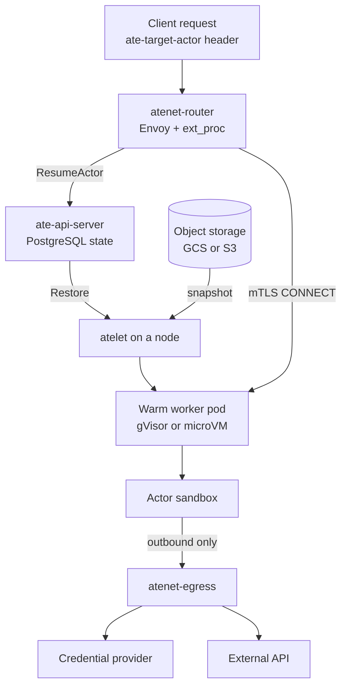

Run a thousand agents on Kubernetes the usual way and you get a thousand pods, most of them asleep, waiting on a model or a human. Each idle pod still holds memory and a slot on a node.

[Agent Substrate](https://github.com/agent-substrate/substrate) takes the opposite bet: keep a small pool of warm worker pods, and treat each agent (the project calls it an *actor*) as a snapshot that is restored onto any free worker when a request arrives. The repository is Apache-2.0, written in Go, and the README says it has reached 1.0 and the project site says Agent Substrate is a CNCF Sandbox project. At the time of reading the last commit was dated 20 November 2026.

It's a code read, not a benchmark. We cloned the repository and read the docs and the Go sources; we did not stand up a cluster. The headline numbers below are the project's own claims, and the post says what you'd have to measure. It pairs with [Monday's post](/dives/models-agentic/2026-11-16) on document pipelines in one way: both are about state that has to outlive the process that produced it. Google's [AX](/dives/github/2026-10-09) from an earlier Friday runs on top of this layer, according to the README.

## What it is

Substrate is a runtime, not an agent SDK. It runs ordinary OCI images inside a gVisor (`runsc`) sandbox or a Cloud Hypervisor microVM, one actor per sandbox. A control plane (`ate-api-server`) keeps actor records in PostgreSQL. A node daemon (`atelet`) moves snapshots. A router (`atenet-router`, Envoy plus an `ext_proc` filter) resumes actors on demand. An egress gateway (`atenet-egress`) handles everything leaving the sandbox.



A suspended actor is a database record pointing at a snapshot. Creating one copies nothing; it points at the template's golden snapshot until its first suspend (`docs/security/threat-model.md`, step A2). That's the whole density trick: idle cost is a row and some object storage, not a pod.

## What changed from the older way

The common pattern for agent platforms has been one long-lived container per session, or rebuilding state from a transcript on each turn. A third option is now on the table: checkpoint the process and restore it. gVisor and Kata/Cloud Hypervisor both support suspend and resume, which is what Substrate builds on. The trade is a new data-management problem: the docs say so plainly ("we trade one problem ... for another", `docs/concepts/architecture.md`).

## How a request wakes an actor

The path, from the docs and the code:

1. The caller sends the request to the router with an `ate-target-actor: <atespace>/<actor>` header (`internal/atenet/headers.go:29`). `Host` does not select the actor.
2. The router's `ext_proc` calls `ResumeActor` on the control plane. Concurrent requests for the same actor share one "flight", so a burst doesn't start ten restores (`cmd/atenet/internal/router/ingress/flight.go`, `resumer.go:192`).
3. The control plane takes a lease, assigns a worker, tells `atelet` to restore, and returns the worker's address. The workflow is written to be re-entered: a repeated call "fast-forwards past the steps a previous attempt completed, deriving progress from the persisted actor alone" (`cmd/ateapi/internal/controlapi/workflow_resume.go:51-53`).
4. The router opens an mTLS `CONNECT` tunnel to `atunnel` on the worker (port 8443) and forwards the request.

```steps
{"title": "One request to a sleeping actor", "nodes": ["Router", "Control plane", "atelet", "Worker", "Actor"], "steps": [{"node": 0, "text": "Request arrives with the target actor header. The actor is SUSPENDED, so the router calls ResumeActor and parks the request."}, {"node": 1, "text": "The scheduler picks two eligible workers at random and takes the less loaded one (power of two choices). No worker with room returns ResourceExhausted."}, {"node": 2, "text": "atelet restores from the node-local copy if it still has one, otherwise downloads the snapshot from object storage."}, {"node": 3, "text": "The sandbox is restored in a pre-started worker pod, so no Kubernetes scheduling or image pull sits on the path."}, {"node": 4, "text": "State is RUNNING. The router tunnels the original request to the actor over mTLS."}]}
```

The scheduler is short enough to read in one sitting. `Schedule` filters workers that apply and have room, then picks two at random and returns the less loaded, where load is the higher of actor-slot and compute utilization (`cmd/ateapi/internal/scheduling/scheduling.go:123-166`). It's power-of-two-choices, a deliberate pick over "least loaded" because it avoids every concurrent resume piling onto the same worker. If nothing has room it returns `ErrNoCapacity` (`scheduling.go:72`), which the workflow turns into `ResourceExhausted` (`workflow_resume.go:427-433`).

## Request parking: where the design earns its keep

When the pool is saturated, the old behaviour was an immediate 503. `docs/concepts/request-parking.md` explains why that's wrong in an oversubscribed system: another actor usually suspends within milliseconds and frees a worker. So the router treats `ResourceExhausted` and `Unavailable` as retryable and holds the request, retrying with exponential backoff.

The budget is `--parked-request-budget`, default 5 seconds (`cmd/atenet/internal/router/ingress/parking.go:29`). Two details are easy to miss:

- **The budget bounds retries, not a restore that has started.** An attempt already in flight is never cancelled, because the control plane has committed work to it. The request keeps waiting until one second before Envoy's `ext_proc` timeout, which is the budget plus 5 seconds (`resumer.go:41-46`), and is served late if the restore finishes.
- **Parking is bounded.** Callers that don't fit in the parking lot are shed with a 503 (`resumer.go:281-348`). An unbounded wait queue would turn a saturated pool into a memory problem in the router.

The 15-second constant at `resumer.go:37` looks like a contradiction, but it isn't: it applies only when parking is disabled, and then only concurrent-update conflicts are retried.

## Docs vs code

- **Parking default.** The docs say 5 seconds; `parking.go:29` agrees. The 15 seconds in `resumer.go:37` is the parking-off budget, as above.
- **Snapshot timings.** The API guide gives the defaults as 5 minutes for the background upload and 30 minutes before the local copy is detached (`docs/reference/api-guide.md:708-709`), and the code agrees (`cmd/atelet/internal/snapshottracker/background.go:35,38`). `cmd/atelet/main.go:656` also rejects an upload delay larger than the detach delay, which the docs don't mention. The same guide warns that neither the start nor the end of the upload is promised, and that an eviction gives an actor 30 minutes to be suspended by its harness or it becomes `CRASHED` and loses work since the last snapshot (`docs/guides/upgrade.md:181`).
- **Worker privilege.** The security page marks "Worker Capability Reduction" as in progress: workers still run as root with `SYS_ADMIN` and `NET_ADMIN`. The controller code agrees (`cmd/atecontroller/internal/controllers/workerpool_apply.go:402,423`).
- **Performance claims.** README and site say under 500 ms to resume and over 500 activations per second; the architecture page lists 100 ms at p95 and 1,000 per second as "north star" targets, and a billion actors per cluster as a scale target. Different numbers, different roles: a claim and a goal. The repository has a benchmarking suite (`benchmarking/`, described as "nascent"), but we did not run it and found no results table in the docs we read.

## What to learn from the design

**Keep the hot path off the Kubernetes API.** Actor and worker state lives in PostgreSQL; only `WorkerPool` and `SandboxConfig` are Kubernetes objects. The docs' own reasoning: the API server isn't built for millions of objects or high write rates, and pod scheduling takes seconds that a millisecond-lived workload can't afford.

**Make workflows re-entrant instead of transactional.** Resume derives its progress from persisted state, so a control-plane restart mid-restore is a retry, not an incident. Per-actor locks serialise lifecycle calls (`internal/actorlock/actorlock.go`).

**Say how long your durability window is.** Suspend returns after the local checkpoint by default; the upload follows. A synchronous mode exists. If your agents hold anything you can't re-derive, choose deliberately.

**Move secrets out of the thing that gets prompt-injected.** See the threat model below.

## Threat model and failure modes

- **Prompt-injected or malicious actor.** The sandbox is the primary boundary; plain Linux containers are unsupported. Actors have default-deny networking with no path to the API server, database or Kubernetes API (`docs/security/security.md`). Mitigation lives at the gVisor/microVM boundary and the egress policy.
- **Credential theft.** The actor sends a placeholder header; `atenet-egress` fetches the secret from a credential provider and replaces the header outside the sandbox, so the secret never lands in memory, files or snapshots (`docs/guides/egress-credential-injection.md`). If a policy needs injection and no provider is configured or named, the request is denied (`cmd/atenet/internal/router/egress/credentials.go:140-165`). Fail-safe direction: deny.
- **Egress gateway as a confused deputy.** One shared proxy serves all actors by default, and per-actor proxies are listed as unsupported. The certificate is issued only to the worker the actor is assigned to, and an unknown actor behind a still-valid certificate gets 403, while a transient control-plane error gets 503 (`egress.go:506-512`).
- **Tenant data between actors.** Actors move between workers on resume, so the worker is not a boundary between them (`threat-model.md`). The docs list the "delete guarantee" (scrubbing local state between actors) and per-actor snapshot encryption as in progress or future. If you mix mutually hostile tenants today, read that table first.
- **Lost state.** An asynchronous suspend leaves a window, 5 minutes by default, where the newest snapshot exists only on one node. A node failure inside it loses that state, and `checkSnapshotUpload` returns `DataLoss` when a snapshot records no upload (`workflow_resume.go:162-166`).
- **Quotas.** "Comprehensive quotas and anti-DoS throttling" is marked Future in the security table; atespace network policies and resource quotas are pending. A runaway actor is bounded by its worker's resources, not by a per-tenant budget.

## Alternatives and when to switch

| Option | What it is | When to switch |
|---|---|---|
| Agent Substrate | Snapshot/restore actors onto warm pods in gVisor or microVMs; self-hosted on Kubernetes | You run thousands of mostly idle, untrusted agents and can operate Postgres, object storage and a control plane |
| One pod or Job per session (plain Kubernetes, optionally with gVisor via RuntimeClass) | Idle cost is a pod; no snapshots | Fewer than a few hundred concurrent sessions, or sessions are short and stateless |
| Managed sandbox services (hosted code-execution sandboxes from model vendors or cloud providers) | Someone else runs the isolation and lifecycle | You'd rather buy isolation than operate it, and residency and lock-in permit |
| Durable-execution engines such as Temporal (see the [system post](/dives/system/2026-10-14)) | Replay a workflow log, not a process image | Your agent state is explicit and replayable, and you don't need arbitrary untrusted code in a sandbox |

## Numbers

| Number | Value | Source and date |
|---|---|---|
| Park budget default | 5 s | `parking.go:29`, read 20 November 2026 |
| Envoy wait past the budget | budget + 5 s, minus 1 s for the router | `resumer.go:41-46`, 20 November 2026 |
| Assignment retry backoff | 15 ms start, doubling, capped at 250 ms; about 0.5 to 1 s in total | `workflow_resume.go:316-325`, 20 November 2026 |
| Background upload delay | 5 min | `snapshottracker/background.go:35`, 20 November 2026 |
| Local snapshot detach delay | 30 min | `snapshottracker/background.go:38`, 20 November 2026 |
| Actor certificate and JWT lifetime | 1 hour | `workerservice/certificate.go:98`, `jwt.go:39`, 20 November 2026 |
| Claimed resume latency | under 500 ms, vendor claim | README, 20 November 2026; not verified |
| Claimed activation rate | more than 500 per second, vendor claim | README, 20 November 2026; not verified |
| Claimed density | 10x vs standard containers, vendor claim | README, 20 November 2026; not verified |
| North star targets | 100 ms p95, 1,000/s, 1 billion actors | `docs/concepts/architecture.md`, 20 November 2026 |

```calc
{"title": "Warm worker pods needed (our arithmetic, not a project figure)", "inputs": [{"id": "actors", "label": "Registered actors", "min": 1000, "max": 1000000, "step": 1000, "value": 100000, "unit": ""}, {"id": "active", "label": "Share active at the same moment", "min": 0.1, "max": 20, "step": 0.1, "value": 2, "unit": "%"}, {"id": "per", "label": "Actors per worker pod", "min": 1, "max": 8, "step": 1, "value": 1, "unit": ""}, {"id": "head", "label": "Headroom for bursts", "min": 1, "max": 3, "step": 0.1, "value": 1.5, "unit": "x"}], "outputs": [{"label": "Worker pods", "formula": "ceil(actors * active / 100 / per * head)", "decimals": 0, "unit": "pods"}, {"label": "Pods if every actor kept its own", "formula": "actors", "decimals": 0, "unit": "pods"}], "note": "Illustrative. The project's own demo multiplexes about 250 actors over 8 pods, one active actor per pod (README). Size from your own measured active share."}
```

## Where it fits

Use it if you run many long-lived, mostly idle, untrusted agents, you're already on Kubernetes, and your team can operate PostgreSQL, object storage and an Envoy-based router. The README's "VERY young" warning about contributions and the "In Progress" and "Future" rows in the security table are honest signals. Wait if you need strong multi-tenant guarantees today: per-actor snapshot encryption, restore re-authorisation and quotas are on the roadmap, not in the table's "Met" column. Skip it for a few hundred short-lived sessions; a pod per session is simpler.

## How others use it

Google Cloud introduced [Agent Executor](https://cloud.google.com/blog/products/ai-machine-learning/agent-executor-googles-distributed-agent-runtime) on 20 May 2026 as an open-source runtime, and its post describes Agent Substrate as the layer that moves agents onto and off ready compute, built with the GKE team. The README lists Agent Executor and kagent as ecosystem projects, and says kagent uses Substrate to run sandboxed, stateful agents. kagent's own [blog](https://kagent.dev/blog/the-future-of-kagent) gave its figures as of August 2026 (163 releases, 174 contributors, 3,400+ stars), and its site footer says kagent and Agent Substrate are CNCF Sandbox projects. We found no published production numbers for Substrate itself, such as actors per cluster or resume latency from a customer, as of 20 November 2026; treat those as unproven.

## Exercise: 45 minutes, read-only

No cluster needed. The second step shows the budget numbers in real output.

```terminal
$ git clone --depth 1 https://github.com/agent-substrate/substrate && cd substrate
$ grep -n "DefaultParkedRequestBudget =" cmd/atenet/internal/router/ingress/parking.go
29:	DefaultParkedRequestBudget = 5 * time.Second
$ grep -n "DefaultUploadDelay =\|DefaultDetachDelay =" cmd/atelet/internal/snapshottracker/background.go
35:	DefaultUploadDelay = 5 * time.Minute
38:	DefaultDetachDelay = 30 * time.Minute
```

1. **Trace a resume (20 min).** Start at `cmd/atenet/internal/router/ingress/resumer.go:192`, follow it to `workflow_resume.go:54`, then `ensureWorkerAssigned` (line 237). Write down which step is retried, which is not, and what state is persisted between them.
2. **Break the durability window (10 min).** Read `docs/concepts/architecture.md` on asynchronous suspend. Decide: for your agents, is a 5-minute window acceptable? What would you set `--snapshot-upload-delay` to, given the code requires it not to exceed the detach delay?
3. **Audit the egress path (15 min).** Read `credentials.go:140-165`. List every configuration state that ends in a denial, and one that you'd want a test for.

> [!TRY] If you do have a cluster
> The `demos/counter` walkthrough (about 5 minutes per its README) shows the three fidelity levels: memory, rootfs and volumes. Time a resume on your hardware before you trust the 500 ms claim.

```quiz
{"title": "Check yourself", "questions": [{"q": "A burst of requests exhausts the worker pool. What does the router do by default, and for how long?", "a": "It parks the requests and retries ResumeActor with backoff, for up to 5 seconds by default (parking.go:29). An in-flight restore is never cancelled and can finish late."}, {"q": "Why can an actor lose its newest state after an asynchronous suspend?", "a": "SuspendActor returns after the local checkpoint; the upload follows after 5 minutes by default. A node failure inside that window loses the snapshot that exists only on the node."}, {"q": "Where does the API key live when an actor calls an external service?", "a": "Outside the sandbox. The actor sends a placeholder header; the egress gateway fetches the credential from a provider and swaps it in, and denies if no provider is configured."}]}
```

## Evidence

| Source | Type | Date | What we checked |
|---|---|---|---|
| [agent-substrate/substrate](https://github.com/agent-substrate/substrate) at commit b909b18f | primary | 20 Nov 2026 | Read the Go sources cited above, the README and the docs; checked the licence (Apache-2.0); did not build or run it |
| `docs/security/security.md`, `docs/security/threat-model.md` (last updated 29 Oct 2026) | primary | 29 Oct 2026 | Quoted the status table and the per-step checks |
| `docs/concepts/architecture.md`, `docs/concepts/request-parking.md` | primary | 20 Nov 2026 | Compared with `parking.go`, `resumer.go`, `workflow_resume.go` |
| [Agent Executor announcement](https://cloud.google.com/blog/products/ai-machine-learning/agent-executor-googles-distributed-agent-runtime) | primary | 20 May 2026 | Read the Agent Substrate section; no production figures given there |
| [kagent blog](https://kagent.dev/blog/the-future-of-kagent) | primary | Aug 2026 | Read the stats and the CNCF Sandbox line |
| Latency and density claims (README, ate.dev) | secondary (vendor claim) | 20 Nov 2026 | Quoted only; not reproduced |

Reading the code is the cheap half of learning this one, so it's fine to stop before you ever touch a cluster.
