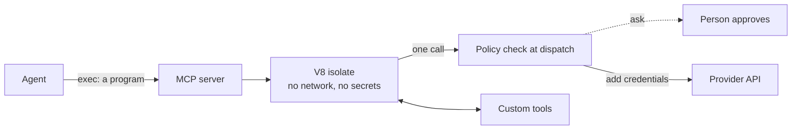

Give an agent an `update_record` tool and you have given it every record, in every way that tool allows. Most MCP gateways stop at deciding which tools the agent can see. That is all or nothing.

[Coral](https://github.com/withcoral/coral) tries a different cut. The agent doesn't call tools one at a time; it writes a short TypeScript program that calls several, filters the results and returns only what the task needs. The program runs in a sandbox with nothing in it, and the gateway makes a fresh allow, ask or block decision on every call the program makes.

The repository is Apache-2.0, written in Rust, with an `ee/` directory under a separate Enterprise licence. The last commit we saw was dated 26 November 2026 (commit 27647481). It's a code read, not a benchmark: we cloned it, read the crates and the ADRs, and did not run it. This pairs with [Monday's post](/dives/models-agentic/2026-11-23) in one way: retrieval, like tool calling, is only as safe as the check that sits between the model and the data.

## What it is

Coral sits between your agent (any MCP client) and the systems it works on. You add providers (GitHub, Slack, your own OpenAPI document or MCP server), set a policy per tool, and give the agent one MCP URL. The agent discovers tools by calling `coral.search` inside a program, so tool schemas don't sit in its context up front. When a program works, the agent saves it as a custom tool, which then shows up in the same search.



The wider idea, letting the model write code against tools instead of calling them one by one, is often called code mode. What Coral adds is the control plane around it: policy per tool, a person in the loop for risky calls, and identity attached to every run.

## What changed from the older way

In 2023 and 2024, most teams gave a model a flat list of function definitions and trusted the application to enforce permissions in each tool's handler. A common pattern now is a gateway in front of MCP servers that filters the tool list per user. Coral's bet is that the filter is too coarse and that the check belongs on each call, with the code of a custom tool able to hold rules ("only tickets idle for 30 days") that allow or block can't express. That's the README's argument; whether it holds up for your tools is something you'd test.

## How a call is decided

The central function is `decide` in `crates/coral-run/src/enforcement.rs:325`. Walk through its order:

1. **Is the run still current?** If the run was terminated, or its claim, principal or deadline no longer match, nothing dispatches (`enforcement.rs:244-250`).
2. **Is the actor still authorised?** The facts (workspace membership, provider, tool row, account) are re-read in the same transaction that records the dispatch start. A revocation that commits first is seen; one that commits after the dispatch start doesn't stop that call (module comment, `enforcement.rs:1-12`). That's a precise, honest guarantee, and it means revocation is not instant for a call already in flight.
3. **Is the tool disabled?** Then the call fails with `ToolDisabled` (`enforcement.rs:269`).
4. **Does the tool need approval?** If so, an approved request counts only if it was decided before its own deadline; otherwise the call ends as `ApprovalExpired`, `ApprovalDeclined` or `ApprovalRequired` (`enforcement.rs:337-361`).
5. **Do the credentials need refreshing?** If so the call parks on a refresh and meets the check again.

Only then does it return `Dispatch`. Credentials are attached after this, by the host. In the HTTP request builder they sit in a separate, redacted slot from the program-visible headers (`crates/coral-upstream/src/http/request.rs:16-22`).

```steps
{"title": "One Slack post that needs approval", "nodes": ["Agent", "Isolate", "Policy", "Person", "Slack"], "steps": [{"node": 0, "text": "The agent sends a program through exec. It has already found the GitHub and Slack tools with coral.search."}, {"node": 1, "text": "The program lists pull requests (a read, so it runs) and then calls the Slack post tool. The isolate can do nothing else: no fetch, no secrets."}, {"node": 2, "text": "The post is not read-only, so the default is approval_required. The call parks and an approval request is created."}, {"node": 3, "text": "A person sees the exact call and arguments and approves, or declines, within the wait (15 minutes at most, and never past the run's deadline)."}, {"node": 4, "text": "The check runs again against current facts, then the host adds the credential and sends the request."}]}
```

## The default policy is a heuristic

If nobody sets a rule, the default for a tool is its declared default, else Enabled when it reads, else ApprovalRequired (`crates/coral-policy/src/lib.rs:1227-1233`). "Reads" means the provider declares a read-only hint or the HTTP method is one RFC 9110 calls safe (`lib.rs:1218`).

That's a sensible default and an assumption you should know you're making. A GET endpoint that triggers a side effect, or a provider that sets the read-only hint wrongly, runs without approval. If you import your own OpenAPI document or MCP server, the default is only as good as its annotations.

## Docs vs code

- **"Allow, Ask or Block."** The README uses those words. The code has three states, `Enabled`, `ApprovalRequired` and `Disabled` (`crates/coral-catalog/src/types.rs:923-930`). Same thing, different names, but you'll meet the second set in logs and APIs.
- **"By default, tools that read data run right away and everything else needs your approval."** Confirmed in `lib.rs:1227-1233`, with the heuristic caveat above and a third rule: a tool can carry a declared default, and a private tool's author declares its own.
- **"No network access" for programs.** Consistent with the outbound design: provider calls go through a guarded client, and ADR 0008 says the guard runs at connection time against every DNS answer and every redirect. In the client, redirects are switched off entirely (`crates/coral-outbound/src/transport.rs:66`). We read the mechanism, we did not try to escape the isolate.
- **Resource limits.** The docs list a heap setting, a CPU setting, a fan-out limit and more (`apps/docs/reference/configuration.mdx`, `[runtime]`). In code, the execution heap defaults to 128 MiB (`crates/coral-v8/src/memory.rs:57`) and fan-out to 32 (`crates/coral-run/src/types.rs:1263`). The CPU budget is "none by default" (`types.rs`, doc comment on `RunCpuBudget`), and on Windows it can't be set at all because there is no safe thread CPU clock call.
- **Heap is a threshold, not a hard cap.** The code says the heap settings "are not hard allocation or process caps", and termination adds 64 MiB of headroom (`memory.rs:10-15`). The docs describe it as the heap a program "may use".
- **Audit.** The README says Coral logs every approval, and lists "immutable audit log" under Coral Enterprise, which it calls "coming soon". The open-source edition has an approval history (`crates/coral-run/src/approval_history.rs`); we did not check how tamper-evident it is.

## What to learn from the design

**Decide at dispatch, not at listing.** The check runs in the same transaction as the record that the call started, so "what was true when it ran" is a stored fact, not a guess. If you build an agent gateway, this is the pattern to copy, with the caveat about calls already in flight.

**Keep secrets out of the thing that gets prompted.** A program can't read a credential: the secret type has no Debug output and no serialisation, and it's bounded at 16 KiB with control characters rejected (`crates/coral-credentials/src/lib.rs:35`). Encrypted records are bound to their record identity, so a ciphertext can't be copied to another row.

**Make the sandbox cheap to throw away.** A fresh isolate per program means no state to leak between runs. The CPU watchdog interrupts each budgeted isolate every 100 ms and reads the thread's CPU clock, so a program waiting on a tool consumes none of its budget (`crates/coral-v8/src/cpu.rs:1-19`).

**Let policy live next to the tool.** Custom tools are code, so a rule like "only close tickets with 30 days of silence" is a function, not a config key. Each provider call inside it is still checked.

## Threat model and failure modes

- **Prompt injection through tool results.** A malicious ticket body can steer the agent into writing a harmful program. Mitigation: the program still can't call anything the policy blocks, and a non-read call stops at a person. Residual risk: an approver who clicks through. The request shows the exact call and arguments, which is the right place to make the decision.
- **Mislabelled tools.** The read-only default relies on annotations (`lib.rs:1218`). A provider imported from an untrusted OpenAPI document or MCP server could mark a mutating endpoint safe. Mitigation: set explicit rules for any tool whose effect you didn't verify.
- **Confused deputy.** Shared tools can use the caller's own account, so teammates share a tool without sharing a token (README). Check that each provider is set that way; a shared service account makes the gateway the deputy for everyone.
- **SSRF through providers.** Private means RFC 1918 and unique-local IPv6, never metadata, link-local or CGNAT ranges, and both loopback and private networks default to deny (ADR 0008). Enabling them trusts provider admins with that reach, and the ADR says classification is not network isolation.
- **Runaway or slow programs.** No CPU budget by default; the run's deadline is the only stop until you set one. The fan-out limit of 32 bounds concurrent calls to a provider, not the total.
- **Fail-safe direction.** A disabled tool, an expired approval, a lost authority or a refresh failure all end the call rather than letting it through (`enforcement.rs:269, 356, 360`). A restart mid-wait is handled by re-checking facts, not by trusting the old decision.

## Alternatives and when to switch

| Option | What it is | When to switch |
|---|---|---|
| Coral | Self-hosted gateway, programs in V8, per-call policy, approvals, custom tools | You want per-call control and approvals, and can run a service with OIDC and SQLite or Postgres |
| Tool-list filtering in an MCP gateway or proxy | Decide which tools a user or agent can see | Agents call few tools and the tool's own handler already enforces row-level rules |
| Provider-side scoped tokens and your own API policy layer | Least-privilege credentials per agent, enforced by the API | You own the APIs and want one enforcement point that doesn't depend on a gateway |
| Managed agent platforms from the cloud providers | Hosted identity, tool registry and audit | You'd rather buy than operate, and residency and lock-in allow it |

## Numbers

| Number | Value | Source and date |
|---|---|---|
| Approval wait, at most | 15 minutes, further bounded by the run deadline | `execution.rs:17`, read 27 November 2026 |
| Fan-out limit default | 32 invocations in flight per run | `types.rs:1263`, 27 November 2026 |
| Execution heap default | 128 MiB, a pressure threshold, plus 64 MiB termination headroom | `memory.rs:10,57`, 27 November 2026 |
| CPU watchdog check | every 100 ms | `cpu.rs:19`, 27 November 2026 |
| CPU budget default | none | `types.rs`, doc comment on `RunCpuBudget`, 27 November 2026 |
| Secret size cap | 16 KiB | `coral-credentials/src/lib.rs:35`, 27 November 2026 |
| Applied output cap | 8 MiB | `types.rs:1213`, 27 November 2026 |
| Token, cost and time savings, 37% / 31% / 29% | vendor claim, 34 tasks, Opus 5.5 | README, 27 November 2026; not verified |
| Adoption, "more than 450 companies" | vendor claim | README, 27 November 2026; not verified |

```calc
{"title": "Approvals a person must handle (our arithmetic, not a project figure)", "inputs": [{"id": "runs", "label": "Agent runs per day", "min": 10, "max": 5000, "step": 10, "value": 500, "unit": ""}, {"id": "writes", "label": "Non-read calls per run", "min": 0, "max": 10, "step": 0.5, "value": 1.5, "unit": ""}, {"id": "ruled", "label": "Share covered by an explicit allow rule", "min": 0, "max": 100, "step": 5, "value": 60, "unit": "%"}], "outputs": [{"label": "Approvals per day", "formula": "runs * writes * (1 - ruled / 100)", "decimals": 0, "unit": "requests"}], "note": "Illustrative. Every approval waits up to 15 minutes (execution.rs:17); the point is that the default ask-on-write policy does not scale to hundreds of runs without explicit rules."}
```

## Where it fits

Use it if you run agents that act on several SaaS systems, want a person to approve writes, and can host a service with an identity provider. Wait if you need an audit log that is tamper-evident today: the README lists that under the Enterprise edition. Skip it for a single agent with two read-only tools. The ADR folder has about 40 accepted decisions and is worth reading even if you never run the code: they explain why choices were made, which a README rarely does.

## How others use it

The README states that more than 450 companies use Coral, across support, SecOps, business intelligence and SRE. It links to the project's own blog post on how its Slackbot uses per-caller accounts. We found no independent write-up with named production numbers as of 27 November 2026; treat the adoption and benchmark claims as the vendor's, and the 100-task gateway comparison as something to rerun on your tasks before you rely on it.

## Exercise: 45 minutes, read-only

```terminal
$ git clone --depth 1 https://github.com/withcoral/coral && cd coral
$ grep -n "const APPROVAL_WAIT" crates/coral-run/src/execution.rs
17:const APPROVAL_WAIT: Duration = Duration::from_mins(15);
$ grep -n "DEFAULT_INVOCATIONS: usize" crates/coral-run/src/types.rs
1263:    pub const DEFAULT_INVOCATIONS: usize = 32;
$ grep -n "None => ToolAccessState" crates/coral-policy/src/lib.rs
1231:        None => ToolAccessState::ApprovalRequired,
```

1. **Trace a decision (20 min).** Read `decide` (`enforcement.rs:325`). Write the order of its checks and say which result a revoked user gets mid-run, and which a user gets whose approval was decided one second late.
2. **Audit your defaults (15 min).** List five tools your agents use. For each, would `reads_only` call it a read? Mark any where it would be wrong, and write the explicit rule you'd set.
3. **Read one ADR (10 min).** Pick `docs/adr/0008-outbound-network-permissions.md` and name the one setting you'd change for a cluster that can reach a metadata service.

> [!TRY] If you do run it
> Add one provider, call a write tool from an agent, and look at the approval request. Check whether the arguments shown are enough for you to say yes safely.

```quiz
{"title": "Check yourself", "questions": [{"q": "Where does Coral decide whether a program may call a tool, and what changes if a user is revoked a moment after the call starts?", "a": "At dispatch, in the enforcement check that runs in the transaction recording the dispatch start. A revocation that commits first is seen; one that commits after the recorded start does not stop that call."}, {"q": "Which calls run without approval by default?", "a": "Tools whose provider declares a read-only hint, or whose HTTP method is safe under RFC 9110, unless a declared default or an explicit rule says otherwise. Everything else defaults to approval_required."}, {"q": "Name two defaults you should change before giving agents to a team.", "a": "No CPU budget (set execution_cpu_seconds) and 32 calls in flight per run (fan_out_limit); also review the heuristic read-only default for imported tools."}]}
```

## Evidence

| Source | Type | Date | What we checked |
|---|---|---|---|
| [withcoral/coral](https://github.com/withcoral/coral) at commit 27647481 | primary | 26 Nov 2026 | Read `enforcement.rs`, `lib.rs` (policy), `execution.rs`, `types.rs`, `memory.rs`, `cpu.rs`, `transport.rs` and the credentials crate; checked the licence (Apache-2.0, plus a separate `ee/` licence); did not build or run it |
| `docs/adr/0008-outbound-network-permissions.md` | primary | 27 Nov 2026 | Quoted the defaults and the connection-time guard |
| `apps/docs/reference/configuration.mdx` | primary | 27 Nov 2026 | Compared the `[runtime]` table with the code defaults |
| README claims (37% / 31% / 29%, 450 companies, ISO 27001) | secondary (vendor claim) | 27 Nov 2026 | Quoted only; not reproduced |

Reading the code is the cheap half of this one; if you only get through the first step of the exercise, that's a good Friday.
