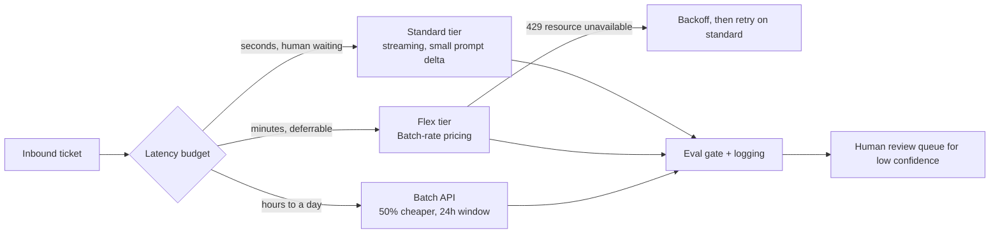

A customer says: "We want AI for our support operation." Three sentences later you learn there are three different jobs hiding in that sentence. A human agent waiting on a suggested reply. A triage step that can take a few minutes. A backfill of years of old tickets that nobody needs before Monday.

Treat those as one workload and you pay interactive prices for the backfill, or you make the live agent wait behind it. That's the shape of a good Forward Deployed Engineer question: the model part is easy, the deployment part is the interview. This one is in the style of what an OpenAI FDE loop might ask, aimed at the role (embedded with a strategic customer, owning scoping through production rollout). It isn't a reported question.

Public FDE postings describe the job as discovery, system design, build and rollout with the customer's team. One of them says success is measured by production adoption and eval-driven feedback. Postings change, so check the current wording on OpenAI's careers page.

## The question

*A logistics company handles support by email and chat. They want:*

1. *Live reply suggestions for agents, with a second or two of patience.*
2. *Automatic triage and tagging of every inbound ticket, where a few minutes of delay is fine.*
3. *A one-off classification of several million historical tickets, to build a taxonomy.*

*They have a fixed monthly budget and a compliance team. Design the inference architecture. How do you decide what runs where, how do you keep cost down, and how do you know it's good enough to switch on?*

## ⏸ Pause: answer out loud for 10 minutes first

Seriously. Set a timer. Say your clarifying questions first, then the architecture, then how you'd roll it out. Then come back.

```timer
{
 "minutes": 10,
 "label": "Answer out loud before you read on"
}
```

## A framework that works here

Four moves, in this order.

**1. Ask before you draw.** What's the latency promise to the agent, and who feels it when it slips? What are the data residency and retention rules? What does a wrong tag cost: a misrouted ticket, or a wrong refund? Is there labelled history? Who owns the final decision when the model is unsure? Ten minutes of questions beat ten minutes of boxes.

**2. Sort workloads by latency budget, then map to tiers.**



What the docs say, as of this writing:

- **Batch**: 50% cheaper than synchronous calls, a 24-hour completion window (the only value currently accepted), up to 50,000 requests or 200 MB per file, one model per file. Batch rate limits are a separate pool from per-model limits, so a backfill doesn't eat live capacity. Expired requests land in an error file with code `batch_expired`; you match them back with `custom_id`.
- **Flex**: beta, limited model availability. Priced at Batch rates, with prompt-caching discounts on top. It can return a 429 "resource unavailable", and you aren't charged for that. The docs suggest exponential backoff if you can wait, or a retry with `service_tier` set to `auto` if finishing matters more than cost. Timeouts are likelier, so raise the SDK timeout.
- **Priority processing**: sold as lower, steadier latency at a higher price. OpenAI's priority processing documentation sets the current terms, ramp behaviour and model support; read it before you put it in a design. Don't quote a number you haven't read.

Which workload goes where:

- Agent reply suggestions: standard, streamed. Priority only if measured p95 under load justifies the premium.
- Triage: flex with a standard fallback. Here "no capacity" is a routine event, not an incident, so the fallback path must be tested, not assumed.
- Historical backfill: Batch. Chunk it into files under the limits, key every row by `custom_id`, and make the job resumable so an expired chunk is just resubmitted.

**3. Design the prompt for the cache.** Caching works on an exact prefix, and the docs are blunt: the entire rendered prefix must match. So put the long stable material first (policies, taxonomy, tool definitions, few-shot examples) and the ticket text last. Things that quietly break hits: editing an earlier message instead of appending, changing tools, the output schema, reasoning effort or verbosity between calls, and prefixes under the minimum length. Caches live on individual machines, and the docs advise keeping roughly 15 requests per minute per cache key, partitioning higher traffic across keys. Cached tokens still count toward tokens-per-minute limits, which surprises people sizing quotas. Cache lifetimes and discount multipliers differ by model generation, so read the page for the model you actually deploy.

**4. Put an eval gate in front of every change.** OpenAI's evaluation guidance says to build evals from real production traffic, including edge and adversarial cases, to log everything so you can mine it, and to calibrate an LLM judge against human annotations before you trust it. For this customer: sample a few hundred real tickets, have their senior agents label them, measure the judge against those labels, and only then let the judge grade prompt and model changes at scale. Pairwise or pass/fail grading beats a 1–10 scale, and watch for position and verbosity bias.

## A model answer, compressed

"First I'd split this into three workloads, because they have three different latency budgets. I'd confirm the budgets with the customer, plus the residency and retention constraints, before choosing anything.

Live suggestions run on the standard tier with streaming and a stable prompt prefix, so most input tokens are cache reads. Triage runs on flex because a minute of delay is invisible to them, with a bounded backoff and a fallback to standard when flex is out of capacity. The historical backfill runs through Batch in resumable chunks, since it's half price and has its own rate-limit pool.

Nothing ships until it passes an eval set built from their own logged tickets, labelled by their experts, with the LLM judge checked against those labels. Low-confidence outputs go to a human queue, and I'd start in shadow mode: the model suggests, the agent decides, and we compare for two weeks before triage is allowed to act on its own."

## What top candidates add at this level

- **A cost model they can defend.** Not "cheaper tiers", but tokens per ticket by workload, a cache hit assumption stated as an assumption, and which line item to measure first. Treat any ratio you haven't measured on the customer's data as a guess and say so.
- **Failure modes by tier.** Flex 429s and timeouts, expired batch rows, cache-busting prompt edits in a Friday deploy, a judge that drifted after a model update.
- **A rollout ladder.** Shadow, then assist, then autonomous for the low-risk categories only, with a kill switch the customer controls.
- **Feedback upstream.** An FDE's output isn't only the deployment. Repeated customer patterns become a reusable eval kit or a playbook, and model gaps go back to product and research with data attached.
- **A clean "not yet".** If the triage taxonomy isn't agreed, the right answer is to run the backfill first and let it produce the taxonomy.

## One tip

When you're stuck, go back to the customer's question and ask what is expensive for them: waiting, a wrong answer, or tokens? The architecture usually follows.

```quiz
{
 "title": "Check yourself",
 "questions": [
  {
   "q": "Which workload goes to Batch, and why?",
   "a": "The one-off backfill of historical tickets: it can wait up to a day, costs half as much, and has its own rate-limit pool."
  },
  {
   "q": "What keeps the live-suggestion prompt cheap?",
   "a": "A stable prompt prefix, so most input tokens are cache reads. A careless edit to the prefix busts the cache."
  },
  {
   "q": "What has to be true before triage acts on its own?",
   "a": "It passes an eval set built from the customer's own labelled tickets, it has run in shadow mode, and low-confidence cases go to a human queue."
  }
 ]
}
```

## Ten-minute practice

Take the three workloads and write the rest of the design as a one-page table: workload, latency budget, tier, fallback, cache layout, eval metric, owner. If a cell is empty, that's the follow-up question you'd ask the customer.

Sources: [OpenAI Batch guide](https://developers.openai.com/api/docs/guides/batch), [Flex processing](https://developers.openai.com/api/docs/guides/flex-processing), [Prompt caching](https://developers.openai.com/api/docs/guides/prompt-caching), [Evaluation best practices](https://developers.openai.com/api/docs/guides/evaluation-best-practices), and public Forward Deployed Engineer postings, e.g. [this listing](https://www.jointaro.com/jobs/openai/forward-deployed-engineer).

If you'd rather skip the timer today, that's fine. Reading it once and revisiting it next week still counts.
