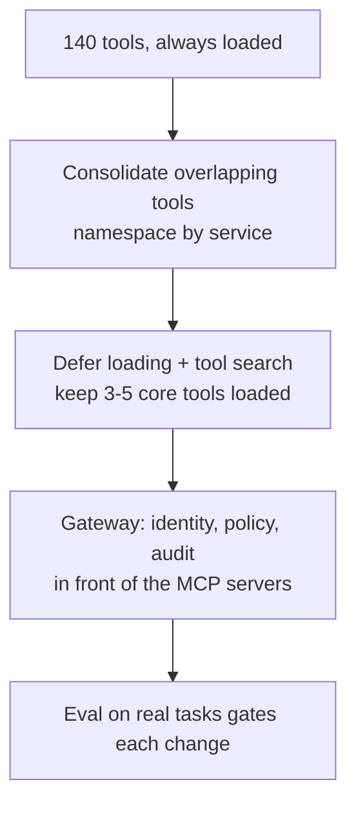

A customer's agent started with eight tools and worked nicely. Then came a Jira server, a Slack server, a monitoring server, a document store. Now it has 140 tools, runs slower, costs more, and sometimes calls the wrong one with total confidence. Their VP's response: "Let's give it more autonomy."

That sentence is the whole interview. This one is in the style of what an Anthropic loop might ask a Senior AI/ML Engineer, a customer scenario where you're expected to diagnose, push back politely and propose something measurable. It isn't a reported question, and I haven't checked any company's current interview format.

## The question

*An insurer runs an internal claims-support agent. It connects to five MCP servers (policy system, claims system, document store, ticketing, messaging) exposing about 140 tools in total. Over three months, answer quality has dropped, cost per task has roughly doubled, and users report that it "forgets" steps. The sponsor wants to remove the fixed approval steps and let the agent "just figure it out". You have a 30-minute call with their engineering lead. What do you ask, what do you measure, and what do you recommend?*

## Pause: answer out loud for 10 minutes first

Say the clarifying questions first, then what you'd measure, then the recommendation.

```timer
{
 "minutes": 10,
 "label": "Answer out loud before you read on"
}
```

## A framework that works here

**1. Separate three problems that look like one.** "Worse and costlier" could be context bloat from tool definitions, wrong-tool selection, or a task that never needed an agent. Ask what a typical request does: how many steps, in what order, and how often the order varies. Ask what changed three months ago besides tool count (model version, prompt, retrieval).

**2. Measure the cheap things first.**

```stats
~55K | tokens of tool definitions across 58 tools in Anthropic's multi-server example, before any work
30–50 | tools after which, per the docs, Claude's tool-selection accuracy degrades
3–5 | tools a typical request needs loaded with tool search
10+ | tools, or over 10K definition tokens: Anthropic's threshold for considering tool search
```

The first and last figures come from Anthropic's November 2025 engineering post and the tool search docs. Treat them as reference points, not predictions for this customer's catalogue: count their real definition tokens (one request, usage field) and replay a labelled set of tasks to see how often the right tool is chosen.

**3. Decide workflow versus agent per step, not per product.** Anthropic's own framing is that workflows run through predefined code paths while agents direct their own tool use, and that you should find the simplest solution and add complexity only when needed. A claims flow like "look up policy, check coverage rule, fetch the claim documents, draft a decision note, request approval" is mostly a fixed sequence. Making the model rediscover that order on every run is where the "forgets steps" complaint comes from.

```compare
{
 "title": "Where the approval steps should live",
 "options": [
  {"label": "Agent decides everything", "text": "Flexible, but the order, the approvals and the retries all depend on the model's judgement on each run. Hard to audit, and cost grows with every wrong turn."},
  {"label": "Workflow for the spine, agent for the open parts", "text": "Policy lookup, approval gates and the final write are code. The agent handles document triage and the 'what else is relevant?' investigation, where the path is genuinely unknown."}
 ]
}
```

**4. Fix the tool surface, in this order.**



- **Consolidate and name.** Anthropic's tool-writing guidance says too many or overlapping tools distract agents, suggests one `schedule_event` instead of three list/create tools, and recommends prefixes like `asana_` and `jira_`. Namespacing matters for search too: the docs advise service prefixes so one search matches a whole group.
- **Defer what isn't needed.** With the tool search tool you send every definition, mark most with `defer_loading: true`, and keep at least one non-deferred tool. Search returns up to 5 matches by default as `tool_reference` blocks, and the prompt-cache prefix stays intact. A deferred tool can't carry `cache_control`, so put the breakpoint on a non-deferred one. The limit is 10,000 deferred tools per request. If tools come through the MCP connector, set deferral once on the `mcp_toolset`'s `default_config`.
- **Trim results too.** Return high-signal fields, not raw IDs, and offer a concise response format. Anthropic's example saw the concise variant use about a third of the tokens (72 versus 206).
- **Put a gateway in front for identity and audit.** That's a different problem from selection, and the earlier post on [one MCP URL for a hundred engineers](/deep-dives/system/2026-10-21) covers it: per-agent identity, policy on every call, a log you can read. Don't sell it as a fix for accuracy.

**5. Prove it with an eval.** Build 100 to 200 tasks from the customer's real tickets, with a verifiable outcome each (the right claim status, the right document attached). Track accuracy, tool-call count, tokens and tool errors, as Anthropic's tool-writing guidance suggests, and hold some tasks out so you don't overfit the descriptions. Anthropic reports that on its MCP evaluations accuracy with tool search rose from 49% to 74% for Opus 4 and from 79.5% to 88.1% for Opus 4.5 (published November 2025, older models). That's a vendor's own test: your number is the one that counts.

## A model answer, compressed

> [!REVEAL] Show the answer
> "Before I recommend anything I'd want three numbers: definition tokens per request, how often the agent picks the wrong tool on a labelled sample, and how many steps in a typical claim run in the same order every time. I'd also ask what changed besides the tool count.
>
> My expectation, which I'd state as a hypothesis, is that two things are happening. Always loading 140 tool definitions is costing tokens and hurting selection, since the docs say selection degrades past 30–50 tools. And the 'forgets steps' symptom comes from asking the model to re-derive a sequence that is really a workflow.
>
> So I'd push back on removing the approval steps. Autonomy isn't the dial to turn first. I'd move the fixed spine (policy lookup, approval gate, final write) into code, keep the agent for document triage and open-ended investigation, consolidate and namespace the overlapping tools, and put the rest behind deferred loading with tool search, keeping the three to five most-used tools loaded. A gateway comes alongside for identity and audit.
>
> Each change gets gated by an eval from their own closed claims, and I'd start in shadow mode. If the numbers show the agent is reliable on a step, we can talk about giving it that step. That's earned autonomy, step by step, instead of a switch."

## What top candidates add at this level

- **A hypothesis they're willing to lose.** They say what result would change their mind, such as selection accuracy being fine and the problem being retrieval quality.
- **Cost and latency separated.** Tool search adds a search round trip but shrinks input. They'd measure both rather than assume the trade.
- **Search quality as a system.** Descriptions are the index. They'd monitor which tools get discovered and rewrite descriptions, and consider custom embedding-based search if the built-in variants miss.
- **A respectful "no".** The sponsor's goal (less friction) is legitimate. They offer a path to it, not a lecture.
- **Governance.** Write tools get narrower permissions than read tools, and a human approval stays on money-moving actions until the data says otherwise.

## One tip

In customer scenarios, repeat the customer's real goal back before you disagree with their proposed solution. "You want fewer manual steps without more mistakes" lands better than "I wouldn't do that".

```quiz
{
 "title": "Check yourself",
 "questions": [
  {
   "q": "Which three problems can hide behind 'the agent got worse as we added tools'?",
   "a": "Context bloat from tool definitions, wrong-tool selection as the catalogue grows, and a task that should have been a fixed workflow."
  },
  {
   "q": "What does defer_loading do, and what must stay non-deferred?",
   "a": "It keeps a tool's definition out of context until search finds it. You still send all definitions each request, and at least one tool (normally the search tool) stays loaded; keep the 3–5 most used loaded too."
  },
  {
   "q": "Why not simply remove the approval steps?",
   "a": "They're the fixed, auditable part of the flow. Move them into code and extend autonomy to a step only after an eval on real tasks shows the agent handles it."
  }
 ]
}
```

## Ten-minute practice

Take any agent you know and list its tools. Mark each as always needed, sometimes needed or rarely needed, then write which steps are fixed order and which are open-ended. That table is your first slide.

Sources: Anthropic, [Building effective agents](https://www.anthropic.com/engineering/building-effective-agents) (December 2024; the page notes some tooling has since changed), [Writing tools for agents](https://www.anthropic.com/engineering/writing-tools-for-agents), [Advanced tool use](https://www.anthropic.com/engineering/advanced-tool-use) (24 November 2025), and the [tool search tool documentation](https://platform.claude.com/docs/en/agents-and-tools/tool-use/tool-search-tool).

If today's practice slips to the weekend, nothing breaks. The scenario will still be here, and so will the tools.
