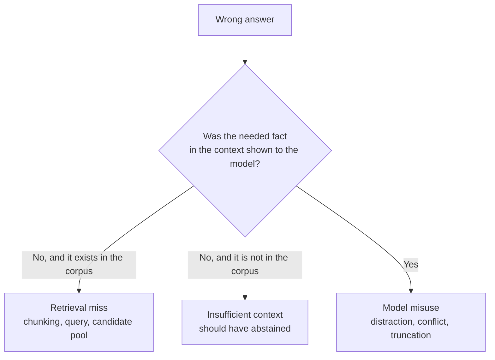

Here is a number that should make you uncomfortable. In Meta's CRAG benchmark, GPT-4 Turbo answered 33.5% of questions correctly with no retrieval at all. Give it straightforward RAG with up to 50 web pages and that rises to 43.6%. Truthfulness, which is accuracy minus hallucination, goes the other way: 20.0 down to 13.4.

Retrieval made the system more often right and, by that score, worse. A project deep-dive is where a panel finds out whether you saw that coming.

This one is written in the style of what a Meta loop might ask a Principal or Staff Architect. It isn't a reported question, and I haven't checked any company's current interview format. It builds on this week's [retrieval building block](/deep-dives/models-agentic/2026-10-26), [Tuesday's composition study](/deep-dives/research/2026-10-27) and [Wednesday's knowledge-assistant design](/deep-dives/system/2026-10-28).

## The question

*"Tell me about a retrieval-augmented system you owned that stopped improving. Walk us through the architecture, how you measured it, why it plateaued, and what you'd change. Then tell us what you would have removed."*

Project deep-dives are about ownership. You'd answer from your own history. The model answer below is a composite built from published numbers, so it has no personal anecdote in it, and yours shouldn't borrow one.

## Pause: answer out loud for 10 minutes first

Structure it as: system and metric, diagnosis, the change you'd make, and what you'd cut.

```timer
{
 "minutes": 10,
 "label": "Answer out loud before you read on"
}
```

## A framework that works here

**1. Name the metric you were actually optimising.** Panels at this level listen for whether "quality" meant recall@k, answer accuracy or something users trusted. If the headline number is retrieval-only, say so and say what it doesn't cover.

**2. Triage every wrong answer into one of three bins.**



The bins matter because the fixes don't overlap. Reranker tuning does nothing for a question the corpus can't answer.

**3. Show that the middle bin is large.** Google's *Sufficient Context* paper labelled whether retrieved context contained enough to answer. On Musique, 55.4% of contexts were insufficient. With insufficient context on a human-labelled set, models still hallucinated often: Gemini 1.5 Pro 40.4%, Claude 3.5 Sonnet 36.5%, GPT-4o 15.4%, while abstaining 50.0%, 53.8% and 61.5% of the time. Those are 2024 models and a curated set of 45.2% insufficient cases, so treat them as an illustration of the pattern, not a ranking.

**4. Count the cost of wrong answers.** CRAG scores an answer as accurate (+1), missing (0) or hallucinated (-1), so a system that abstains beats one that guesses at the same accuracy. Try it on your own figures:

```calc
{
 "title": "CRAG-style truthfulness for your system",
 "inputs": [
  {"id": "acc", "label": "Answers that are correct", "min": 0, "max": 100, "step": 0.1, "value": 33.5, "unit": "%"},
  {"id": "hall", "label": "Answers that are wrong but confident", "min": 0, "max": 100, "step": 0.1, "value": 13.5, "unit": "%"}
 ],
 "outputs": [
  {"label": "Truthfulness (accuracy minus hallucination)", "formula": "acc - hall", "decimals": 1, "unit": "points"},
  {"label": "Share of questions left unanswered", "formula": "max(0, 100 - acc - hall)", "decimals": 1, "unit": "%"}
 ],
 "note": "Defaults are GPT-4 Turbo with no retrieval in the CRAG paper (Table 5). Scoring definition from Section 4.2 of the paper."
}
```

```chart
{"title": "GPT-4 Turbo truthfulness in CRAG: retrieval did not help", "type": "bar", "x": ["LLM only", "Task 1 (5 pages)", "Task 2 (+ KG APIs)", "Task 3 (50 pages + APIs)"], "series": [{"name": "Truthfulness", "values": [20.0, 7.7, 16.2, 13.4]}], "unit": "points", "xLabel": "Setting", "yLabel": "Accuracy minus hallucination", "note": "Source: Yang et al., CRAG, Table 5 (auto-eval). Accuracy rose from 33.5% to 35.9%, 41.3% and 43.6% across the three tasks."}
```

**5. Don't stack components on faith.** Dell's engineers published a deployment study of RAG Fusion, which rewrites a query, retrieves for both and merges with reciprocal rank fusion. Tested at a fixed budget of 10 chunks on 115 synthetic queries, Hit@10 fell from 51.3% to 47.8% for the first prompt. Top-3 moved by up to 4.35 points, which is three to five queries, and none of the differences was statistically significant after correction. Their explanation is that extra candidates are cut by reranking and truncation, and many are near-duplicates. [Tuesday's study](/deep-dives/research/2026-10-27) found the same shape at larger scale: stacked gains overlap.

## A model answer, compressed

> [!REVEAL] Show the answer
> "The system answered questions over a few hundred thousand pages of internal policy. Our headline metric was recall@10 on a labelled set, which had climbed for two quarters and then stopped, while users' complaints about wrong answers didn't.
>
> I'd start by admitting the metric was retrieval-only. So I sampled wrong answers and put each in one of three bins: needed fact retrievable but not retrieved, needed fact not in the corpus, and fact present in context but ignored. I'd expect the second bin to be bigger than the team assumed. Published work backs that expectation: on Musique, 55.4% of retrieved contexts were insufficient, and models mostly answered anyway.
>
> So the change isn't another retrieval component. It's an abstain path: a sufficiency check on the retrieved context, tuned on the labelled set, with a fallback that says what was searched and routes the user to a person. I'd score answers the CRAG way, so a refusal costs nothing and a confident wrong answer costs a point.
>
> What I'd remove: query-rewriting fusion. Dell's deployment study shows lower Hit@10 and no significant Top-3 gain at a fixed budget, with extra latency. It's a component that looked free on recall and wasn't free end to end. I'd keep hybrid search and the reranker only if our own one-stage-at-a-time ablation shows they carry weight, and I'd re-run the full ablation whenever the corpus grows by an order of magnitude."
>
> **Security and failure modes:** Retrieved chunks are untrusted input, so instructions inside them must not change tool use or the abstain decision, and the sufficiency check should see chunks as quoted data. Permissions are enforced at query time, never in the prompt. Labelled sets built from real questions hold personal data and get production-grade access rules and redaction. The design fails toward "I don't know" with sources searched, never toward a fluent guess, and each stage has a latency budget so a slow reranker degrades to the fused list instead of timing out.
>
> **Alternatives:** A prompt instruction to abstain is the cheapest start, and the table below covers the dedicated sufficiency check and a retrieval-score threshold, with the condition that flips each choice.

## What top candidates add at this level

- **A number against their own design.** They say what they'd remove and why, with a figure, instead of defending every component.
- **Metric hygiene.** They separate retrieval metrics (recall@k, nDCG) from answer metrics, and say the correlation between them has to be measured, not assumed.
- **Cost of a wrong answer.** They ask what a confident error costs the business and set the abstain threshold from that, not from a benchmark.
- **Staleness.** They name when the ablation expires: corpus growth, model swap, embedding change.
- **Ownership.** They talk about who gets paged when answer quality drops, and which dashboard shows it first.

## One tip

Pick one thing from your own project to cut and say it early. Panels at this level trust a candidate who volunteers a mistake more than one who has a defence for everything.

## Threat model and failure modes

- **Prompt injection through retrieved chunks.** A document containing instructions can steer the answer or fake its own sufficiency. Treat chunks as data in a delimited block, give the retrieval stage no write tools, and test with planted instructions in the eval set.
- **Confident answers on insufficient context.** The measured failure above. Fail safe: abstain with the sources searched, route to a human, and track the abstain rate so it doesn't quietly fall to zero.
- **Permission leaks through shared indexes.** If tenants or roles share an index, a chunk from another tenant can enter the context and the abstain logic can't help. Filter at query time and test the filter with a canary document.
- **Eval-set data exposure.** Labelled sets built from real traffic carry PII and answers to sensitive questions. Redact before storing and restrict access like production.
- **Cost and latency creep.** Multi-query steps multiply retrieval calls. In Dell's run, retrieval for Q1 plus Q2 averaged 66.0 s against 54.6 s for Q1 alone, in their setup. Cap query fan-out and fall back to the single-query path on timeout.

## Alternatives and when to switch

| Option | What it does | When to switch |
|---|---|---|
| Prompt-level abstain instruction | Tell the model to answer only from context | Day one, and until a labelled set shows it abstains too rarely, as in the Sufficient Context results |
| Sufficiency check plus selective generation | A model labels whether the context is enough and gates the answer (the paper's autorater reached 93.0% accuracy on 115 labelled instances) | Wrong answers cost more than refusals, and you can afford an extra model call per query |
| Retrieval-score threshold | Abstain when the top reranker score is low | You need a nearly free gate and have calibrated the threshold on your own labelled queries |

## Numbers

| Number | Source | Date |
|---|---|---|
| 4,409 question-answer pairs, five domains, eight question types | [CRAG, arXiv 2406.04744](https://arxiv.org/abs/2406.04744) | v2, 1 November 2024 |
| GPT-4 Turbo accuracy 33.5% (no retrieval) vs 43.6% (Task 3); truthfulness 20.0 vs 13.4 | [CRAG, Table 5](https://arxiv.org/html/2406.04744v2) | 1 November 2024 |
| Five commercial systems: hallucination 16% to 25%, latency 3.4 s to 11.6 s (equal-weighted) | [CRAG, Table 6](https://arxiv.org/html/2406.04744v2) | 1 November 2024 |
| Over 30% of CRAG questions had the answer in retrieved results but not in the prompt | [CRAG, Section 3.2](https://arxiv.org/html/2406.04744v2) | 1 November 2024 |
| 55.4% of Musique contexts insufficient; Gemini 1.5 Pro hallucinated 40.4% on insufficient cases | [Sufficient Context, Sections 4 and Table 4](https://arxiv.org/html/2411.06037v3) | v3, 23 April 2025 |
| Selective generation raised the correct fraction of answers by 2% to 10% | [Sufficient Context, abstract](https://arxiv.org/abs/2411.06037) | v3, 23 April 2025 |
| Hit@10 51.3% to 47.8%; Top-3 +0.87 to +4.35 points, none significant, N = 115 | [Dell RAG Fusion study, Tables 1 to 4](https://arxiv.org/html/2603.02153v1) | 2 March 2026 |

The sources are mostly from 2024 and 2025. Newer work on the theme is in [Tuesday's post](/deep-dives/research/2026-10-27) (21 October 2026), and the 2024 models in these tables would behave differently today, so re-measure rather than quote them.

```quiz
{
 "title": "Check yourself",
 "questions": [
  {
   "q": "What are the three bins for a wrong RAG answer, and why do they matter?",
   "a": "Retrieval miss, insufficient context, and model misuse. Each has a different fix: a better retriever, an abstain path, or context packing and prompting. Changing a retriever component does nothing for questions the corpus can't answer."
  },
  {
   "q": "In CRAG, why did GPT-4 Turbo's truthfulness fall when straightforward RAG raised its accuracy?",
   "a": "Hallucination rose faster than accuracy: from 13.5% with no retrieval to 30.1% in Task 3, while accuracy went from 33.5% to 43.6%. Truthfulness is accuracy minus hallucination, so it dropped from 20.0 to 13.4."
  },
  {
   "q": "What did the Dell study find about RAG Fusion at a fixed 10-chunk budget?",
   "a": "Hit@10 fell (51.3% to 47.8% on the first prompt) and Top-3 differences of up to 4.35 points were not significant on 115 queries. Reranking and truncation absorbed the extra candidates, and many were near-duplicates."
  }
 ]
}
```

## Ten-minute practice

Take 20 recent wrong answers from any RAG system you know. Put each in one of the three bins and write the count. If the "not in the corpus" bin is the biggest, your next sprint is an abstain path, not a better retriever.

## Evidence

| Source | Type | Date | What we checked |
|---|---|---|---|
| [CRAG: Comprehensive RAG Benchmark (arXiv 2406.04744)](https://arxiv.org/abs/2406.04744) | primary | 1 November 2024 (v2) | Read the abstract page and the HTML text; copied Table 5 and Table 6 figures, the scoring definition (Section 4) and the retrieval recall notes; did not read the appendix tables beyond the ones cited |
| [Sufficient Context (arXiv 2411.06037)](https://arxiv.org/abs/2411.06037) | primary | 23 April 2025 (v3) | Read the abstract and HTML text; copied the dataset sizes, the autorater accuracy, Table 4(b) and the limitations; the abstract page shows no venue or comments |
| [Scaling RAG with RAG Fusion: Lessons from an Industry Deployment (arXiv 2603.02153)](https://arxiv.org/abs/2603.02153) | primary | 2 March 2026 | Read the abstract and HTML text; copied Tables 1 to 6 and the significance results; the study is one knowledge base, 115 synthetic queries, and measures retrieval hits rather than answer quality |
| Monday, Tuesday and Wednesday posts of week 4 | secondary (our posts) | 26 to 28 October 2026 | Reused the pipeline and the composition finding; sources are cited there |

Pick one idea from this and try it on something you already run. If it slips to next week, the question will keep.
