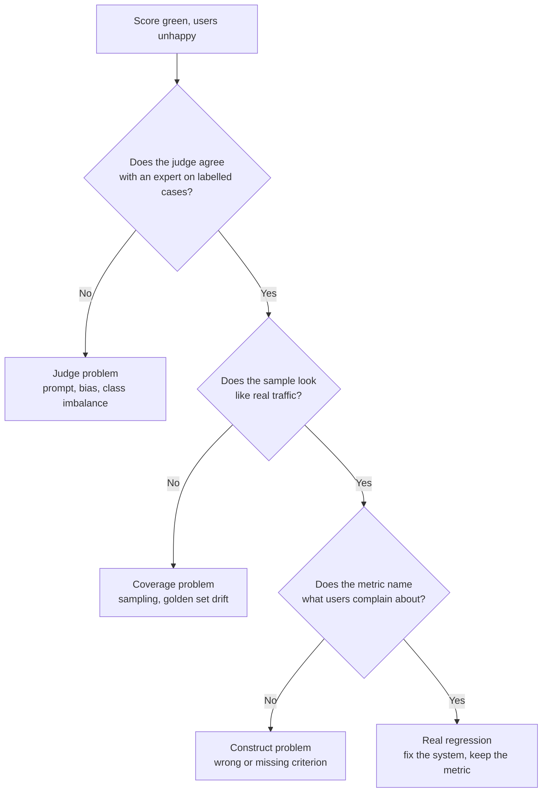

Picture a support copilot with a quality dashboard that has been green for six weeks. Groundedness is up, the judge's pass rate is up, latency is flat. Then the support leads say agents have stopped trusting the suggestions.

Nothing in the dashboard is lying. It just isn't measuring what the leads are feeling. That gap is exactly what a behavioural round for a senior architect probes, and it's the question this post practises.

It's written in the style of what a Microsoft loop might ask an AI/Solution Architect. It isn't a reported question, and I haven't checked any company's current interview format. It pulls together this week's [eval building block](/deep-dives/models-agentic/2026-11-02), [Tuesday's calibration audit](/deep-dives/research/2026-11-03) and [Wednesday's support-copilot design](/deep-dives/system/2026-11-04).

## The question

*"Tell me about a time a quality metric or evaluation result for an AI system looked healthy and was wrong. How did you find out, what did you change about the measurement, and what did you change about how the team works?"*

Behavioural answers come from your own history, so there's no borrowing one. The model answer below is a composite assembled from published numbers and documentation, with no personal anecdote in it. Yours shouldn't copy it either.

## Pause: answer out loud for 10 minutes first

Use the order: situation and metric, how the gap showed up, what you changed in the measurement, what you changed in the process, what it cost.

```timer
{
 "minutes": 10,
 "label": "Answer out loud before you read on"
}
```

## A framework that works here

**1. Name the metric and its blind spot in one sentence.** "We tracked the judge's pass rate on a sample of traffic" is a claim a panel can probe. "Quality was good" isn't.

**2. Say how you found out, and be honest that it wasn't the dashboard.** Real stories usually start with a human signal: complaints, escalations, an expert reading traces. Hamel Husain's guidance on LLM-as-judge is built on this order: a principal domain expert labels Pass or Fail with a written critique first, and the judge is tuned to agree with them, not the other way round ([critique shadowing](https://hamel.dev/blog/posts/llm-judge/), published 29 October 2024, modified 1 September 2026).

**3. Diagnose which layer was wrong.** Most "green but wrong" cases fall into one of four, and each has a different fix:



**4. Show you know the agreement trap.** Hamel Husain's example: if only 5% of cases fail, a judge that always says Pass agrees with the expert 95% of the time. Report the true positive rate and true negative rate separately. Try it:

```calc
{
 "title": "Raw agreement hides a judge that misses failures",
 "inputs": [
  {"id": "fail", "label": "Share of cases that truly fail", "min": 1, "max": 50, "step": 1, "value": 5, "unit": "%"},
  {"id": "catch", "label": "Failures the judge flags (true negative rate)", "min": 0, "max": 100, "step": 1, "value": 0, "unit": "%"},
  {"id": "pass", "label": "Good answers the judge passes (true positive rate)", "min": 0, "max": 100, "step": 1, "value": 100, "unit": "%"}
 ],
 "outputs": [
  {"label": "Raw agreement with the expert", "formula": "(100 - fail) * pass / 100 + fail * catch / 100", "decimals": 1, "unit": "%"},
  {"label": "Failures actually caught", "formula": "catch", "decimals": 0, "unit": "%"}
 ],
 "note": "Defaults reproduce the always-Pass judge in Hamel Husain's critique-shadowing guide (5% failures, 95% agreement). Here 'positive' means Pass, as in that guide."
}
```

**5. Quantify coverage.** Microsoft Foundry's continuous evaluation samples live traffic through a rule with `max_hourly_runs`, and the docs say the default limit is 100 runs per hour; runs beyond it are skipped ([monitor agents dashboard](https://learn.microsoft.com/en-us/azure/ai-foundry/observability/how-to/how-to-monitor-agents-dashboard), page dated 25 September 2026). That's a sensible cost control and also a fact every score on the dashboard inherits.

```calc
{
 "title": "How much traffic does a capped evaluation rule see?",
 "inputs": [
  {"id": "traffic", "label": "Conversations per hour", "min": 100, "max": 20000, "step": 100, "value": 5000, "unit": ""},
  {"id": "cap", "label": "Evaluation runs per hour (cap)", "min": 10, "max": 1000, "step": 10, "value": 100, "unit": ""}
 ],
 "outputs": [
  {"label": "Share of traffic graded", "formula": "min(100, cap / traffic * 100)", "decimals": 1, "unit": "%"},
  {"label": "Rough margin on a 90% pass rate (95% interval, one hour)", "formula": "1.96 * sqrt(0.9 * 0.1 / min(cap, traffic)) * 100", "decimals": 1, "unit": "points"}
 ],
 "note": "Cap default from the Foundry docs (25 September 2026). The margin is a plain binomial approximation and assumes the sample is random; the docs also offer intelligent sampling, which is not random."
}
```

**6. Know the judge's own biases.** The CALM study defines 12 judge biases and tests six models. Its robustness figures are about how often a verdict survives a perturbation: position was 0.566 for ChatGPT and 0.832 for Claude-3.5, and Qwen2-72B rated its own outputs about 16% differently from other judges ([Ye et al., arXiv 2410.02736](https://arxiv.org/abs/2410.02736), October 2024, so older models). The paper's advice is simple: judge with a different model from the generator, and randomise answer order.

**7. End on process, not heroics.** The strongest closings change a standing habit: a monthly expert-labelled refresh, a judge validation gate before any prompt change ships, a dashboard tile showing coverage next to every score.

## A model answer, compressed

> [!REVEAL] Show the answer
> "The situation was a support copilot whose quality dashboard had been green for weeks while team leads reported that agents were ignoring its suggestions. The headline metric was a judge-scored pass rate on sampled production traffic.
>
> We found out from people, not from the dashboard. I'd asked an expert to read about fifty traces and give each a Pass or Fail with a one-line critique. Their Fail rate was far above what the dashboard implied, and the critiques clustered around answers that were fluent and cited a policy, but quoted the wrong version of it.
>
> Then I'd work down the layers. First, the judge: I'd compute true positive and true negative rates against the expert, not raw agreement, because with a low failure rate a lenient judge looks excellent. Second, coverage: the evaluation rule graded a capped sample, so I'd check what share of traffic it saw and whether it skipped the busy hours. Third, the construct: the criterion was 'is the answer grounded in the retrieved text', and the failure was 'the retrieved text was the wrong version'. Groundedness couldn't see that.
>
> What changed in the measurement: a version-correctness check as code, not a judge, since the policy version is a fact; the judge re-validated on 30 to 50 Pass and 30 to 50 Fail expert labels with the prompt frozen before the test run; and coverage shown on the tile next to every score.
>
> What changed in the process: a standing weekly sample read by a named expert, every confirmed failure becomes a test case, and no judge prompt ships without re-running the labelled set. The cost was a few expert hours a week, which I'd defend against the price of agents learning to ignore the tool.
>
> I'd also say what I'd do differently: I'd have asked for the expert read before launch, because the dashboard was designed by the same people who built the pipeline."
>
> **Security and failure modes:** Traces contain customer text, so the labelling tool needs production-grade access and redaction before experts see them. A judge reads untrusted content, so it can be steered by instructions planted in a ticket or retrieved document; give it no tools and treat the content as quoted data. The design should fail toward under-claiming: a tile that shows low coverage or a stale judge validation date, not a green number.
>
> **Alternatives:** Raw agreement against a spreadsheet of labels is the cheapest start; the table below covers a validated judge, deterministic checks and human-only review, and what flips each choice.

## What top candidates add at this level

- **They separate incident from system.** The incident is one paragraph. The rest is what the measurement system now does that it didn't.
- **They name the bias, not just "the judge was wrong".** Position, verbosity or self-enhancement, with the fix: shuffle order, normalise length, judge with another model family.
- **They quote coverage and an uncertainty.** "We graded about 2% of traffic, so the interval on that pass rate was wide" is a sentence few candidates say.
- **They price the process.** Expert hours per week against the cost of the failure, in the same sentence.
- **They say what they'd retire.** A metric nobody acts on is clutter on the dashboard.

## One tip

Pick a story where the fix was boring. A panel at this level trusts the candidate who says "we added a weekly expert read and a coverage tile" more than one whose story ends in a new framework.

## Threat model and failure modes

- **Prompt injection through graded content.** A support ticket or retrieved page can contain text telling the judge to pass the answer. Give the judge no tools, delimit the content as data and add planted-instruction cases to the labelled set.
- **Label and trace exposure.** Expert review needs real conversations. Redact personal data before storage, restrict access like production, and set a retention period for the labelled set.
- **Judge drift after a model swap.** A provider update or a switch of judge model changes verdicts silently. Pin the judge version where the platform allows it, and re-run the labelled test set before accepting a new one.
- **Silent coverage loss.** Capped or filtered evaluation rules skip runs without failing anything. Chart the number of graded runs next to the score and alert on a drop.
- **Self-grading loop.** A judge from the same model family as the generator tends to favour it (Qwen2's self-enhancement error was 16.1% in CALM). Use a different family and keep the human sample as the anchor.

## Alternatives and when to switch

| Option | What it does | When to switch |
|---|---|---|
| Expert-labelled spreadsheet and weekly read | Humans give Pass or Fail plus a critique on a sample | Day one, and always as the anchor; add automation when the weekly sample can't cover the failure modes you've found |
| Validated LLM judge (custom or a platform's built-in evaluators) | Scores every sampled trace against a criterion the expert defined | You have 30 to 50 Pass and 30 to 50 Fail expert labels per split and the judge's true positive and true negative rates are acceptable |
| Deterministic checks as code | Assertions on facts: policy version, required fields, forbidden actions | The criterion is a fact, not a judgement; prefer it to a judge whenever you can write the check |

## Numbers

| Number | Source | Date |
|---|---|---|
| A judge that always passes gets 95% raw agreement when 5% of cases fail | [Hamel Husain, critique shadowing](https://hamel.dev/blog/posts/llm-judge/) | Published 29 October 2024, modified 1 September 2026 |
| Validate with about 30 to 50 Pass and 30 to 50 Fail examples in each of dev and test; below 60 examples intervals are often too wide | Same guide | Same |
| Honeycomb's judge took three iterations to exceed 90% agreement with the expert (roughly balanced data) | Same guide | Same |
| Foundry continuous evaluation: default limit 100 runs per hour | [Foundry monitor agents dashboard](https://learn.microsoft.com/en-us/azure/ai-foundry/observability/how-to/how-to-monitor-agents-dashboard) | Page dated 25 September 2026 |
| Run success below 95% and latency above 10 seconds are the dashboard's own investigation hints | Same page | Same |
| 12 judge biases; position unchanged-verdict rate 0.566 (ChatGPT) to 0.832 (Claude-3.5) | [CALM, arXiv 2410.02736](https://arxiv.org/abs/2410.02736), Table 7 | v2, 4 October 2024 |
| Self-enhancement error: Qwen2 16.1%, ChatGPT 8.91%, GPT-4-Turbo 1.16% | CALM, Table 5 | v2, 4 October 2024 |

The CALM models are 2024 models, so use the figures as a list of things to test, not as a ranking.

```chart
{"title": "Position bias in LLM judges: how often the verdict survives swapping answer order", "type": "bar", "x": ["ChatGPT", "Qwen2-72B", "GPT-4o", "GLM-4", "GPT-4-Turbo", "Claude-3.5"], "series": [{"name": "Verdict unchanged", "values": [56.6, 76.0, 77.6, 78.1, 81.8, 83.2]}], "unit": "%", "xLabel": "Judge model (2024)", "yLabel": "Share of verdicts unchanged", "note": "Source: Ye et al., CALM, Table 7 (robustness rate, position), arXiv 2410.02736 v2. Two-option setting; with three or four options most models fall below 0.5 per Section 4.2."}
```

```quiz
{
 "title": "Check yourself",
 "questions": [
  {
   "q": "Why is raw agreement a poor way to validate a judge when failures are rare?",
   "a": "A judge that always says Pass agrees with the expert on every good case. With 5% failures that is 95% agreement while catching none. Report true positive and true negative rates separately."
  },
  {
   "q": "A continuous evaluation rule is capped at 100 runs per hour and you serve 5,000 conversations an hour. What do you tell the panel about the score?",
   "a": "About 2% of traffic is graded, so the score has a wide interval, rare failures may never be sampled, and busy hours can be underrepresented. Show coverage next to the score."
  },
  {
   "q": "Name two judge biases and one mitigation for each.",
   "a": "Position bias: randomise or swap answer order and check the verdict holds. Self-enhancement: judge with a different model family from the generator. Others from CALM include verbosity and authority bias."
  }
 ]
}
```

## Ten-minute practice

Write your story in five sentences: metric, blind spot, how you found out, what you changed in the measurement, what you changed in the process. If the last sentence is a tool name, rewrite it as a habit.

## Evidence

| Source | Type | Date | What we checked |
|---|---|---|---|
| [Hamel Husain, Creating a LLM-as-a-Judge (critique shadowing)](https://hamel.dev/blog/posts/llm-judge/) | primary | Published 29 October 2024, modified 1 September 2026 | Read the process steps, split sizes, the always-Pass agreement example and the Honeycomb case |
| [Hamel Husain, Your AI product needs evals](https://hamel.dev/blog/posts/evals/) | primary | 29 March 2024 | Read the three levels and the advice against generic metrics; it reports no failure rates for off-the-shelf metrics |
| [Microsoft Foundry: monitor agents dashboard](https://learn.microsoft.com/en-us/azure/ai-foundry/observability/how-to/how-to-monitor-agents-dashboard) | primary | Page dated 25 September 2026 | Read the continuous evaluation code, the `max_hourly_runs` setting, the troubleshooting row giving the default of 100 per hour, and the preview labels |
| [Microsoft Foundry: observability concepts](https://learn.microsoft.com/en-us/azure/ai-foundry/concepts/observability) | primary | Page dated 15 October 2026 | Read the three lifecycle stages, evaluator types and monitoring features |
| [Justice or Prejudice? Quantifying Biases in LLM-as-a-Judge (arXiv 2410.02736)](https://arxiv.org/abs/2410.02736) | primary | v2, 4 October 2024 | Read the abstract page and the first 100,000 of about 130,000 characters of the HTML; copied bias names and Tables 5 and 7 figures as extracted. No code link or comments appear on the abstract page as of 5 November 2026 |
| Monday, Tuesday and Wednesday posts of week 5 | secondary (our posts) | 2 to 4 November 2026 | Reused the judge, calibration and go-live framing; sources are cited there |

Tomorrow's repo will still be there if you'd rather rest; a skipped day is just a skipped day.
