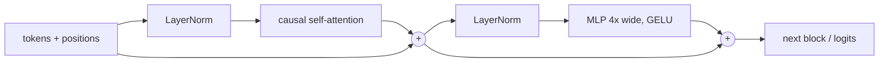

You can call `model.generate()` a thousand times a day and still be fuzzy on what happens inside one forward pass. That fuzziness is cheap until you have to explain why a prefix cache helps, why context length costs what it costs, or why a fine-tune made one thing worse. Then it gets expensive.

The cure is old and unglamorous: write a small GPT yourself, once, and watch the loss move. This is Step 1 of a six-step lab ladder. Today is part 1.

## The 5-minute version

**The ladder.** 1) GPT from scratch, 2) modern components, 3) efficiency, 4) beyond transformers, 5) ablation lab, 6) your own hypothesis. Each step has one classic paper and one coding task. We stay on a step until it's solid.

**The classic paper for Step 1:** [Attention Is All You Need](https://arxiv.org/abs/1706.03762) (Vaswani et al., 2017). It proposed an architecture "based solely on attention mechanisms, dispensing with recurrence and convolutions entirely". The pitch was quality and parallelism: the authors report 28.4 BLEU on WMT 2014 English-to-German and 41.8 for a single model on English-to-French. Those are translation numbers, not what you'll be measuring.

One caveat: the original is an encoder-decoder for translation. GPT-style models keep only the decoder side, with a causal mask. The code below is that decoder-only variant.

**The reference implementation:** [nanoGPT](https://github.com/karpathy/nanoGPT), a rewrite of minGPT with a `model.py` of roughly 300 lines. Its README now marks it deprecated in favour of [nanochat](https://github.com/karpathy/nanochat), which covers tokenizer, pretraining, SFT, RL and a KV-cache inference engine. For a first read I'd still pick nanoGPT: smaller, and it does only the one thing we want today.

**The key insight:** a transformer block is two residual additions.



In nanoGPT's `Block` that is literally `x = x + self.attn(self.ln_1(x))` then `x = x + self.mlp(self.ln_2(x))`. It's pre-norm: normalisation sits before each sublayer. The MLP expands `n_embd` to `4 * n_embd`, applies GELU and projects back.

**Why a senior architect should care.** Serving-time concerns map onto lines you're about to write:

- Attention is the only place tokens talk to each other. That's why context length drives memory and why K and V are what you cache.
- The causal mask is why a prefix can be reused but a suffix can't.
- nanoGPT ties the token embedding to the output head (`wte.weight = lm_head.weight`), so "total" and "non-embedding" parameter counts differ in ways that matter when you compare model sizes.

## Do it (about 90 minutes)

Colab or a laptop. A GPU makes it quick; a CPU is fine at the sizes below.

**Data.** Any plain-text file of a few hundred KB works. Tiny Shakespeare is traditional, and nanoGPT's `data/shakespeare_char/prepare.py` builds it. Make a character vocabulary, encode the text as integers, hold out the last 10% for validation.

### Rung 1: the bigram table (15 min)

An `nn.Embedding(V, V)` whose row for the current character is the logits for the next one. No context beyond one token.

```python
import torch, torch.nn as nn, torch.nn.functional as F

class Bigram(nn.Module):
    def __init__(self, V):
        super().__init__()
        self.table = nn.Embedding(V, V)
    def forward(self, idx, targets=None):
        logits = self.table(idx)                       # (B, T, V)
        loss = None
        if targets is not None:
            loss = F.cross_entropy(logits.view(-1, logits.size(-1)), targets.view(-1))
        return logits, loss
```

Before training, the loss should sit near `ln(V)`, the loss of guessing uniformly. If it is much higher, your output layer starts out too confident (check the initialisation). This check won't catch an off-by-one target shift, which starts at about the same loss; for that, assert on one batch that `y[:, :-1]` equals `x[:, 1:]`.

Train a couple of thousand steps with AdamW and write down the validation loss. That's your floor.

### Rung 2: one head of causal self-attention (25 min)

Add token and position embeddings, then a single head.

```python
class Head(nn.Module):
    def __init__(self, n_embd, head_size, block_size):
        super().__init__()
        self.q = nn.Linear(n_embd, head_size, bias=False)
        self.k = nn.Linear(n_embd, head_size, bias=False)
        self.v = nn.Linear(n_embd, head_size, bias=False)
        self.register_buffer("mask", torch.tril(torch.ones(block_size, block_size)))
    def forward(self, x):
        B, T, C = x.shape
        q, k, v = self.q(x), self.k(x), self.v(x)
        att = (q @ k.transpose(-2, -1)) * k.size(-1) ** -0.5   # scale
        att = att.masked_fill(self.mask[:T, :T] == 0, float("-inf"))
        att = F.softmax(att, dim=-1)
        return att @ v
```

The `tril` mask with `masked_fill` is the same manual path nanoGPT keeps as a fallback. The fast path calls PyTorch's `scaled_dot_product_attention(..., is_causal=True)`, same maths in a fused kernel. Write the slow one first so you know what the fast one replaces.

Why the scale? Dot products grow with dimension, softmax saturates, and gradients through it shrink. Remove the scale and see what happens to your loss.

### Rung 3: multi-head, MLP, residuals, LayerNorm (30 min)

Run several heads in parallel and concatenate. nanoGPT does it with one batched `c_attn = nn.Linear(n_embd, 3 * n_embd)` and a reshape to `(B, nh, T, hs)`. Add an output projection, add the MLP, wrap both in the pre-norm residual pattern from the diagram, stack 4 blocks.

Sizes that fit a CPU, from the README's low-resource run: `block_size=64`, `n_layer=4`, `n_head=4`, `n_embd=128`, `dropout=0.0`. The README's GPU config is bigger (256 context, 384 channels, 6 layers, 6 heads) and reports a best validation loss of 1.4697 in about 3 minutes on one A100. That's the repo's own number; to compare, your tokenisation, split and eval settings must match.

### Rung 4: generate, then break it (20 min)

Sample 500 characters at each rung. Then three one-line experiments:

1. Remove the causal mask. Training loss will look wonderful and generation will be garbage. Work out why (the model can see the answer).
2. Remove the residual connections in the 4-layer model. Compare how fast the loss falls.
3. Halve `block_size`. Which kinds of mistakes show up in the samples?

## What to observe

- The bigram loss plateaus early; samples look like plausible letter pairs and nothing more.
- Attention helps a lot, and samples start to look word-shaped and line-shaped. Log your own numbers, they depend on your run.
- Train loss pulling well below validation loss on a small corpus means memorisation. Notice how soon that happens at 128 channels.
- Count parameters by hand, then compare with `sum(p.numel() for p in model.parameters())`. If you tie embedding and head, count the shared matrix once.

## How you know the step is complete

Without looking at the code, you can:

- Draw one block and say what Q, K, V and the output projection each do.
- Explain why the causal mask makes prefix reuse legal.
- Predict the effect of removing the scale, the mask or the residuals, then be right.
- Derive the starting loss from `ln(V)`.

Part 2 picks up with training-loop hygiene (learning-rate schedule, gradient clipping, eval cadence) and a proper read of nanoGPT's `train.py`.

## Try this

Take any model you rely on and write down three numbers you can't currently derive: parameter count, KV cache bytes per token, and what another thousand tokens of context costs. Then derive them for your tiny GPT. Scaling the arithmetic up is the easy part.

Two rungs done is a perfectly good Sunday. The ladder will wait for you.
