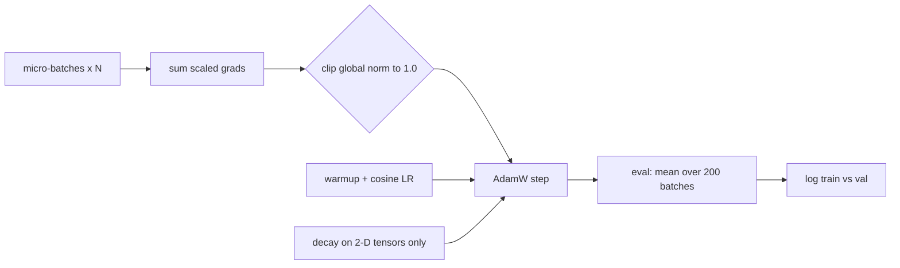

Take two copies of the same GPT, same data, same parameter count. Train one with a flat learning rate and no clipping, the other with a warmup, a cosine decay and a clip at 1.0. The architecture didn't change, and the outcome did.

Part 1 built the model. Part 2 is the part most tutorials rush: the loop around it. If you ever tune a fine-tune, read someone's training config, or wonder why a run diverged at step 3,000, this is the vocabulary.

## The 5-minute version

**Where we are.** Step 1 of the lab ladder (GPT from scratch). Classic paper is still [Attention Is All You Need](https://arxiv.org/abs/1706.03762). Today adds one more: [Decoupled Weight Decay Regularization](https://arxiv.org/abs/1711.05101) (Loshchilov and Hutter, ICLR 2019), the paper behind AdamW. Its claim: L2 regularisation and weight decay are equivalent for plain SGD but "not the case for adaptive gradient algorithms, such as Adam", so you should decay the weights directly, outside the gradient step. The authors report this separates the best decay factor from the learning rate and improves Adam's generalisation on image classification. We're taking that as the reason AdamW exists, not as a claim about GPTs.

**The reference.** [nanoGPT's `train.py`](https://github.com/karpathy/nanoGPT/blob/master/train.py), with `configure_optimizers` and `estimate_mfu` in `model.py`. Its defaults are a useful map of "reasonable for a GPT-2-size run":

| Knob | nanoGPT default |
|---|---|
| peak / min learning rate | `6e-4` / `6e-5` |
| warmup | 2,000 iters, linear |
| decay | cosine to `min_lr` over `lr_decay_iters` (600,000) |
| AdamW betas | 0.9, 0.95 |
| weight decay | 0.1 |
| grad clip | 1.0 |
| micro-batch / accumulation | 12 / 40 (`5 * 8`) |
| eval | every 2,000 iters, 200 batches per split |

Those are the repo's own settings for its big run. Your CPU-sized model should not copy them; the shape matters, the numbers don't.

**The key insight.** Five small mechanisms, each guarding against a different failure.



- **Warmup** keeps the first Adam steps small while its moment estimates are still junk.
- **Cosine decay** lets the model settle instead of bouncing around a minimum at full LR.
- **Selective weight decay** shrinks weight matrices and embeddings, not biases or LayerNorm gains. nanoGPT splits by tensor rank: `dim() >= 2` decays, the rest doesn't.
- **Clipping** caps the global gradient norm, so one nasty batch can't throw the weights across the loss surface.
- **Accumulation** buys a bigger effective batch without more memory.

**Why a senior architect should care.** This is the config surface of every fine-tuning job you'll approve. "Effective batch size", "warmup ratio" and "max grad norm" are fields in nearly every training recipe, and when a run goes bad they're the first three suspects. Knowing what each one protects against turns a vague argument into a ten-minute diagnosis.

## Do it (about 90 minutes)

Same tiny GPT from part 1. Everything below is a change to the loop, not the model. Keep one baseline run with a constant learning rate, no clipping and no decay, so every change has something to be compared with.

### Rung 5: the schedule (20 min)

nanoGPT's `get_lr` has three branches: linear warmup, cosine decay, then a floor. Write it yourself:

```python
import math

def get_lr(it, lr=6e-4, min_lr=6e-5, warmup=100, decay_iters=2000):
    if it < warmup:
        return lr * (it + 1) / (warmup + 1)
    if it > decay_iters:
        return min_lr
    ratio = (it - warmup) / (decay_iters - warmup)
    coeff = 0.5 * (1.0 + math.cos(math.pi * ratio))   # 1 -> 0
    return min_lr + coeff * (lr - min_lr)

# set it every iteration, on every param group
for g in opt.param_groups:
    g["lr"] = get_lr(it)
```

Scale `warmup` and `decay_iters` to your run length: a few percent warmup, decay across the whole run. Plot the schedule before training. A schedule you've never plotted is a schedule you've never read.

### Rung 6: AdamW with two parameter groups (15 min)

```python
decay   = [p for p in model.parameters() if p.requires_grad and p.dim() >= 2]
nodecay = [p for p in model.parameters() if p.requires_grad and p.dim() < 2]
opt = torch.optim.AdamW(
    [{"params": decay, "weight_decay": 0.1},
     {"params": nodecay, "weight_decay": 0.0}],
    lr=6e-4, betas=(0.9, 0.95),
)
```

Print the parameter counts in each group. The no-decay group should be tiny. If it's empty, your biases or norm gains landed in the wrong list.

The `0.95` second beta is worth a note. The common library default is 0.999; nanoGPT uses 0.95, which makes the variance estimate react faster. I'd treat it as a setting to try, not a law.

### Rung 7: accumulation, clipping, honest eval (25 min)

```python
accum = 4
opt.zero_grad(set_to_none=True)
for micro in range(accum):
    x, y = get_batch("train")
    _, loss = model(x, y)
    (loss / accum).backward()          # divide, or gradients sum instead of average
gn = torch.nn.utils.clip_grad_norm_(model.parameters(), 1.0)
opt.step()
```

`clip_grad_norm_` returns the pre-clip global norm. **Log it every step.** It's the cheapest health signal in the whole loop: it spikes before the loss does.

For eval, do what nanoGPT's `estimate_loss` does: switch to `eval()`, run a fixed number of batches per split under `no_grad`, average, switch back.

```python
@torch.no_grad()
def estimate_loss(n=200):
    model.eval()
    out = {}
    for split in ("train", "val"):
        out[split] = sum(model(*get_batch(split))[1].item() for _ in range(n)) / n
    model.train()
    return out
```

A one-batch validation loss on a small corpus swings by more than most of the effects you're trying to see. Average before you conclude anything.

### Rung 8: break each one on purpose (30 min)

Change one thing at a time and keep the same seed. Write down your prediction first.

1. **No warmup, peak LR 3x higher.** Does loss spike early? Does the grad norm show it first?
2. **No clipping, same high LR.** Compare the max grad norm over the run with and without.
3. **Decay everything**, including biases and norms. Probably small at this size. Say so if you see nothing; a null result is still a result.
4. **Forget the `/ accum`.** Gradients become `accum` times larger. With AdamW the update barely changes, because Adam normalises by gradient size, but your gradient-clipping threshold now means something different, and with plain SGD the learning rate effectively grows `accum` times. Predict which of these you'll see before you run it.
5. **Evaluate on 1 batch instead of 200.** Re-run the same checkpoint five times and look at the spread.

### Optional: read the MFU line

`estimate_mfu` in `model.py` counts `6*N + 12*L*H*Q*T` FLOPs per token (the PaLM formula) and divides achieved throughput by an A100 bfloat16 peak of 312 TFLOPS. Notice it hard-codes that hardware number. MFU on any other GPU is relative to an A100 unless you change it. That's a good example of how a "utilisation" figure can be accurate arithmetic and still not mean what you assume.

```curve
{
 "title": "What the breakages look like (illustrative shapes, not measured)",
 "xLabel": "Step",
 "yLabel": "Val loss",
 "series": [
  {
   "name": "Healthy",
   "points": [
    [
     0,
     4.3
    ],
    [
     200,
     3.2
    ],
    [
     500,
     2.5
    ],
    [
     1000,
     2.05
    ],
    [
     2000,
     1.75
    ],
    [
     3000,
     1.62
    ],
    [
     5000,
     1.5
    ]
   ]
  },
  {
   "name": "No warmup",
   "points": [
    [
     0,
     4.3
    ],
    [
     100,
     5.6
    ],
    [
     200,
     4.9
    ],
    [
     500,
     3.4
    ],
    [
     1000,
     2.6
    ],
    [
     2000,
     2.1
    ],
    [
     3000,
     1.95
    ],
    [
     5000,
     1.82
    ]
   ],
   "bug": true
  },
  {
   "name": "No grad clipping",
   "points": [
    [
     0,
     4.3
    ],
    [
     200,
     3.2
    ],
    [
     500,
     2.5
    ],
    [
     1000,
     2.1
    ],
    [
     1300,
     3.4
    ],
    [
     1600,
     2.4
    ],
    [
     2000,
     2.0
    ],
    [
     3000,
     1.8
    ],
    [
     5000,
     1.68
    ]
   ],
   "bug": true
  }
 ]
}
```

## What to observe

- The grad norm trace. Does it settle after warmup? Does it ever jump by an order of magnitude?
- How early each breakage shows up. Some, like a missing warmup, hurt in the first hundred steps. Others only show late.
- The gap between train and val as the LR decays. A cosine tail usually tightens train loss fastest, which can widen the gap on a small corpus.
- Which breakages you predicted correctly. The misses are where your intuition is thin.

## How you know the step is (nearly) complete

Without looking at the code, you can:

- Explain why Adam needs warmup, and what the grad norm tells you that the loss doesn't.
- Say why coupling L2 into Adam's gradient differs from decaying weights directly, in two sentences.
- Compute the effective batch in tokens for any config: micro-batch × accumulation × block size × GPUs.
- Predict the symptom of each of the five breakages before running it.

Part 3, if the author hasn't marked the step done, covers scaling a run up: bigger widths, a real tokeniser, and reading loss curves against compute.

## Try this

Open a fine-tuning config you already use (any framework). Find the learning rate, warmup, max grad norm, weight decay and effective batch size. For each one, write a one-line guess at what breaks if it's wrong. Then check the guesses against the training logs from your last run.

One rung is a fine Sunday too. The loop will still be there when you come back.
