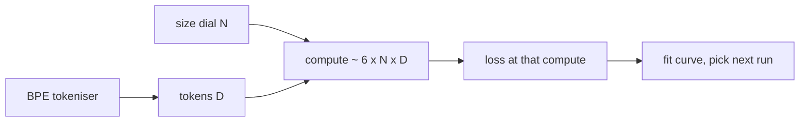

A loss of 1.47 sounds like a result. It isn't, not by itself. Which tokeniser? How many tokens seen? On what compute? Strip those away and the number is a mood.

Parts 1 and 2 gave you a model and a loop that behaves. Part 3 is about the habit that separates a lab exercise from engineering: never read a loss without knowing what it cost and what it counts.

## The 5-minute version

**Where we are.** Step 1 of the ladder (GPT from scratch). The classic paper is still [Attention Is All You Need](https://arxiv.org/abs/1706.03762). Two more join it today, both about scale:

- [Scaling Laws for Neural Language Models](https://arxiv.org/abs/2001.08361) (Kaplan et al., 2020): loss follows a power law in model size, dataset size and training compute, across more than seven orders of magnitude, and architecture details like width and depth matter little within a wide range. Its practical advice was to spend a compute budget mostly on a bigger model and stop well before convergence.
- [Training Compute-Optimal Large Language Models](https://arxiv.org/abs/2203.15556) (Hoffmann et al., 2022, "Chinchilla"): across 400+ models (70M to over 16B parameters, 5 to 500B tokens) they found model size and tokens should scale equally: "for every doubling of model size the number of training tokens should also be doubled." Their 70B Chinchilla, trained on about 4x more data than the 280B Gopher with the same compute, beat Gopher, GPT-3 (175B), Jurassic-1 and Megatron-Turing NLG (530B) on a wide range of tasks, and reached 67.5% average MMLU accuracy.

The two papers disagree on how to split a budget, and the later one won. Treat that as a lesson in how fast "the rule" changes.

**What's different in practice now.** The compute-optimal recipe is a floor, not the goal for models that get served. A smaller model trained on more tokens than Chinchilla suggests costs more to train but less on every request, which is why open-weight labs train well past the optimum. Chinchilla optimises training compute. The paper notes that a smaller model also saves inference compute, but it doesn't size models for inference. If your model will be queried billions of times, price both.

For a current reference harness, [nanochat](https://github.com/karpathy/nanochat) (MIT licence) trains a GPT-2-capability model for about $48 on an 8xH100 node at roughly 2 hours, or around $15 on spot instances, per its README (leaderboard best 1.65 hours as of its March 2026 entry). Its single complexity dial is `--depth`; width, learning rate, training horizon and weight decay are derived from it. That's the same idea as this post: one size knob, everything else tied to it.

**The key insight.**



Three things move together: tokeniser, size, tokens. Change one and the loss isn't comparable with last week's.

**Why a senior architect should care.** "Should we use the bigger model?" and "should we fine-tune on more data?" are the same question wearing different hats. A 6ND estimate and a loss-versus-compute curve turn them into arithmetic you can defend in a review.

```stats
400+ | models trained for the Chinchilla fits (70M to 16B+ parameters)
2x | tokens per doubling of model size (Chinchilla's equal-scaling rule)
50,257 | GPT-2 BPE vocabulary size
~$48 | nanochat GPT-2-capability speedrun on 8xH100 (README)
```

## Do it (about 90 minutes)

Same tiny GPT and loop as parts 1 and 2. Three changes: the tokeniser, the size dial, the bookkeeping.

### Rung 9: a BPE tokeniser (25 min)

Byte-pair encoding, [introduced for subword units in translation](https://arxiv.org/abs/1508.07909) by Sennrich et al. (2015), starts from raw units and repeatedly merges the most frequent adjacent pair into a new token. Byte-level BPE starts from the 256 byte values, so nothing is ever out of vocabulary. Karpathy's [minbpe](https://github.com/karpathy/minbpe) (MIT) is the readable reference: a `BasicTokenizer`, a `RegexTokenizer` that splits text by category first so merges don't cross letters, digits and punctuation, and a `GPT4Tokenizer` that reproduces tiktoken's cl100k_base. Its example: with "aaabdaaabac" and 3 merges, `aa` becomes 256, `ab` 257, and their pair 258, giving `[258, 100, 258, 97, 99]`.

```python
from minbpe import RegexTokenizer   # clone minbpe next to your notebook

tok = RegexTokenizer()
tok.train(open("input.txt").read(), vocab_size=1024)   # 256 bytes + 768 merges
ids = tok.encode("To be, or not to be")
assert tok.decode(ids) == "To be, or not to be"
print(len(ids))
```

Re-tokenise your corpus, save the ids as an array, and set `vocab_size` and `block_size` in your model config. Two checks before training: the encode/decode round trip is exact, and the untrained loss is near `ln(vocab_size)` (you used the same check for characters in part 1).

For a ready-made vocabulary, nanoGPT's OpenWebText prep uses the GPT-2 BPE via `tiktoken` (50,257 tokens), stored as uint16 ids. With that vocabulary the embedding table alone is 50,257 x 768, about 38.6M parameters, roughly 31% of GPT-2 small's 124M. At small scale the vocabulary is a big slice of your model.

> [!WATCH] Watch out for
> A BPE loss and a character-level loss are not comparable. One predicts a token, the other a character. If you want to compare across tokenisers, convert to bits per byte first (total loss in nats divided by bytes of text, over `ln 2`).

### Rung 10: three sizes, one dial (30 min)

Pick three configurations that differ by roughly 2–3x in parameter count, changing depth and width together (nanochat's lesson: one dial, the rest derived). For example:

```yaml
small:  {n_layer: 4,  n_head: 4, n_embd: 128}
medium: {n_layer: 6,  n_head: 6, n_embd: 192}
large:  {n_layer: 8,  n_head: 8, n_embd: 256}
```

For each, count parameters (`sum(p.numel() for p in model.parameters())`), and train with the same loop, seed and data. Use the schedule from part 2, scaled to each run length. Write down the loss at fixed token counts, not fixed steps, so the three runs line up on the same x-axis.

### Rung 11: price it with 6ND (15 min)

The Chinchilla analysis uses the standard approximation that training FLOPs are about 6 x parameters x tokens: 2ND for the forward pass and twice that for the backward. nanoGPT's [scaling-laws notebook](https://github.com/karpathy/nanoGPT/blob/master/scaling_laws.ipynb) checks it against the exact count for six of the paper's models and finds the ratio between about 0.99 and 1.10. Good enough for planning, not for billing.

```calc
{"title": "What will this run cost? (planning estimate)", "inputs": [{"id": "n", "label": "Parameters", "min": 1, "max": 1000, "step": 1, "value": 10, "unit": "M"}, {"id": "d", "label": "Training tokens", "min": 0.01, "max": 100, "step": 0.01, "value": 1, "unit": "B"}, {"id": "peak", "label": "GPU peak (bf16)", "min": 50, "max": 1000, "step": 1, "value": 312, "unit": "TFLOPS"}, {"id": "mfu", "label": "Utilisation", "min": 0.05, "max": 0.6, "step": 0.01, "value": 0.3, "unit": ""}], "outputs": [{"label": "Training compute", "formula": "6 * n * d * 1000000000000000000 / 1000000000000000000", "decimals": 1, "unit": "x 10^15 FLOPs"}, {"label": "GPU-hours", "formula": "6 * n * 1000000 * d * 1000000000 / (peak * 1000000000000 * mfu) / 3600", "decimals": 2, "unit": "GPU-hours"}], "note": "312 TFLOPS is the A100 bf16 peak hard-coded in nanoGPT's estimate_mfu. The default utilisation is an assumption; measure yours."}
```

Fill in your three runs. Do the estimate before you train, then compare with wall-clock time. If you're off by more than 3x, find out why: data loading, a small batch, or a GPU you didn't know was shared.

### Rung 12: plot loss against compute (20 min)

On log-log axes, plot val loss against 6ND for your three runs. If your sizes and token counts are sensible, you get the start of a power-law-looking curve and, more usefully, the point where a bigger model stops paying for itself at your budget.

Expect noise. At this scale the curves won't be clean, and Kaplan's neat power laws were measured over many orders of magnitude, not three tiny models. If your points are scattered, say so. A fit you'd bet on needs more runs than a Sunday allows.

```curve
{"title": "What to look for (illustrative shapes, not measured)", "xLabel": "Training compute (log scale, arbitrary units)", "yLabel": "Val loss", "series": [{"name": "Small", "points": [[1, 3.9], [3, 3.3], [10, 3.0], [30, 2.9], [100, 2.88]]}, {"name": "Medium", "points": [[1, 4.0], [3, 3.3], [10, 2.9], [30, 2.6], [100, 2.5]]}, {"name": "Large, undertrained", "points": [[1, 4.2], [3, 3.6], [10, 3.2], [30, 2.9], [100, 2.7]], "bug": true}]}
```

The shape to notice: the small model flattens early, the big one starts worse and overtakes late. Which one is cheapest for a given loss depends on where you stop.

## What to observe

- Where each model's curve flattens, and whether the flat part is the model running out of capacity or the data running out of variety.
- Whether training longer or growing the model buys more loss per unit of compute at your budget.
- How much of the small model's parameter count is the embedding table.
- The gap between your 6ND time estimate and the real clock.

## How you know the step is (nearly) complete

Without looking at the code, you can:

- Train a byte-level BPE tokeniser and say why the round trip must be exact.
- Explain why losses from two tokenisers can't be compared directly.
- Estimate training FLOPs and GPU-hours for a run with 6ND and a utilisation guess.
- State Chinchilla's rule in one sentence, and one reason real teams train past it.

Part 4, if the author hasn't marked the step done, covers ablations: removing one architectural piece at a time and measuring what it was worth.

## Try this

Take any model you've sized recently, for training or for serving, and write down four numbers: parameters, training tokens, the tokeniser, and the cost per million served tokens. If you can't fill one in, that's the gap to close before the next "should we go bigger" meeting.

Half a ladder rung is still progress. The curves will wait.
