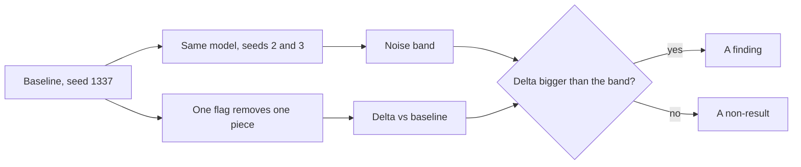

Take a transformer block apart and ask which piece you'd miss least. Most people say the heads, or the weight decay, or "some of the norms". Then they never check.

Part 3 ended with a promise: remove one architectural piece at a time and measure what it was worth. That's this post. The twist is that the first experiment isn't an ablation at all. It's the unchanged model run again with different seeds, because without that you can't tell a finding from a coin flip.

> [!TRY] Run it
> The whole exercise is one file with pass gates and the measured runs behind every number below: [labs/lab/2026-11-01](https://github.com/VRSupriya/thevoyager.dev/tree/main/labs/lab/2026-11-01). The reference run took about a minute on a 4-core CPU; all nine runs about seven minutes.

## The 5-minute version

**Where we are.** Step 1 of the ladder (GPT from scratch). The classic paper is still [Attention Is All You Need](https://arxiv.org/abs/1706.03762). Today's job is method rather than a new paper: how to run an ablation you can defend.

**The method in four rules.**

1. **Measure the noise first.** Same code, same data, two more seeds. If the baseline moves by 0.013 between seeds, a 0.01 improvement from your "idea" is nothing.
2. **Change one thing.** Each ablation is a flag that removes exactly one piece; everything else, including the schedule, stays put.
3. **Say what changed besides the thing.** Removing the MLP also removes 65% of the parameters. An ablation that shrinks the model is a different question from one that doesn't.
4. **Report the size and budget.** A ranking from 0.8M parameters and 2,000 steps is a ranking for that.



**What we found** (validation loss after 2,000 steps; lower is better; one run each, so read differences under about 0.02 as noise):

```chart
{"title": "Validation loss after 2,000 steps (our run, 0.8M-parameter GPT)", "type": "bar", "x": ["Baseline", "Seed 2", "Seed 3", "No weight decay", "One head", "No MLP", "No position emb.", "No LayerNorm", "No attention"], "series": [{"name": "Val loss", "values": [1.8427, 1.856, 1.8478, 1.8372, 1.8397, 1.981, 2.0308, 2.1381, 2.4741]}], "unit": "", "xLabel": "Variant", "yLabel": "Val loss", "note": "Source: our run, labs/lab/2026-11-01/run.json. The first three bars are the same model with seeds 1337, 2 and 3."}
```

```stats
0.013 | spread of val loss across three seeds of the unchanged model
0.63 | val loss added by removing attention (2.474 vs 1.843)
0.30 | added by removing every LayerNorm (2.138 vs 1.843)
~0.00 | difference from one head or no weight decay: inside the noise
```

**Why a senior architect should care.** Reviews are full of claims of the form "we removed X and nothing changed" or "X is essential". Both are ablation claims. Asking for the seed spread, the parameter count of the ablated model and the training budget takes thirty seconds and filters out most of them.

## Do it (about 90 minutes)

### Rung 13: the baseline and its noise (15 min)

The model is the same pre-norm GPT as parts 1–3: four layers, four heads, width 128, character vocabulary of 65, 816,128 parameters, 2,000 steps of AdamW with warmup and cosine decay. Run it three times:

```bash
cd labs/lab/2026-11-01
pip install -r requirements.txt
python3 run.py --results base.json                # seed 1337
python3 run.py --seed 2 --results seed2.json
python3 run.py --seed 3 --results seed3.json
```

Our three val losses were 1.8427, 1.8560 and 1.8478: a range of 0.013. Hold that number in your head for the rest of the post.

### Rung 14: the ablation flags (25 min)

`--ablate` takes one of six values. Each is a few lines in `run.py`; read them before you run them:

```python
self.pos  = None if a.ablate == "no_pos"  else nn.Embedding(a.block_size, a.n_embd)
self.attn = None if a.ablate == "no_attn" else CausalSelfAttention()
self.mlp  = None if a.ablate == "no_mlp"  else nn.Sequential(
    nn.Linear(a.n_embd, 4 * a.n_embd), nn.GELU(), nn.Linear(4 * a.n_embd, a.n_embd))
norm = (lambda: nn.Identity()) if a.ablate == "no_ln" else (lambda: nn.LayerNorm(a.n_embd))
# one_head sets n_head = 1 at the same width; no_wd sets weight decay to 0.0 on the matrices
```

Because the blocks add each sublayer back onto the residual stream, deleting a sublayer leaves a valid network. That is also why ablation is easy here and harder in a model with tangled wiring.

### Rung 15: run all six and fill the table (30 min)

```bash
for v in no_pos one_head no_mlp no_attn no_ln no_wd; do
  python3 run.py --ablate $v --results $v.json
done
```

For each, write down val loss, the delta against the seed-1337 baseline, and the parameter count. The parameter count is not decoration: it tells you whether you removed a capability or just removed capacity.

### Rung 16: say what you expect before you look (20 min)

Before reading our numbers, rank the six by damage and write it down. The exercise is to find where your intuition and the measurement disagree. Then read on.

## Expected results

The gates in `expected.json` check the baseline only; the ablations are measured, not gated, because their sizes depend on the machine's seed behaviour. The first block is the recorded run of the unchanged model:

| Check | Gate | Our run |
|---|---|---|
| Starting val loss near ln(65) = 4.174 | between 4.0 and 4.4 | 4.181 |
| Baseline val loss after 2,000 steps | at most 1.95 | 1.8427 |
| Val minus train loss | at most 0.25 | 0.1408 |

The measured ablations (our run, CPU, torch 2.14.1; delta against the seed-1337 baseline of 1.8427):

| Variant | Parameters | Val loss | Delta | Read it as |
|---|---|---|---|---|
| Baseline, seeds 1337 / 2 / 3 | 816,128 | 1.8427 / 1.8560 / 1.8478 | noise: 0.013 | the yardstick |
| No weight decay | 816,128 | 1.8372 | -0.005 | non-result |
| One head instead of four | 816,128 | 1.8397 | -0.003 | non-result |
| No MLP (attention only) | 289,280 | 1.9810 | +0.138 | real, but 65% fewer parameters |
| No position embeddings | 807,936 | 2.0308 | +0.188 | real |
| No LayerNorm anywhere | 813,824 | 2.1381 | +0.295 | real |
| No attention (MLP only) | 553,984 | 2.4741 | +0.631 | large |

Your numbers will differ in the third decimal on other hardware or library versions. The ordering, and which rows sit inside the noise band, should not.

## What to observe

**Attention is the one piece you can't do without, and the reason is mundane.** Without it every position is processed alone, so the model can only learn "which character tends to follow this one". The MLP-only model's train and val losses are almost identical (2.468 and 2.474) because there's nothing to overfit with, and gradient clipping fired on only 65 of 2,000 steps against about 1,950 for the baseline.

**LayerNorm costs more than position embeddings, even in a four-layer model.** The no-LayerNorm run still trained, but clipping fired on 1,711 steps and it ended 0.30 behind. This is a shallow network with a tuned small learning rate. [Xiong et al. (ICML 2020)](https://arxiv.org/abs/2002.04745) argue where normalisation sits changes gradient behaviour at initialisation and whether warmup is needed; our run says nothing about deep stacks, where the effect should be larger, not smaller.

**The model without position embeddings still learns.** It ends 0.19 behind, not at the bigram floor. The causal mask means position `t` attends to exactly `t` tokens, which leaks order. [Kazemnejad et al. (NeurIPS 2023)](https://arxiv.org/abs/2305.19466) find that decoder-only models with no positional encoding (NoPE) can represent both absolute and relative position, and generalise to longer sequences better than several explicit encodings on their reasoning and math tasks. Our block size is fixed at 64, so we measured none of that. For a production angle, Hugging Face's [SmolLM3 write-up](https://huggingface.co/blog/smollm3) (July 2025) drops rotary embeddings in every fourth layer, following Yang et al. (2025), and reports better long-context performance without a short-context cost, on a 3B model trained on 100B tokens.

**One head versus four: no difference here.** Don't generalise it. [Michel, Levy and Neubig (NeurIPS 2019)](https://arxiv.org/abs/1905.10650) report that many heads can be removed from a trained model at test time with little loss; that's pruning after training, a different question from training with one head. Our result says only that at width 128 and 2,000 steps, four patterns weren't worth more than one. With a vocabulary of 65 characters and a block of 64, there may not be much for extra heads to specialise on.

**Weight decay: no difference, and the reason is the horizon.** [D'Angelo et al. (2023)](https://arxiv.org/abs/2310.04415) argue that for LLM-style, close-to-one-epoch training, weight decay matters for optimisation dynamics and stability, not as a regulariser. Our run is 2,000 steps at batch 12 over a 1M-character corpus, nowhere near that regime, so a null result is the expected one. SmolLM3 reports turning weight decay off on the embeddings only, borrowed from OLMo 2, for stability.

**The MLP result needs a footnote.** Dropping it removed 527,000 parameters and cost 0.14. Per parameter that's cheap, but this is not a controlled comparison: the right control is an attention-only model widened to 816k parameters, which this lab doesn't run. [Geva et al. (EMNLP 2021)](https://arxiv.org/abs/2012.14913) describe feed-forward layers, about two-thirds of a transformer's parameters, as key-value memories of patterns in the training data. A 1M-character corpus doesn't need much memory.

## Step complete when

You can, without looking at the code:

- Reproduce the baseline gates: starting loss between 4.0 and 4.4, val loss at most 1.95, val minus train at most 0.25.
- Report your own seed-to-seed spread and use it to say which of your six ablations are findings and which are non-results.
- Explain why the no-position model still beats the no-attention model, and what the experiment does not tell you about long contexts.
- Name one ablation in this lab that changed the parameter count, and why that muddies the comparison.

If you submit a run with `python3 scripts/submit_lab.py submit labs/lab/2026-11-01 --results base.json --notes "..."`, the gates are checked for you.

## Quiz

```quiz
{"title": "Check yourself", "questions": [{"q": "The baseline moves by 0.013 across three seeds and your new idea improves val loss by 0.008. What do you conclude?", "a": "Nothing yet. It is inside the noise band. Run more seeds, or a longer or larger setup, before claiming a gain."}, {"q": "Removing the MLP cost 0.14 val loss and removed 65% of the parameters. Why isn't that proof the MLP is cheap?", "a": "Capacity changed too. A fair control is an attention-only model widened to the same parameter count; otherwise you can't separate 'the MLP is unnecessary' from 'a smaller model is a bit worse'."}, {"q": "The model without position embeddings trains fine. Why, and what does that not show?", "a": "The causal mask lets position t attend to exactly t tokens, which leaks order. It does not show the model generalises to longer sequences; our block size was fixed at 64."}, {"q": "Four heads and one head tie at width 128. Does that mean production models don't need many heads?", "a": "No. One size, one budget and a 65-character vocabulary. It says only that this setup has little for extra heads to do."}]}
```

## Try this

Pick one component in a system you own (a reranker, a cache, a guardrail, a prompt section) and run the same protocol: the unchanged system on three seeds or three sample sets, then with the piece removed. If the spread is bigger than the difference, you've learned the test is too weak, which is also worth knowing.

## Evidence

| Source | Type | Date | What we checked |
|---|---|---|---|
| `labs/lab/2026-11-01/run.json`, `output.txt` | our run | 1 November 2026 | Ran all nine configurations (baseline, two extra seeds, six ablations); every loss, delta and parameter count in this post is copied from it |
| [Attention Is All You Need](https://arxiv.org/abs/1706.03762) | primary | June 2017 | Cited as the lab's classic paper; not re-read for this post |
| [Xiong et al., On Layer Normalization in the Transformer Architecture](https://arxiv.org/abs/2002.04745) | primary | Feb 2020 (ICML 2020) | Read the abstract page: Pre-LN gradient behaviour at initialisation and warmup. We did not reproduce it |
| [Kazemnejad et al., The Impact of Positional Encoding on Length Generalization](https://arxiv.org/abs/2305.19466) | primary | May 2023 (NeurIPS 2023) | Read the abstract page and Comments field: NoPE claims. We did not test length generalization |
| [Michel et al., Are Sixteen Heads Really Better than One?](https://arxiv.org/abs/1905.10650) | primary | May 2019 (NeurIPS 2019) | Read the abstract page: test-time head pruning. The abstract page gives no percentage, so we quote none |
| [D'Angelo et al., Why Do We Need Weight Decay in Modern Deep Learning?](https://arxiv.org/abs/2310.04415) | primary | Oct 2023, revised Nov 2024 | Read the abstract page: the near-one-epoch LLM claim |
| [Geva et al., Transformer Feed-Forward Layers Are Key-Value Memories](https://arxiv.org/abs/2012.14913) | primary | Dec 2020 (EMNLP 2021) | Read the abstract page: the key-value memory framing and the two-thirds parameter share |
| [SmolLM3 blog post](https://huggingface.co/blog/smollm3) | primary | 8 July 2025 | Read the page: NoPE in every fourth layer and embedding weight-decay change; the post gives no numeric ablation scores |

Skipping a rung is fine. The ablations will still be there next Sunday.
