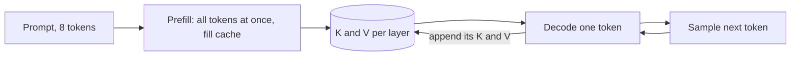

Here's a test that catches a whole class of inference bugs: decode greedily with the KV cache, decode greedily without it, and diff the tokens. They should be identical. If they're not, you haven't got a slightly different model, you've got a broken one that still produces fluent text.

Part 4 took the small GPT apart. This part makes it generate properly. We add a KV cache to the part-4 model, check that it's exact, time it, and then spend the second half on the other thing that decides how a model feels in production: how you pick the next token.

> [!TRY] Run it
> One file, five pass gates, and the runs behind every number below: [labs/lab/2026-11-22](https://github.com/VRSupriya/thevoyager.dev/tree/main/labs/lab/2026-11-22). Training takes about a minute on a 4-core CPU; the whole lab took about 80 seconds per seed.

## The 5-minute version

**Where we are.** Still Step 1 (GPT from scratch). The classic paper stays [Attention Is All You Need](https://arxiv.org/abs/1706.03762); today's reading is practical: [Shazeer (2019)](https://arxiv.org/abs/1911.02150) on why incremental decoding is memory-bandwidth bound, and [Holtzman et al. (2019)](https://arxiv.org/abs/1904.09751) on why likelihood is a poor decoding objective.

**The KV cache in three lines.** At step `t`, attention needs the keys and values of all earlier tokens. They don't change once computed, so keep them. Each new step then processes one token instead of `t`.



**What it costs.** Compute drops, memory rises. Per token, the cache holds `2 x layers x kv_heads x head_dim x bytes`. For our model that is 4,096 bytes in fp32. For [Mistral-7B-v0.1's published config](https://huggingface.co/mistralai/Mistral-7B-v0.1/raw/main/config.json) (32 layers, 8 KV heads, head dim 128, bf16) it is 131,072 bytes, 128 KiB per token.

```calc
{"title": "KV cache size per sequence (defaults: Mistral-7B-v0.1 config, bf16)", "inputs": [{"id": "layers", "label": "Layers", "min": 1, "max": 128, "step": 1, "value": 32, "unit": ""}, {"id": "kvh", "label": "KV heads", "min": 1, "max": 64, "step": 1, "value": 8, "unit": ""}, {"id": "hd", "label": "Head dimension", "min": 32, "max": 256, "step": 32, "value": 128, "unit": ""}, {"id": "bytes", "label": "Bytes per value", "min": 1, "max": 4, "step": 1, "value": 2, "unit": "B"}, {"id": "ctx", "label": "Context length", "min": 1000, "max": 128000, "step": 1000, "value": 32000, "unit": "tokens"}], "outputs": [{"label": "KiB per token", "formula": "2 * layers * kvh * hd * bytes / 1024", "decimals": 0, "unit": "KiB"}, {"label": "GiB per sequence", "formula": "2 * layers * kvh * hd * bytes * ctx / 1073741824", "decimals": 2, "unit": "GiB"}], "note": "Formula checked against our own lab (4,096 B per token for the 0.8M model). Defaults from Mistral-7B-v0.1 config.json, read 22 November 2026. Set KV heads to 32 to see multi-head attention: four times the memory."}
```

**What we measured** (our run, CPU, torch 2.14.1):

```stats
5e-6 | largest logit difference, cached vs recomputed
11.1 | largest logit difference with a wrong position offset
4.7x | speedup at 512 tokens (2.71s vs 0.57s)
88% vs 47% | real words at T=0.5 vs T=1.3
```

**Why a senior architect should care.** The cache is why decode is cheap in compute and expensive in memory. Most serving decisions in the coming Phase-2 weeks (batch size, paging, quantised or shared KV) are about where those bytes live.

## Do it (about 90 minutes)

### Rung 17: give attention a memory (25 min)

The change to part 4's attention is small: if a cache is passed in, append the new keys and values to it, and let new queries see the whole cached history.

```python
if cache is not None:
    if "k" in cache:
        k, v = torch.cat([cache["k"], k], dim=2), torch.cat([cache["v"], v], dim=2)
    cache["k"], cache["v"] = k, v
    past = k.shape[2] - T
att = (q @ k.transpose(-2, -1)) / math.sqrt(hs)
allowed = torch.ones(T, past + T, dtype=torch.bool).tril(diagonal=past)  # new token i sees cache + new tokens up to i
```

The `diagonal=past` mask is the part people get wrong. During prefill (`T` > 1) the new tokens still need a causal mask among themselves; during decode (`T` = 1) the mask is all True.

The second place the cache touches the model is position. New tokens must get positions `past, past+1, ...`, not `0, 1, ...`:

```python
start = 0 if pos_bug else past
x = self.tok(idx) + self.pos(torch.arange(start, start + T))
```

### Rung 18: prove it is exact (15 min)

Decode 56 tokens greedily three ways: recompute everything, cache, cache with the position bug. Compare tokens and last-position logits at every step.

| Variant | Tokens identical to recompute | Largest logit difference |
|---|---|---|
| Cached, correct | yes | 4.8e-6 |
| Cached, position offset wrong | 12% match (seed 2: 4%) | 11.1 (seed 2: 10.8) |

The bug diverges from step 1, which is why it's easy to catch with this test and easy to miss without it: the output is still plausible text.

### Rung 19: time it (20 min)

Timing doesn't need trained weights, so we use a random-init copy with a 512-token block. Best of three runs, one sequence, greedy:

```chart
{"title": "Seconds to generate N tokens, one sequence, CPU (our run)", "type": "line", "x": ["64", "128", "256", "512"], "series": [{"name": "Recompute the prefix", "values": [0.09, 0.24, 0.71, 2.71]}, {"name": "KV cache", "values": [0.05, 0.10, 0.22, 0.57]}], "unit": "s", "xLabel": "Tokens generated", "yLabel": "Seconds", "note": "Source: our run, labs/lab/2026-11-22/output.txt. 0.8M-parameter model, 4 CPU threads, best of 3."}
```

The speedup grows with length (1.7x, 2.4x, 3.2x, 4.7x) because recomputation redoes work proportional to the prefix at every step. The cached line isn't flat either: attention still reads the whole cache each step, which is exactly why decode is bound by memory bandwidth, the point of Shazeer's multi-query attention paper. At this size the speedups are modest because Python overhead dominates; a large model on a GPU would show a different ratio, and we haven't measured that.

### Rung 20: sample 200 continuations per setting (30 min)

From a newline prompt, generate 63 characters, 200 samples, cached and batched. Score each setting on three things: the share of generated words that appear in the training text (a cheap proxy for "is this English-ish"), the share of unique words (diversity), and the model's own negative log-likelihood of its output.

```python
logits = logits / temperature
if top_k:  # keep the k largest, mask the rest
    kth = logits.topk(top_k, dim=-1).values[:, -1:]
    logits = logits.masked_fill(logits < kth, float("-inf"))
if top_p:  # keep the smallest set of tokens whose probability mass reaches top_p
    sl, si = logits.sort(dim=-1, descending=True)
    p = F.softmax(sl, -1)
    sl = sl.masked_fill((p.cumsum(-1) - p) > top_p, float("-inf"))
    logits = torch.full_like(logits, float("-inf")).scatter(-1, si, sl)
```

### Rung 21: predict before you look (20 min)

Write down which setting you'd ship for a chatbot and which for brainstorming, then read the table.

## Expected results

| Check | Gate | Our run |
|---|---|---|
| Baseline val loss after 2,000 steps | at most 1.95 | 1.870 |
| Cached and uncached greedy tokens identical | equals 1 | 1 |
| Largest logit difference, cached vs recomputed | at most 1e-4 | 4.768e-06 |
| Cached speedup at 512 tokens | at least 2.0 | 4.7 |
| Real-word share at T=0.5 minus T=1.3 | at least 0.1 | 0.408 |

Sampling results (our run, seed 1337, 200 samples of 64 characters each):

| Setting | Real words | Unique words | Model's NLL of its own text | Distinct samples |
|---|---|---|---|---|
| Greedy | 100.0% | 0.2% | 1.141 | 1 of 200 |
| T=0.5 | 87.6% | 23.6% | 1.263 | 200 |
| T=0.8 | 74.8% | 38.4% | 1.535 | 200 |
| T=1.0 | 63.0% | 51.0% | 1.791 | 200 |
| T=1.3 | 46.8% | 66.6% | 2.289 | 200 |
| top-k = 5 (T=1) | 80.4% | 30.7% | 1.416 | 200 |
| top-p = 0.9 (T=1) | 74.7% | 39.6% | 1.551 | 200 |

Seed 2 reproduced the pattern: val loss 1.853, real words 87.6% at T=0.5 and 47.1% at T=1.3, cache difference 4.3e-6, speedup at 512 tokens 5.6x (against 4.7x for seed 1337, so read timing ratios as a range, not a point).

## What to observe

**The trade-off is a dial, not a winner.** From T=0.5 to T=1.3, real words fell from 88% to 47% while unique words rose from 24% to 67%. Which end you want is a product decision. A support bot wants the top of the table; a name generator wants the bottom.

**Greedy is a trap, and the numbers show why.** All 200 samples were identical (they share a prompt), and unique words were 0.2%: the output loops. The 100% real-word score is the proxy being fooled, which is the case for always reading two metrics together. This matches the core observation in Holtzman et al.: likelihood as a decoding objective gives bland, repetitive text.

**Truncation versus a lower temperature: about a wash here.** top-k=5 reached 80% real words with 31% unique; T=0.8 got 75% with 38%; top-p=0.9 landed next to T=0.8 (75% and 40%). The three are on a similar frontier at this size, and with a 65-character vocabulary there's little tail for top-p to cut. [Min-p sampling](https://arxiv.org/abs/2407.01082) (ICLR 2025) argues that top-p lets junk through at high temperatures and scales the cutoff by the top token's probability instead; its authors report gains on GPQA, GSM8K and a creative-writing benchmark and say Hugging Face Transformers and vLLM adopted it. We didn't run min-p, and a character model says nothing about a 100k-token vocabulary.

**A self-NLL below the validation loss is a warning sign.** The model's loss on real held-out text was 1.87; greedy and T=0.5 text scores 1.14 and 1.26 against the same model. Text the model finds unsurprising isn't text a person finds interesting.

## Threat model and failure modes

- **A silent position or mask bug.** The cache bug above produced fluent text and 11 logits of drift. Mitigation: keep the cached-vs-recompute diff as a CI test, run on every kernel, quantisation or framework change.
- **Cache growth as a denial of service.** Memory per request is linear in context. A tenant who sends long prompts or sets a huge `max_tokens` consumes memory other tenants need. Cap context and output per tenant and fail the request, not the server.
- **Shared prefix caches across tenants.** Serving systems reuse cached prefixes to save compute. Whether that reuse is isolated per tenant, and whether cache hits are visible through timing, is a property of your stack. Check it rather than assuming; this lab doesn't test it.
- **Decoding settings as behaviour.** A temperature or top-p change is a production change: it moved real-word share by 40 points here. Version sampling parameters with prompts and evals.

## Alternatives and when to switch

| Option | What it does | When to switch |
|---|---|---|
| Plain per-sequence cache (this lab) | Contiguous K and V per sequence | Batch of one, short contexts, teaching |
| Paged cache ([PagedAttention / vLLM, 2023](https://arxiv.org/abs/2309.06180)) | Fixed-size blocks, near-zero fragmentation, sharing across requests | Many concurrent requests of varying length; the paper reports 2–4x throughput over earlier systems, a claim to reproduce on your own workload |
| Fewer KV heads (MQA / [GQA](https://arxiv.org/abs/2305.13245)) | Shrink the cache at the architecture level | You choose or train the model; Mistral-7B's config uses 8 KV heads for 32 query heads, a 4x smaller cache than full multi-head |
| Compress or evict the cache (e.g. [ARKV](https://arxiv.org/abs/2603.08727), Feb 2026) | Quantise or drop cached tokens | Memory-bound at long context and you can afford an accuracy check; the authors report about 97% of baseline accuracy at 4x less KV memory on LongBench with LLaMA3 and Qwen3, which is their claim, not ours |

## Numbers

| Number | Value | Source |
|---|---|---|
| KV bytes per token, this lab's model (fp32) | 4,096 | our run |
| Cached vs recomputed speedup at 64 / 128 / 256 / 512 tokens | 1.7x / 2.4x / 3.2x / 4.7x | our run, CPU, one seed |
| Mistral-7B-v0.1 KV per token (bf16) | 128 KiB; about 4 GiB at 32,000 tokens | computed from the [published config](https://huggingface.co/mistralai/Mistral-7B-v0.1/raw/main/config.json), read 22 November 2026 |
| Same model with 32 KV heads | 512 KiB per token | computed, same config |
| Max logit drift, correct vs buggy cache | 4.8e-6 vs 11.1 | our run |

## Step complete when

You can, without looking at the code:

- Reproduce the gates: val loss at most 1.95, cached and uncached greedy decoding identical, logit difference at most 1e-4, speedup at 512 tokens at least 2x, and a real-word gap of at least 0.1 between T=0.5 and T=1.3.
- Say what happens to the output when the position offset is wrong, and why a perplexity check on the model wouldn't catch it.
- Compute a KV cache size from a model's config and say which way GQA moves it.
- Explain why greedy decoding scored 100% on real words and why that number is misleading alone.

If you submit a run with `python3 scripts/submit_lab.py submit labs/lab/2026-11-22 --results results.json --notes "..."`, the gates are checked for you.

## Quiz

```quiz
{"title": "Check yourself", "questions": [{"q": "Cached and uncached greedy decoding must produce identical tokens. Why test that rather than just checking perplexity?", "a": "A wrong position offset or mask still gives fluent text and similar-looking quality, but changes the logits. The token diff catches it from step 1; a quality check may not."}, {"q": "Why does the cache's speedup grow with sequence length?", "a": "Recomputation redoes work proportional to the whole prefix at each step, so total cost grows quadratically; the cached path does one token's work per step, though it still reads the whole cache."}, {"q": "A model has 32 layers, 8 KV heads, head dim 128, bf16. How much KV cache per token?", "a": "2 x 32 x 8 x 128 x 2 bytes = 131,072 bytes, 128 KiB. About 4 GiB at 32,000 tokens."}, {"q": "Greedy decoding scored 100% real words. Why isn't that a good result?", "a": "All samples collapsed to the same looping text (0.2% unique words). One metric alone rewards degenerate output; read quality and diversity together."}]}
```

## Try this

Take the sampling settings of one LLM feature you run or use and write down why each value was chosen. If the honest answer is "default", build a 50-prompt set, run three settings, and score them on two measures that pull in opposite directions, as we did with real words and unique words.

## Evidence

| Source | Type | Date | What we checked |
|---|---|---|---|
| `labs/lab/2026-11-22/run.json`, `output.txt` | our run | 22 November 2026 | Ran the lab and the seed-2 experiment; every loss, timing, logit difference and sampling figure above is copied from them |
| [Attention Is All You Need](https://arxiv.org/abs/1706.03762) | primary | June 2017 | Cited as the lab's classic paper; not re-read for this post |
| [Shazeer, Fast Transformer Decoding: One Write-Head is All You Need](https://arxiv.org/abs/1911.02150) | primary | Nov 2019 | Read the abstract page: memory-bandwidth cost of loading keys and values in incremental decoding |
| [Holtzman et al., The Curious Case of Neural Text Degeneration](https://arxiv.org/abs/1904.09751) | primary | Apr 2019 | Read the abstract page: likelihood decoding gives bland, repetitive text; nucleus sampling |
| [Nguyen et al., Min-p sampling](https://arxiv.org/abs/2407.01082) | primary | July 2024, revised Nov 2025 | Read the abstract page: method, benchmarks and the adoption claim, which we did not verify in those frameworks |
| [Ainslie et al., GQA](https://arxiv.org/abs/2305.13245) | primary | May 2023 (EMNLP 2023) | Read the abstract page and Comments field |
| [Kwon et al., PagedAttention](https://arxiv.org/abs/2309.06180) | primary | Sept 2023 | Read the abstract page: the 2–4x throughput claim; not reproduced |
| [ARKV](https://arxiv.org/abs/2603.08727) | primary | Feb 2026 | Read the abstract page; the ~97% and 4x figures are the authors' claim and we did not run the code |
| [Mistral-7B-v0.1 config.json](https://huggingface.co/mistralai/Mistral-7B-v0.1/raw/main/config.json) | primary | read 22 November 2026 | Read the file: layers, KV heads, head size, dtype; computed the cache sizes ourselves |

Whatever you ran or skipped this week, the cache will still be there next Sunday, and so will the tokens.
