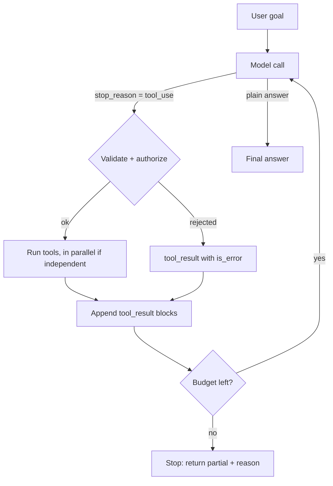

If your orchestration code contains `tool_choice: {"type": "tool", "name": "..."}`, check which model it points at. On Claude Opus 5.5, Sonnet 5.5, Fable 5.1 and Mythos 5.1, that request returns a 400.

Forced tool use was the cheapest trick for keeping a model on rails: "you will call `route_ticket`, no chatting." It's gone on the newest tier. What replaces it says a lot about where tool calling is heading, and it's a good excuse to look at the loop underneath all of this.

## Part A: This week's big model/feature change

### What changed

The [Claude Platform release notes](https://platform.claude.com/docs/en/release-notes/overview) list the same break on two launches: Opus 5.5 (September 22) and Sonnet 5.5 (September 28). `tool_choice` types `any` and `tool` return a 400. `auto` and `none` still work. The [define-tools docs](https://platform.claude.com/docs/en/agents-and-tools/tool-use/define-tools#forcing-tool-use) point you to `auto` combined with strict tool use, or to structured outputs when you need a fixed JSON response.

The same docs say adaptive thinking alone doesn't block forced calls: Opus 5 and Haiku 5.5 accept them. The restriction is per model, not per feature. And on models that do accept forcing, a forced call skips thinking entirely.

Two nearby changes from the same notes matter for agent builders:

- **Haiku 5.5 (October 7)** has adaptive thinking on by default, and manual `budget_tokens`, `temperature`, `top_p`, `top_k` and prefill all return 400. Code ported from Haiku 4.5 will break in several places at once.
- **Inline tools (beta, from September 22):** a `tool_addition` block in a mid-conversation system message adds or upgrades a tool without touching `tools` or invalidating the prompt cache. I haven't tested this, so treat the cache claim as the vendor's.

### How the replacement works

Strict tool use (`strict: true` on the tool definition) uses grammar-constrained sampling. The tool's `input` is guaranteed to match your JSON schema, and the tool `name` is always one you provided. It uses the same pipeline as structured outputs, and the compiled schemas are cached for up to 24 hours.

Notice what's guaranteed and what isn't. Strict mode guarantees that *if* the model calls a tool, the arguments are well-formed. It does not guarantee the model calls a tool at all. Forcing guaranteed the reverse: a call happened, whatever the arguments were (unless you also had strict on).

So you've lost a guarantee about control flow and gained one about data shape. Your loop has to pick up the first.

### Architectural implications

If you forced a tool to get structured output, use the structured outputs feature instead. That's what it's for, and it doesn't pretend to be an action.

If you forced a tool to make a routing or classification step deterministic, the model is now free to answer in prose. Your loop must treat "no tool call" as a legitimate outcome and decide what to do. Retrying with a nudge in the user message is the documented path ("use the get_weather tool in your response"), but a retry cap and a fallback belong in code.

Also note a cost detail from the docs: changing `tool_choice` invalidates cached message blocks, while tool definitions and system prompts stay cached. If you toggled `tool_choice` per step in a long loop, you were paying for reprocessing. Moving to a constant `auto` is a quiet win.

### What to verify before trusting the claims

- Run your eval set with forcing removed. Measure the rate at which the model answers without calling the tool, per prompt class. The docs say prompting "still influences which tool `auto` picks"; they don't give you a number.
- Check strict-mode schema limits. Not every JSON Schema feature is supported; the docs link a limitations list. Complex schemas with recursion or heavy `anyOf` are the usual casualties.
- Confirm thinking behaviour in your traces. Forced calls skipped thinking; `auto` calls won't, so latency and token spend per step will shift.
- Re-test on every provider route. The release notes already show differences between the Claude API, Bedrock and Google Cloud (computer-use tool versions, structured outputs on Bedrock for Haiku 5.5).

## Part B: Agentic pattern of the week: the agent loop and tool calling

### The problem

A model can emit text. It can't read your database. The loop is the mechanism that lets it ask for things and see the answers.

### The pattern

The loop is smaller than most frameworks make it look:

1. Send messages and tool definitions.
2. If the response's `stop_reason` is `tool_use`, run each requested tool.
3. Append one user message containing the `tool_result` blocks, then call the model again.
4. Stop when the model answers without a tool call, or when your budget says stop.

Details from the [handle-tool-calls docs](https://platform.claude.com/docs/en/agents-and-tools/tool-use/handle-tool-calls) that bite in practice:

- `tool_result` blocks must come first in the user message; text goes after. Text before a result is a 400.
- Results must immediately follow the assistant message that requested them. No messages in between.
- Tool failures go back as `is_error: true` with an instructive message ("rate limit, retry after 60 seconds"), not a bare "failed". The model reads it and adapts.
- Tool results are untrusted input. Keep them inside `tool_result` blocks, not in the system prompt.

### Trade-offs

- **Simplicity vs control.** The SDK's tool runner owns the loop for you. That's right until you need per-call authorization, step budgets or checkpointing, at which point you write the loop yourself. It's 40 lines; don't let that decision scare you.
- **Tool count vs accuracy.** The docs recommend fewer, broader tools with an `action` parameter and service-prefixed names. More tools means more selection ambiguity and more prompt tokens.
- **Descriptions are the real interface.** The docs call detailed descriptions "by far the most important factor". Treat them as code: review them and test them.

### Failure modes

- **Silent non-call.** Now that you can't force, the model answers in prose when you expected an action. Detect it by checking the response for the expected tool, not just for a tool.
- **Runaway loops.** Nothing in the protocol stops a model from calling tools forever. Cap steps, cap tokens, cap wall-clock, and return a partial result with the reason.
- **Retry storms.** A strict schema removes malformed arguments, but a tool that keeps failing for real reasons gets retried anyway. Count consecutive errors per tool.
- **Bloated results.** A 50 KB tool result goes into every later call. Return identifiers and the few fields the model needs.
- **Side effects on retry.** Network failure after a write means the model may call the tool again. Make mutating tools idempotent or key them by a request id.

### When NOT to use it

If the steps are known in advance, write a workflow and call the model at the points that need judgment. A loop adds variance, cost and an unbounded tail. It earns its place when the next step genuinely depends on what the last tool returned. (Next week's topic is exactly this boundary.)

### Try it in 10 minutes

Write the loop without a framework against any model that supports tools:

1. Define two tools with `strict: true`: `lookup_order(order_id: string)` and `refund(order_id: string, amount: number)`.
2. Make `lookup_order` fail with `is_error: true` and an instructive message on the first call.
3. Add a step cap of 6 and a rule that `refund` needs your code's approval, not the model's.
4. Ask for a refund on a missing order id. Watch what the model does after the error, and what happens when it has nothing left to try.
5. Add a "no tool call when one was expected" counter and log it. That number is the one forced tool use used to hide.

Done beats perfect here: a loop that stops cleanly after six steps teaches more than a clever one that never gets finished.
