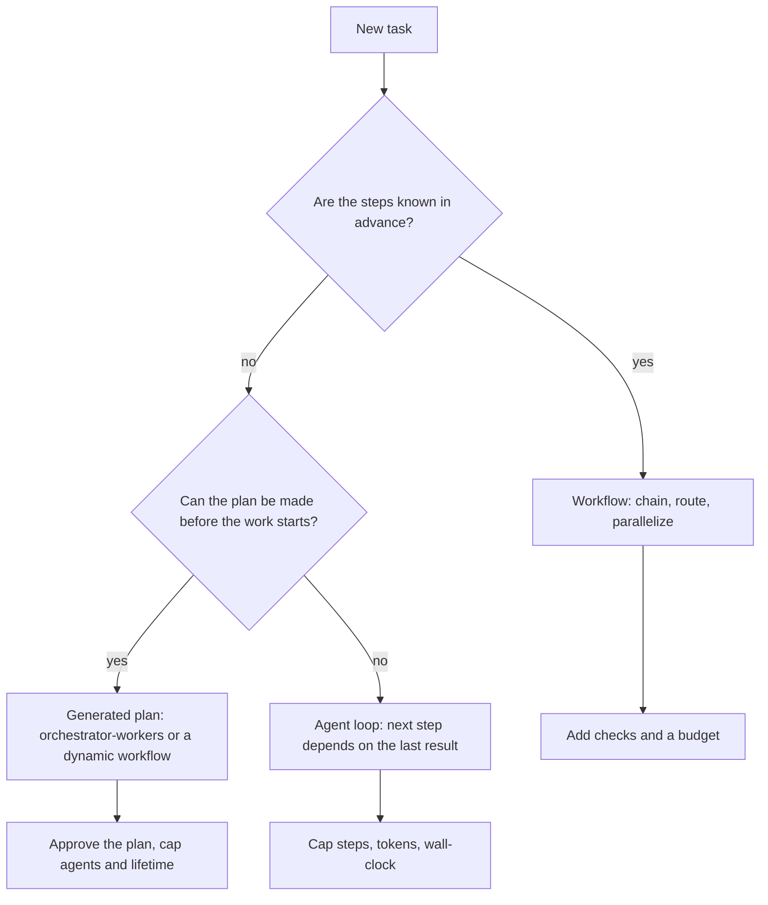

Here's a question that sounds like a typo until you think about it: who owns the control flow when the model writes it?

For two years the line was clean. A workflow is orchestration code you wrote, with model calls at fixed points. An agent is a loop where the model picks the next step. On October 9, Anthropic's Managed Agents added something in between: the agent writes a *program* that runs other agents, and the server executes it in the background.

It's a small beta feature with a big consequence for how you draw that line.

## Part A: This week's big model/feature change

### What changed

The [October 9 release note](https://platform.claude.com/docs/en/release-notes/overview) introduces **dynamic workflows** for Managed Agents (beta, header `managed-agents-2026-04-01`). You turn it on with a `workflows` setting inside the agent's `multiagent` block. The release note's example uses `"multiagent": {"type": "multiagent_20261001", "workflows": {"type": "enabled"}}`. A search for that version string in the docs didn't turn up a match for me, so copy the exact form from the API reference rather than from here.

The [workflow runs docs](https://platform.claude.com/docs/en/managed-agents/workflow-runs) describe the mechanics:

- The agent writes a workflow for the work you describe, then starts a **run** in the same turn. A run is split into named **phases**; each agent in a phase works in its own session thread.
- The program can fan out many agents, pass one agent's result to another, loop (the docs' example: revise a draft until a review passes or the rounds run out), and branch on what came back.
- An agent's result goes **to the program**, not back to the agent you're chatting with. The program decides who runs next and writes their prompts.
- When a run ends, the primary agent gets a turn to read what happened and answer you.

### The numbers the docs give

| Limit | Value |
|---|---|
| Threads working at once in one run | 64 (not guaranteed by the API) |
| Agents a workflow starts over a run's life | 1,000, then `thread_limit_error` |
| Run lifetime | 24 hours by default |
| Runs open at once per session | 10 by default |

Runs don't nest: only the primary thread starts runs. You follow progress through `workflow_run.*` events on the session's event stream, and those events don't trigger webhooks.

### Architectural implications

This is the old orchestrator-workers pattern with one change: the orchestrator is *code the model generated*, not a model re-deciding at every turn. That buys you things a loop can't give you cheaply. Fan-out to hundreds of workers doesn't pass through one context window. Intermediate results never bloat the primary conversation. The shape of the work (phases) is visible in events.

It also moves risk. Three details from the docs are worth designing around:

- **No approval step.** The run starts in the same turn the workflow is written. If you want a plan reviewed first, you have to instruct the agent to describe the run and wait. Otherwise your control is stopping a run that's already going.
- **You don't see the code.** You can ask the agent for the workflow, but you don't see the program, the tool calls that manage runs, or the result each thread returns to it. Your audit trail is phase events plus whatever the agent reports.
- **Handled failures still say "completed".** A failed agent is usually retried once on a new thread. If the program handles a second failure, the run can end `completed`. Tell the primary agent to report what failed, and don't read `completed` as "everything worked".

### What to verify before trusting the claims

- **Cost.** A run counts against your existing rate limits and the session budget, and a budget pause makes a run idle while its lifetime keeps ticking (it can end in `timeout_error`). Price a run at 1,000 agents before you let one start.
- **Plan quality.** Nothing in the docs says how good model-written workflows are at splitting work. Run the same task ten times and compare the phase structures, not only the answers.
- **Variance.** A hand-written pipeline is the same every time. A generated one may not be. That matters if you ever need to reproduce a result for an auditor.
- **Third-party descriptions.** One blog post describes this as the plan "written up front" versus subagents choosing each step. That's a fair summary, but check claims like it against the official page.

## Part B: Agentic pattern of the week: workflows vs agents

### The problem

Every agent project starts with the same temptation: give the model tools and a goal and let it run. Sometimes that's right. Often it's a pipeline wearing a trench coat.

### The pattern

Anthropic's [Building effective agents](https://www.anthropic.com/engineering/building-effective-agents) draws the line this way: workflows are systems where LLMs and tools follow predefined code paths; agents are systems where the LLM directs its own process and tool use. Its advice is to use the simplest thing that works, because agentic systems trade latency and cost for performance.

The same piece lists the workflow shapes, which are the vocabulary you need:

- **Prompt chaining:** fixed sequential calls, optional checks between them.
- **Routing:** classify, then send to a specialised prompt or cheaper model.
- **Parallelization:** sectioning (split the work) or voting (repeat the work).
- **Orchestrator-workers:** a model decides the subtasks at runtime.
- **Evaluator-optimizer:** one model generates, another critiques, in a loop.

The middle branch is the new one. "The plan can be made before the work starts" covers a lot of real jobs: review 400 contracts, migrate 80 services, classify a backlog. The steps aren't known when *you* write the code, but they are known once the model has seen the task.

### Trade-offs

- **Workflow:** cheapest, most predictable, easiest to test. You pay in engineering time and in every case you didn't anticipate.
- **Agent loop:** handles surprises. You pay in cost, latency and an unbounded tail, and errors compound.
- **Generated plan:** big fan-out, flexible shape. You pay in reduced visibility and in having to trust a plan you didn't write.

A reasonable rule: the more irreversible the side effects, the further left on that spectrum you want to be.

### Failure modes

- **Agent-shaped pipelines.** The task has four fixed steps, but it's built as a loop. Symptom: the traces look nearly identical across runs, and you're paying for the model to rediscover them.
- **Pipeline-shaped agents.** The workflow has 30 branches for edge cases and keeps growing. Symptom: every incident adds an `if`.
- **Unreviewed generated plans.** The plan fans out wide, one phase misreads the task, and every worker does the wrong thing at scale.
- **Success theatre.** The orchestrator swallows failures and reports a clean finish.
- **Frameworks hiding the prompts.** The Anthropic piece warns that frameworks can obscure the underlying prompts and responses and make debugging harder. A generated workflow adds a second layer of the same problem.

### When NOT to use it

If you can write the steps down on a whiteboard in five minutes, write them as code. Dynamic workflows fit work that is large, parallel and shaped by the input. They're a poor fit for anything where one wrong early step is expensive to undo, or where you must show an auditor exactly what ran.

### Try it in 10 minutes

You don't need the beta for this; it's a design exercise.

1. Pick one real task you'd hand to an agent, such as triaging support tickets or reviewing pull requests.
2. Write every step as one line. Mark each "fixed" (same every time) or "judgment" (depends on content).
3. Circle the judgment steps. If there are none, you have a workflow. If there are one or two, you have a workflow with a model call at those points.
4. If the judgment steps decide *what the next steps are*, ask: could the plan be produced up front, and could a person approve it? If yes, you're in generated-plan territory.
5. For that case, write down the three caps you'd set: agents, wall-clock, spend. If you can't name them, you're not ready to run it.

If your answer to step 3 is "workflow", that's a good result. Boring and predictable is a feature, and you can come back for the agent later, or never.
