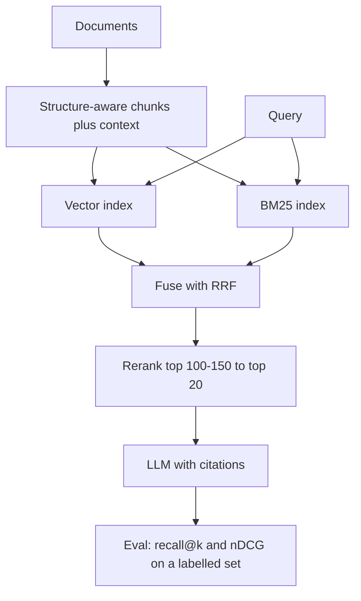

Here is a request shape that worked last month and may return a 400 after your next SDK upgrade: a `text` block in a *user* message carrying a non-empty `citations` array, copied straight from a previous answer.

RAG code does this more often than you'd think, because it replays retrieved chunks with their citation metadata attached. Today's news is small and practical. Then we spend the rest of the post on the thing that actually decides whether your answers are any good: retrieval.

## Part A: This week's big model/feature change

Vendor note: Anthropic has had the last two Monday slots. I'm using it a third time because the alternatives this week are thin. OpenAI's parallel agents for GPT-6 Pro in ChatGPT (October 16) reaches me only through secondary coverage, with no published agent limit, latency or quality numbers. The Kimi and Qwen releases don't change how you build retrieval. This one is documented, dated, and breaks real code.

### What changed

The [Claude API release notes](https://platform.claude.com/docs/en/release-notes/overview) show two items worth your attention:

- **October 21:** API version `2026-10-21`, with SDKs defaulting to it (Python 2.0.0, TypeScript 1.0.0, Go 2.0.0, Java 3.0.0 and others). The SDKs and the `ant` CLI also moved from MIT to Apache 2.0.
- **October 22:** Claude Models on Google Cloud (Anthropic managed), launched as the Claude API operated by Anthropic and reached through your Google Cloud project. Google Cloud IAM controls access and Google Cloud Marketplace handles billing.

### The breaking changes that touch RAG

The [migration guide](https://platform.claude.com/docs/en/api/migration-2026-10-21) lists three request changes for the Messages API, token counting and batches:

- A `text` block with non-empty `citations` in a **user** message returns a 400. That includes text inside `search_result` blocks. Citations on assistant messages you send back still work, and so does `"citations": {"enabled": true}` on documents and search results.
- A `document` block placed directly in an **assistant** message returns a 400. Send documents in user messages.
- `temperature`, `top_p` and `top_k` return a 400 even at default values. On models that accept other values, such as Claude Sonnet 4.6, a request that lowered temperature for consistency loses that effect, and the guide says no other setting replaces it. Keep those requests on `2023-06-01` if you rely on it.

You can pin the old version with the `anthropic-version` header. That's a reasonable move for a week, not a plan.

### The Google Cloud offering, for architects

This is a second Google Cloud route, separate from Google-managed Claude. Per the [docs](https://platform.claude.com/docs/en/build-with-claude/claude-models-on-google-cloud/anthropic-managed):

- Setup creates a **new Anthropic organization** for the project. API keys, workspaces and console settings don't carry over, and a ZDR arrangement elsewhere doesn't carry over either.
- Authentication is Google Cloud credentials only. API keys aren't supported.
- Anthropic is the data processor, and some supporting services such as trust and safety systems process data outside Google Cloud. Leave the location at `global` and set `inference_geo: "us"` per request for US-only inference.
- Supported: web search and fetch, code execution, the memory tool, MCP connector, Files API, prompt caching, batches, CMEK with Cloud KMS, and Managed Agents. Not supported: MCP tunnels and the pre-built self-hosted sandbox workers.
- One detail for your security review: running Managed Agents sessions and scheduled deployments keep running after you revoke the creator's access. Interrupt or archive them yourself.

What to verify: your own residency and data-processor language against that "supporting services outside Google Cloud" line, and your rate limits, which Anthropic manages.

## Part B: Building block of the week: retrieval and RAG design

### The problem

The model only knows what's in the prompt. Retrieval decides what's in the prompt. Most "the model hallucinated" tickets are retrieval tickets: the right passage was never in the top results, so no prompt rewrite could save it.

Senior teams already know the parts. The design work is choosing the order, the cut-offs and the measurement.

### The pipeline



### Chunking: the cheap decision with the long tail

The standard advice from practitioner guides is 512 to 1,024 tokens with structure-aware boundaries for prose. Treat that as a starting point to test, not a finding: the sources are blog posts, and the best size depends on your documents and queries. Two things hold up across corpora:

- Split on structure (headings, clauses, table rows), not on character counts. A contract clause cut in half retrieves badly and cites worse.
- Keep the heading path with the chunk. Queries often match the section title better than the body.

### Contextual chunks

A chunk that says "revenue grew 3% over the previous quarter" doesn't say which company or quarter. [Anthropic's contextual retrieval](https://www.anthropic.com/news/contextual-retrieval) prepends a short model-written context to each chunk before embedding and BM25 indexing. In their test, measured as failed retrievals in the top 20:

```chart {"title": "Failed retrievals in the top 20 chunks (Anthropic's test)", "type": "bar", "x": ["Embeddings only", "Contextual embeddings", "+ contextual BM25", "+ reranking"], "series": [{"name": "Failed retrievals", "values": [5.7, 3.7, 2.9, 1.9]}], "unit": "%", "xLabel": "Pipeline", "yLabel": "Failed retrieval rate", "note": "Source: Anthropic, Contextual Retrieval. The reductions are 35%, 49% and 67% against the baseline. Reranking started from the top 150. Vendor-run numbers on their own datasets: re-measure on yours."}
```

The cost is a one-time preprocessing pass, which Anthropic puts at $1.02 per million document tokens, assuming 800-token chunks, 8k-token documents and prompt caching of the document. Adjust the volume:

```calc {"title": "Contextualising your corpus (one-time)", "inputs": [{"id": "docs", "label": "Corpus size", "min": 1, "max": 5000, "step": 1, "value": 200, "unit": "M tokens"}, {"id": "rate", "label": "Cost per million document tokens", "min": 0.5, "max": 5, "step": 0.01, "value": 1.02, "unit": "$"}], "outputs": [{"label": "One-time cost", "formula": "docs * rate", "decimals": 0, "unit": "$"}], "note": "Rate from Anthropic's Contextual Retrieval post, under its stated assumptions. Re-run when documents change."}
```

The same post makes a point that gets ignored: if your whole knowledge base is under about 200,000 tokens, skip RAG, put it in the prompt and cache it.

### Hybrid search and RRF

Dense vectors catch meaning and miss exact identifiers: part numbers, clause IDs, error codes. BM25 does the opposite. Run both and fuse.

The scores can't be compared directly (BM25 has no upper bound; cosine does), so fuse ranks instead. Reciprocal rank fusion gives each document `1/(rank + k)` per list and sums them. [Azure AI Search's docs](https://learn.microsoft.com/en-us/azure/search/hybrid-search-ranking) describe it with k=60, and note that semantic ranking runs after RRF.

### Reranking

Retrieve wide, rerank narrow. Anthropic's test started from 150 candidates and kept 20 for the model. A cross-encoder reranker reads query and passage together, which is why it beats the embedding distance but costs latency per candidate. Practitioner guides quote roughly 50 ms and a fraction of a cent per query for rerank-v3.5 class models; I'd treat that as a number to measure on your traffic.

### How it's done now

In 2023 most teams embedded fixed 500-token chunks and took the top 5. Most production systems now run hybrid retrieval with a reranker and structured chunks, and a growing share let an agent issue several queries instead of one. That last step is the unproven part: [AgenticRAGTracer](https://arxiv.org/abs/2602.19127) (February 2026, 1,305 data points) reports GPT-5 at 22.6% exact match on its hardest subset, with failures driven by reasoning chains that stop too early or wander too far. Multi-step retrieval is useful for multi-hop questions and compounds errors. Use it where single-shot demonstrably fails.

### Where plain RAG fails

- **Multi-hop:** the answer needs fact A to find fact B. One query can't do it.
- **Aggregation:** "how many contracts renew in Q1?" is a query over structured data, not a passage lookup. Use SQL or a table.
- **Freshness:** an index that is a day stale answers confidently with last week's policy.
- **Permissions:** a retrieved chunk the user shouldn't see is a leak. Filter at query time, not in the prompt (week 10 covers this properly).

### When NOT to use it

Small corpus: cache it. Questions that are really database queries: write SQL. Anything where a wrong cited answer is worse than no answer: add an abstain path before adding more retrieval.

### Try it in 10 minutes

Write 20 real questions with the one document each should find, then measure recall@5 for vector only, BM25 only and fused. Fusion in Python:

```python
from collections import defaultdict

def rrf(rankings, k=60):
    scores = defaultdict(float)
    for ranking in rankings:            # each is a list of doc ids, best first
        for rank, doc in enumerate(ranking, start=1):
            scores[doc] += 1.0 / (rank + k)
    return sorted(scores, key=scores.get, reverse=True)

def recall_at_k(results, gold, k=5):
    hits = sum(1 for q, doc in gold.items() if doc in results[q][:k])
    return hits / len(gold)

# results = {query: rrf([vector_hits[query], bm25_hits[query]])}
```

Look at the questions the fused run still misses. Those misses, not a leaderboard, tell you whether to change chunking, add context or add a reranker.

```quiz {"title": "Check yourself", "questions": [{"q": "A request that worked on API version 2023-06-01 now returns a 400 on 2026-10-21 and sends retrieved chunks back with citations. What is the likely cause?", "a": "A text block in a user message carries a non-empty citations array. Remove citations from user-message text blocks, including inside search_result blocks; citations on assistant messages and citations.enabled still work."}, {"q": "Why fuse BM25 and vector results by rank instead of by score?", "a": "BM25 scores have no upper bound and cosine scores sit in a narrow range, so they aren't comparable. RRF uses only positions: 1/(rank + k) per list, summed, with k=60 in Azure's docs."}, {"q": "In Anthropic's test, what did reranking add on top of contextual embeddings plus BM25?", "a": "Failed top-20 retrievals went from 2.9% to 1.9% (a 67% reduction against the 5.7% baseline), reranking from the top 150. Vendor-run numbers on their datasets, so re-measure."}, {"q": "Name two question types where plain RAG is the wrong tool.", "a": "Aggregation (use SQL or a table) and multi-hop questions (need iterative retrieval, with its compounding errors). Also very small corpora, which can sit in a cached prompt."}]}
```

If you only do one thing this week, build the 20-question set. It costs an hour, and every retrieval argument after it gets shorter.
