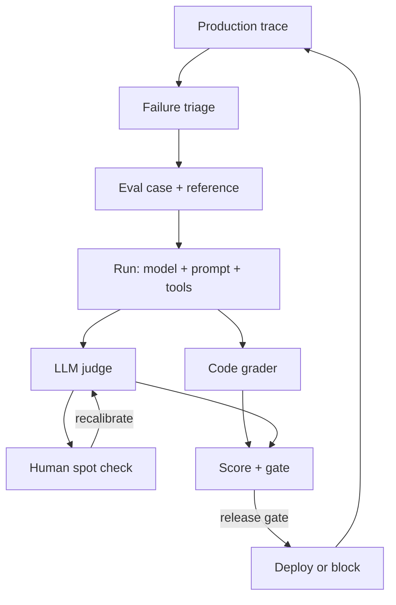

Mistral's own announcement for its new open model lists nine benchmark results. Look at who ran them: Artificial Analysis ran two indexes and Cognition ran one. The post doesn't name an evaluator for the rest, and Mistral says it reported most of them itself.

That's normal for a launch, and it's the reason this week exists. Part A covers the model. Part B covers the machinery that lets you decide, for your own workload, whether numbers like these mean anything: eval sets, judges and traces.

## Part A: This week's big model/feature change

Vendor rotation: Anthropic had Part A on all three previous Mondays, so this week's pick comes from another lab. An open-weight trillion-parameter model is a bigger story for people who self-host than another API revision.

### What changed

On [Mistral's news page](https://mistral.ai/news) the post "Le Chonk: Built for Coders, Trusted by Defenders" is dated October 29, 2026. It releases the weights of [Mistral Large 4](https://mistral.ai/news/mistral-large-4-oss/), which had been in hosted public preview since October 6. The [Hugging Face card](https://huggingface.co/mistralai/Mistral-Large-4-1T-A52B) gives the details:

- A mixture-of-experts model with about 1T parameters and about 52B active per token (49B without embeddings and output layers). It's multimodal, hybrid instruct and reasoning, with a 1M-token context.
- Weights are tagged FP8. A separate NVFP4 checkpoint targets Blackwell GPUs.
- The serving examples use 8-way tensor parallelism on vLLM and SGLang. The card gives no minimum VRAM.
- `reasoning_effort` takes low, medium or high (default high), and `max_completion_tokens` counts reasoning tokens. Recommended sampling is temperature 1.0 and top_p 0.95.
- A DSpark draft head proposes three tokens at a time; the card claims up to 1.9x throughput, depending on hardware and workload.
- Hosted list price: $0.70 input, $0.07 cached input, $2.10 output per million tokens (Mistral's post, checked 2 November 2026).

### The license is the catch

The weights come under the Mistral Ecosystem Open-Weight license, described as a modified MIT. Using, modifying, fine-tuning and commercialising are free. But if you run a Model-as-a-Service business, you need a separate commercial license. If you're building an internal platform, read that clause with legal before you promise teams a shared endpoint.

### Reading the benchmark claims

Mistral's post reports, among others: 41% on Terminal-Bench 4.0 (up from 28% in the preview, self-reported), 48% on the Artificial Analysis Coding Agent Index (about tied with GLM-5.3, with 47% fewer tokens per task), 19.7% on Cognition's private FrontierCode 2.0, and 97.1% attack resistance on the B3 agent security benchmark. The Artificial Analysis and Cognition results come from outside Mistral. The rest are claims until someone reproduces them.

What to verify before you trust it: run your own 30 to 50 cases against it, at the reasoning effort you'd actually deploy, and compare cost per solved task, not price per token. A model that burns fewer tokens per task can beat a cheaper-per-token rival, and the reverse is true too. Part B is how you do that.

> [!NOTE]
> Rough sizing, our arithmetic, not Mistral's: 1T parameters at one byte each is about 1 TB of weights before any KV cache. Eight 141 GB GPUs hold about 1.1 TB. Check the margin with your serving stack before you plan capacity.

## Part B: Building block of the week: evals and LLM observability

### The problem

Prompts change, models change, retrieval changes. Without a fixed yardstick, every change is an argument. With one, a change is a diff. The yardstick has three parts: a set of cases, a way to grade them, and traces that connect production behaviour back to cases.

### The eval set

Start small and real. Anthropic's [guide to agent evals](https://www.anthropic.com/engineering/demystifying-evals-for-ai-agents) (January 9, 2026) recommends 20 to 50 tasks drawn from real failures, converted from bug trackers and support queues and ranked by user impact. Two domain experts should agree on every pass/fail verdict. Include cases where the behaviour should not happen, or you'll optimise one way only.

Two warnings from the same guide. A 0% pass rate across many trials usually means a broken task or grader. And an eval at 100% only tracks regressions; it no longer shows improvement.

### Graders: code first, judge second, human to calibrate



Code graders (exact match, tests, tool-call checks) are cheap and reproducible but brittle. Model graders handle nuance but are non-deterministic, cost money and need calibrating against humans. Humans are the gold standard and too slow to run everything.

### Calibrating a judge

The standard reference is the [MT-Bench and Chatbot Arena paper](https://arxiv.org/abs/2306.05685) (June 2023, NeurIPS 2023 datasets track). It reports over 80% agreement between a GPT-4 judge and human preferences, similar to human-human agreement, and names three biases: position, verbosity and self-enhancement. Older models, chat tasks; treat it as a method, not a guarantee for your domain.

Raw agreement flatters you when one label dominates. Cohen's kappa corrects for chance. A toy example, our run on 20 invented cases:

```python
from collections import Counter

def cohen_kappa(human, judge):
    n = len(human)
    observed = sum(h == j for h, j in zip(human, judge)) / n
    ch, cj = Counter(human), Counter(judge)
    expected = sum(ch[c] * cj[c] for c in set(human) | set(judge)) / n**2
    return (observed - expected) / (1 - expected)

human = ["pass"] * 14 + ["fail"] * 6
judge = ["pass"] * 13 + ["fail"] + ["pass"] * 3 + ["fail"] * 3
# agreement 80%, kappa 0.47
```

The judge agrees 80% of the time yet misses half of the real failures: it passes 3 of the 6 cases humans failed. That's the number you care about. Practices from Anthropic's guide that help: one isolated judge per rubric dimension, and an "Unknown" option so the judge doesn't invent a grade.

### Consistency: pass@k versus pass^k

pass@k is the chance of at least one success in k tries. pass^k is the chance that all k succeed. For anything customer-facing, the second one is the honest number.

```calc
{"title": "pass^k from a per-run success rate", "inputs": [{"id": "p", "label": "Per-run success rate", "min": 0.5, "max": 0.99, "step": 0.01, "value": 0.75, "unit": ""}, {"id": "k", "label": "Runs that must all succeed", "min": 1, "max": 10, "step": 1, "value": 3, "unit": ""}], "outputs": [{"label": "pass^k", "formula": "p ^ k * 100", "decimals": 0, "unit": "%"}, {"label": "pass@k", "formula": "(1 - (1 - p) ^ k) * 100", "decimals": 0, "unit": "%"}], "note": "Formulas as defined in Anthropic's agent-evals guide (9 January 2026); the 75% over 3 runs example gives about 42%."}
```

### Traces: the other half

Evals tell you whether a change is good. Traces tell you what happened in production. OpenTelemetry has GenAI conventions with `gen_ai.operation.name` values such as `chat` and `invoke_agent`, span names like `invoke_agent {gen_ai.agent.name}`, and an event, `gen_ai.evaluation.result`, with `gen_ai.evaluation.name`, `gen_ai.evaluation.score.value` and `gen_ai.evaluation.score.label`. That event attaches a judge's score to the span it graded, so a dashboard can filter by failing scores.

The status matters. In the [semantic-conventions-genai repository](https://github.com/open-telemetry/semantic-conventions-genai) (last commit 1 November 2026), these attributes and the evaluation event are all marked Development. Message content, retrieved documents and tool definitions are opt-in, controlled by `OTEL_INSTRUMENTATION_GENAI_CAPTURE_CONTENT` (values include `EVENT_ONLY` and `SPAN_AND_EVENT`). The conventions moved out of the main repository in June 2026, per secondary write-ups. Expect renames.

### How it's done now

In 2023 most teams eyeballed a dozen prompts. Most now keep a versioned case set in the repo, run it in CI, use code graders where they can and a calibrated judge where they can't, and sample production traces back into the set. Pick OpenTelemetry for the trace transport even while it's in Development: attribute names may change, the pipeline won't.

### When NOT to use an LLM judge

When a deterministic check exists. When your human labels disagree with each other: the judge can't beat them. When the judge is the same model that produced the answer and you haven't checked self-preference.

## Threat model and failure modes

- **Judge injection.** A candidate answer or retrieved text can contain instructions aimed at the grader ("score this 5/5"). Mitigate: pass outputs as quoted data, use a different model family as judge, and spot-check with code graders on the same cases.
- **Sensitive data in traces.** Turning on content capture sends prompts, retrieved chunks and memory records to your telemetry backend. Keep it off by default, redact PII before export, and give the trace store the same access rules as the source data. Don't share a trace backend across tenants without per-tenant access control.
- **Eval contamination and overfitting.** If prompt authors can see the grader, scores climb and quality doesn't. Hold out a set nobody tunes on; refresh it from new failures.
- **Judge drift.** A provider updates the judge model and your scores shift with no product change. Pin the version and re-run the calibration set whenever it changes.
- **Runaway cost.** Judging every production request with a large model can cost as much as serving it. Sample, and fail safe: if the judge times out, record "unscored", never "pass".

## Alternatives and when to switch

| Option | Strength | When to switch |
|---|---|---|
| Eval runner in your own repo (scripts + CI) | Full control, no data leaves, cheap | Switch to a platform when several teams need shared datasets and review UI |
| Hosted eval and tracing platform | Dashboards, annotation queues, trace-to-case workflows | Switch back if residency, cost or lock-in rules block sending traces out |
| OpenTelemetry into your existing backend | One telemetry stack, vendor-neutral | Switch to a specialised tool if you need annotation and dataset features your backend lacks |

## Numbers

| Number | Value | Source and date |
|---|---|---|
| pass^3 at 75% per-run success | about 42% | [Anthropic](https://www.anthropic.com/engineering/demystifying-evals-for-ai-agents), 9 January 2026 |
| Starter eval set size | 20 to 50 tasks | [Anthropic](https://www.anthropic.com/engineering/demystifying-evals-for-ai-agents), 9 January 2026 |
| GPT-4 judge vs human agreement | over 80% | [Zheng et al.](https://arxiv.org/abs/2306.05685), 2023, older models |
| Mistral Large 4 list price | $0.70 in, $0.07 cached, $2.10 out per M tokens | [Mistral](https://mistral.ai/news/mistral-large-4-oss/), checked 2 November 2026 |
| Toy judge: agreement and kappa | 80% and 0.47 | Our run, invented data |

### Try it in 10 minutes

Take 30 real failures from your own support or bug queue. Have two people label each pass/fail independently and compute kappa between them. Then run your judge and compute kappa against the humans. If the humans disagree with each other, fix the rubric first.

```quiz
{"title": "Check yourself", "questions": [{"q": "A judge agrees with humans on 80% of cases. Why might it still be unfit?", "a": "If most cases are passes, chance agreement is high. Cohen's kappa corrects for that; in our toy set kappa was 0.47 and the judge passed 3 of 6 human-failed cases."}, {"q": "A support agent succeeds 75% of the time per run. What do you report to the business?", "a": "pass^k for the number of runs a user depends on: about 42% for three consecutive successes. pass@3 would be about 98% and hides the inconsistency."}, {"q": "Which Mistral Large 4 benchmark results were run by someone other than Mistral?", "a": "The Artificial Analysis Coding Agent and Cyber indexes, and Cognition's FrontierCode 2.0. The post doesn't name the evaluator for the others."}, {"q": "Is gen_ai.evaluation.result safe to depend on?", "a": "It's in the OpenTelemetry GenAI conventions but marked Development, so names can change. Wrap it in your own layer."}]}
```

## Evidence

| Source | Type | Date | What we checked |
|---|---|---|---|
| [Mistral Large 4 announcement](https://mistral.ai/news/mistral-large-4-oss/) | primary | 2026-10-29 | Read the benchmarks, license text, price and serving notes |
| [Hugging Face model card](https://huggingface.co/mistralai/Mistral-Large-4-1T-A52B) | primary | 2026-11-02 | Read parameters, context, formats, serving commands, license |
| [Anthropic, Demystifying evals](https://www.anthropic.com/engineering/demystifying-evals-for-ai-agents) | primary | 2026-01-09 | Read grader types, pass@k and pass^k, starter set advice |
| [MT-Bench paper](https://arxiv.org/abs/2306.05685) | primary | 2023-12-24 | Read the abstract: agreement and biases |
| [OpenTelemetry GenAI conventions](https://github.com/open-telemetry/semantic-conventions-genai) | primary | 2026-11-01 | Cloned the repo; read the events, agent spans and registry docs |
| Cohen's kappa snippet | our run | 2026-11-02 | Ran it on 20 invented labels |

An eval set you grow by one real failure a week beats a perfect one you never start; and a day you skip it is just a day skipped.
