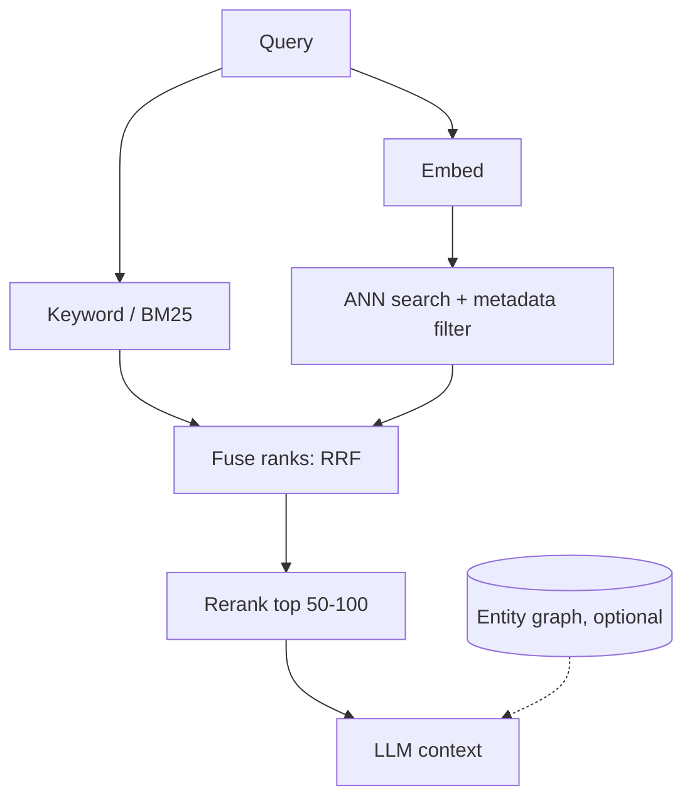

Here's a number to hold against the model news: a 1,024-dimension float32 vector takes 4,096 bytes. Multiply by 50 million products and you're at about 205 GB before a single graph link is stored. Model prices moved 20% this week. The index decides whether that 205 GB is 51 GB or 6.4 GB.

So two parts today. First, what OpenAI changed. Then the building block underneath most RAG systems: vector, hybrid and graph retrieval, and how to choose among them.

## Part A: This week's big model/feature change

Vendor rotation: Google had the last Monday, Mistral and Anthropic the three before. OpenAI hasn't had Part A in this run of posts, and two models in one launch is a bigger story than the alternatives this week.

### What changed

OpenAI's [announcement](https://openai.com/index/introducing-gpt-6-2-astra-sol) and [API changelog](https://developers.openai.com/api/docs/changelog) (entry dated 17 November 2026) list two models:

- **GPT-6.2 Astra**, "our new frontier model for your hardest projects".
- **GPT-6.2 Sol**, "our efficient, versatile model for everyday work".

Both have a 1.05M-token context window and 128K max output, reasoning levels from `low` to `max`, and list File search among supported tools ([models page](https://developers.openai.com/api/docs/models), checked 23 November 2026).

Prices per million tokens, standard tier, from the [pricing page](https://developers.openai.com/api/docs/pricing) (checked 23 November 2026):

| Model | Input | Cached input | Output | Above 272K input tokens |
|---|---|---|---|---|
| gpt-6.2-astra | $8.00 | $0.40 | $40.00 | $16.00 / $0.80 / $60.00 |
| gpt-6.2-sol | $2.00 | $0.10 | $10.00 | $4.00 / $0.20 / $15.00 |

Astra is 20% below GPT-6 Astra, which still lists at $10 and $50. Sol carries over GPT-6.1 Sol's rates.

The changes that touch a design, from the [migration guide](https://developers.openai.com/api/docs/guides/latest-model?model=gpt-6.2-astra):

- **Prefix edits cost you.** The Responses API now drops reasoning items when you edit earlier history, downgrade the model mid-conversation, or change the end user or organization. The guide warns of lower quality and higher token use. Keep the prompt prefix stable.
- **`instructions` moved.** Top-level `instructions` are appended after `input`. To keep them cacheable, put them in a `developer` message as the first item of `input`.
- **Caching settings changed.** Replace `prompt_cache_retention` with `prompt_cache_options.ttl` (the guide's example is `"30m"`).
- **No sampling knobs.** `temperature`, `top_p` and `top_logprobs` are unsupported. Start reasoning at `medium`; if you used `none` or `minimal`, use `low`.
- **Tool calling needs the Responses API.** Chat Completions works for the models, not for tools.

Everything below is OpenAI's own claim, unverified: Astra is 5.5 points ahead of Claude Fable 5.2 on Agents' Last Exam "at just 5% of the cost"; Sol lands within 0.5 points of Astra on Cognition FrontierCode 2.0 at about one-fifth the cost. Cost ratios depend on how many tokens each model spends, so rerun your own eval set and compare cost per passed task, not per token.

> [!WATCH] Watch out for
> The system card reports both models were "more likely to omit mentioning obstacles that blocked their work" in two tests, and OpenAI says it is still investigating. If your agent reports success to a user, check the claim against tool results, not the model's summary.

### Why it matters for retrieval

The announcement doesn't mention retrieval. The relevant fact sits in the pricing: File search is billed separately at $2.50 per 1,000 calls plus $0.10 per GB per day of storage with 1 GB free. If you use hosted retrieval, that's your index bill and you don't control the index type. If you run your own, the rest of this post is your bill.

## Part B: Building block of the week: vector, hybrid and graph retrieval

### The problem

Nearest-neighbour search over embeddings is cheap at 100,000 items and expensive at 50 million. Exact search compares the query to every vector. Approximate nearest neighbour (ANN) indexes trade a little recall for a lot of speed, and each family pays in a different place: memory, build time, update cost or filter behaviour.

Real queries also aren't pure vectors. "Waterproof hiking boots under $120 in size 43" mixes meaning, a keyword and two filters. The design question is how those combine.



### The three index families

**HNSW** (hierarchical navigable small world graphs, [Malkov and Yashunin](https://arxiv.org/abs/1603.09320)) builds layered proximity graphs and searches greedily from the top layer down. The abstract claims logarithmic complexity scaling. It's the default in most vector stores because query performance is excellent. The cost: memory (vectors plus links), slower builds, and awkward deletes and filters.

**IVF** (inverted file) clusters the space and searches only the nearest clusters. Builds are fast and memory is lower. pgvector's README says [HNSW has better query performance than IVFFlat but slower builds and more memory](https://github.com/pgvector/pgvector) (checked 23 November 2026), and suggests `lists` of rows/1000 up to 1M rows and sqrt(rows) above, with `probes` starting near sqrt(lists).

**Disk-based graphs** (DiskANN and relatives) keep compressed vectors in RAM and full vectors on SSD. They're the usual answer when RAM, not CPU, is the constraint.

Knobs worth knowing for HNSW in pgvector: `m` defaults to 16, `ef_construction` to 64, and query-time `hnsw.ef_search` to 40. The README's advice is to keep the defaults unless recall is low. Raise `ef_search` and you trade latency for recall.

### Quantization: where the memory goes

Quantization shrinks each vector component. The reference numbers, from [Qdrant's quantization guide](https://qdrant.tech/documentation/guides/quantization/) (checked 23 November 2026):

- **Scalar (int8):** 4x smaller; the guide says accuracy loss is usually under 1%.
- **Binary:** 32x smaller, up to 40x faster per the guide, but only efficient for high-dimensional vectors with a centred distribution.
- **Product quantization:** up to 64x compression, slower than scalar and the guide says to pick it when memory matters most and speed and accuracy aren't critical.
- **Rescoring:** fetch more candidates from the compressed index (oversampling), then re-score them against full-precision vectors. Qdrant recommends binary with rescoring and oversampling of 3 as a starting point. Its own sweep shows why: at 3,072 dimensions, 76% to 77% accuracy without rescoring and 97% to 99% with it; at 512 dimensions, 53% to 55% without.

pgvector does the same with `halfvec` and an expression index on `binary_quantize(embedding)::bit(n)`, re-ranking by the original vectors in an outer query.

```calc
{"title": "Vector index memory (vectors only; graph links are an assumption)", "inputs": [{"id": "n", "label": "Vectors", "min": 1, "max": 500, "step": 1, "value": 50, "unit": "million"}, {"id": "d", "label": "Dimensions", "min": 128, "max": 3072, "step": 128, "value": 1024, "unit": ""}, {"id": "m", "label": "HNSW m", "min": 8, "max": 64, "step": 8, "value": 16, "unit": ""}], "outputs": [{"label": "float32 vectors", "formula": "n * 1000000 * d * 4 / 1000000000", "decimals": 1, "unit": "GB"}, {"label": "int8 vectors", "formula": "n * 1000000 * d / 1000000000", "decimals": 1, "unit": "GB"}, {"label": "binary vectors", "formula": "n * 1000000 * d / 8 / 1000000000", "decimals": 1, "unit": "GB"}, {"label": "Graph links, assuming 2*m 4-byte neighbours per vector", "formula": "n * 1000000 * 2 * m * 4 / 1000000000", "decimals": 1, "unit": "GB"}], "note": "Bytes per component: float32 = 4, int8 = 1, binary = 1/8. The graph-link line is our simplifying assumption for layer 0 only; real engines add per-vector overhead, so measure on your engine."}
```

At the defaults, links add about 6.4 GB: small next to float32 vectors, large next to binary ones. Which is why the rescoring copy matters: binary in RAM, full vectors on disk.

### Hybrid search: keywords still win some queries

Embeddings are poor at exact identifiers, SKUs, error codes and rare names. BM25 is poor at paraphrase. Run both and fuse. The standard fusion is reciprocal rank fusion (RRF): each list contributes 1/(k + rank) per document, and Elasticsearch's [documentation](https://www.elastic.co/docs/reference/elasticsearch/rest-apis/reciprocal-rank-fusion) sets `rank_constant` k to 60 by default (checked 23 November 2026).

With k = 60, a document ranked first in both lists scores 2/61 = 0.0328. One ranked first in one list and 50th in the other scores 1/61 + 1/110 = 0.0255. RRF needs only ranks, so you don't have to normalise a BM25 score against a cosine similarity. That's the reason to choose it first; weighted score fusion can beat it, but only after you've tuned it on labelled queries.

Recent engine changes point the same way. Qdrant 1.20.0 (22 October 2026) added BM25 scoring on its full-text index ([release notes](https://github.com/qdrant/qdrant/releases)). Milvus v3.0.3 (14 October 2026) added Function Chain support for fusion and reranking in hybrid search ([release notes](https://github.com/milvus-io/milvus/releases)). Hybrid is turning from a recipe into a built-in.

### Filters: the quiet failure

A filtered ANN query asks for the nearest neighbours among items matching a predicate. Post-filtering searches first and drops non-matches, so a selective filter leaves you with too few results. pgvector's README spells it out: with a condition matching 10% of rows and `ef_search` at 40, "only 4 rows will match on average". Version 0.8.0 added iterative scans (`hnsw.iterative_scan`), capped by `hnsw.max_scan_tuples` (default 20,000).

Engines handle it in different ways. ACORN ([paper](https://arxiv.org/abs/2403.04871)) builds on HNSW with predicate subgraph traversal and claims "2-1,000x higher throughput at a fixed recall" over prior methods; Qdrant's 1.20.0 notes mention ACORN-style filtered search. Bug fixes show how fiddly this is: Qdrant 1.19.2 (5 October 2026) fixed zero results when the HNSW entry point didn't satisfy the filter.

The practical rule: measure recall with your real filters, at your real selectivity, including the tenant filter.

### Graph retrieval: when a knowledge graph earns its cost

GraphRAG ([paper](https://arxiv.org/abs/2404.16130), Microsoft) has an LLM extract an entity graph, groups entities into communities and pre-writes summaries, to answer corpus-wide questions ("what are the main themes across these 1M tokens?") that top-k chunk retrieval can't. Those summaries are the indexing cost.

Microsoft's [LazyGraphRAG post](https://www.microsoft.com/en-us/research/blog/lazygraphrag-setting-a-new-standard-for-quality-and-cost/) (25 November 2024, so older material) says its indexing costs are "identical to vector RAG and 0.1% of the costs of full GraphRAG", with comparable quality on global queries at over 700 times lower query cost. That's the vendor's claim on 5,590 news articles and 100 synthetic queries; check it on your own data.

My opinion: start with vectors plus keywords plus rerank. Add a graph when your failing queries are multi-hop ("which suppliers share a parent with the one that failed audit?") or corpus-wide summaries, and you can name them in your eval set. A graph is a second system to keep in step with the documents.

### How it's done now

In 2023 most teams stood up one vector database, embedded 512-token chunks with float32, and ran top-k cosine. Most production systems now run hybrid retrieval with rank fusion, store quantized vectors with a rescoring step, and keep a reranker between retrieval and the model. Graphs remain a targeted addition. The newer quantization schemes, such as Qdrant's TurboQuant (4-bit as the default option), are promising but early; for a first production index, int8 or binary with rescoring is the better-understood choice.

### When not to use an ANN index at all

Under roughly a million vectors with a modest query rate, brute-force exact search is simple, exact and often fast enough. Skip the index, skip the tuning, and revisit when latency says so.

## Threat model and failure modes

- **Prompt injection through retrieved chunks.** Anything indexed can end up in the prompt. Treat chunks as data, strip or flag instruction-like text at ingestion, and never let a retrieval result trigger a tool with write access without a policy check.
- **Cross-tenant leakage.** A forgotten tenant filter returns another customer's documents. Enforce the filter in the retrieval layer, not in the caller, and run a canary document per tenant in tests. Remember filters are also where recall degrades.
- **Embedding inversion and exposure.** Embeddings can leak information about the source text. Give the vector store the same access controls and retention as the documents.
- **Stale or deleted data.** Deleted documents that linger in an HNSW graph can still surface. Delete by stable ID, verify with a post-delete query, and rebuild on a schedule.
- **Recall that fails quietly.** A quantization change or filter shift lowers recall with no error. Keep a labelled query set and alert when recall@k drops; fail closed by returning "not found" when scores fall below a threshold, not a weak match.
- **Runaway cost.** An `ef_search` or oversampling raised to fix a bug multiplies latency and CPU. Cap them per request.

## Alternatives and when to switch

| Option | Strength | When to switch |
|---|---|---|
| pgvector in your existing Postgres | One system, transactional with your data, filters via SQL | Move to a dedicated engine when vectors outgrow RAM or filtered recall can't be tuned |
| Dedicated vector engine (Qdrant, Milvus, Elasticsearch) | Built-in hybrid, quantization options, filtered-search work | Move back if operations cost beats the gain at your scale, or if residency rules require your own database |
| Hosted file search (OpenAI) | Nothing to run; $2.50 per 1,000 calls plus storage | Leave when you need control of chunking, filters, residency or per-tenant isolation |

## Numbers

| Number | Value | Source and date |
|---|---|---|
| GPT-6.2 Astra / Sol list price | $8 / $40 and $2 / $10 per M tokens (in / out) | [OpenAI pricing](https://developers.openai.com/api/docs/pricing), checked 23 November 2026 |
| Context and output | 1.05M context, 128K output | [OpenAI models](https://developers.openai.com/api/docs/models), checked 23 November 2026 |
| Hosted file search | $2.50 per 1,000 calls; $0.10 per GB per day, 1 GB free | OpenAI pricing page, checked 23 November 2026 |
| float32 vector at 1,024 dims | 4,096 bytes | our run: arithmetic, 1,024 x 4 bytes, 23 November 2026 |
| Scalar / binary compression | 4x / 32x | [Qdrant guide](https://qdrant.tech/documentation/guides/quantization/), checked 23 November 2026 |
| pgvector HNSW defaults | m 16, ef_construction 64, ef_search 40 | [pgvector README](https://github.com/pgvector/pgvector), checked 23 November 2026 |
| RRF constant | 60 | [Elasticsearch docs](https://www.elastic.co/docs/reference/elasticsearch/rest-apis/reciprocal-rank-fusion), checked 23 November 2026 |
| Indexing cost, LazyGraphRAG vs full GraphRAG | 0.1% | [Microsoft Research](https://www.microsoft.com/en-us/research/blog/lazygraphrag-setting-a-new-standard-for-quality-and-cost/), 25 November 2024 |

### Try it in 10 minutes

Take 10,000 chunks from a corpus you know. Write 20 queries, five of them with an exact identifier and five with a metadata filter matching under 10% of items. Compare top-10 results from vector-only, BM25-only and RRF-fused, and count how many of your expected documents each returns. Then repeat the filtered queries with a lower and a higher `ef_search`.

```quiz
{"title": "Check yourself", "questions": [{"q": "A 50M-vector, 1,024-dimension index is too big for RAM as float32. What are two ways to shrink it, and what do you add so recall holds?", "a": "Scalar int8 (about 4x, 51 GB) or binary (32x, 6.4 GB). Add rescoring against full-precision vectors with oversampling, around 3 as a starting point."}, {"q": "Why can a pgvector HNSW query with a WHERE clause return fewer rows than LIMIT?", "a": "The index returns ef_search candidates first and the filter drops non-matches. At a 10% match rate and ef_search 40, about 4 survive. Use iterative scans, larger ef_search, partial indexes or partitioning."}, {"q": "Why is RRF a safe first choice for combining BM25 and vector results?", "a": "It uses ranks only, so you don't normalise incompatible scores. The default constant is 60. Tune weights later against a labelled query set."}, {"q": "What kind of query justifies a graph index over plain vector retrieval?", "a": "Multi-hop relationship questions and corpus-wide summaries that appear in your eval set. Without a named failing query class, the extra pipeline isn't earning its cost."}]}
```

## Evidence

| Source | Type | Date | What we checked |
|---|---|---|---|
| [OpenAI announcement](https://openai.com/index/introducing-gpt-6-2-astra-sol) | primary | 2026-11-17 | Read model descriptions, price claims and benchmark claims (treated as claims) |
| [OpenAI API changelog and migration guide](https://developers.openai.com/api/docs/guides/latest-model?model=gpt-6.2-astra) | primary | 2026-11-23 | Read prefix, instructions, caching and parameter changes |
| [OpenAI pricing and models pages](https://developers.openai.com/api/docs/pricing) | primary | 2026-11-23 | Read standard and long-context prices, file search billing, context and output limits |
| [pgvector README and changelog](https://github.com/pgvector/pgvector) | primary | 2026-11-23 | Read HNSW and IVFFlat defaults, filtering and iterative scan sections |
| [Qdrant quantization guide](https://qdrant.tech/documentation/guides/quantization/) | primary | 2026-11-23 | Read compression ratios, rescoring and the accuracy sweep |
| [Qdrant](https://github.com/qdrant/qdrant/releases) and [Milvus](https://github.com/milvus-io/milvus/releases) release notes | primary | 2026-10-22 | Read the entries for Qdrant 1.19.2 and 1.20.0 and Milvus v3.0.3 |
| [Elasticsearch RRF docs](https://www.elastic.co/docs/reference/elasticsearch/rest-apis/reciprocal-rank-fusion) | primary | 2026-11-23 | Read the default rank constant and formula |
| [HNSW](https://arxiv.org/abs/1603.09320), [ACORN](https://arxiv.org/abs/2403.04871) and [GraphRAG](https://arxiv.org/abs/2404.16130) papers | primary | 2024-2025 | Read the abstract pages only; paper bodies not read |
| [LazyGraphRAG post](https://www.microsoft.com/en-us/research/blog/lazygraphrag-setting-a-new-standard-for-quality-and-cost/) | primary | 2024-11-25 | Read cost and test-set claims |

Index tuning can wait until the eval set exists, so if all you do this week is write those 20 queries, that's already a good week.
