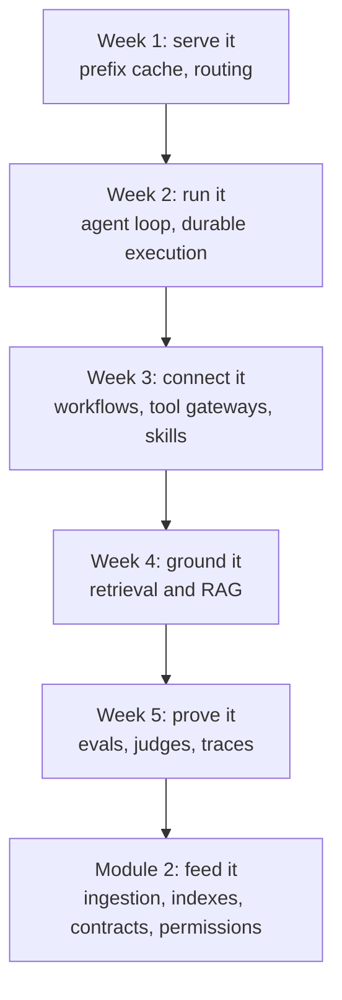

Five weeks of posts, and the pattern only shows when you lay them next to each other. A router that looked fine until the hot set outgrew one pod. A recovery step that helped 11 runs and hurt 2. A stack of RAG upgrades that added a third of what the parts promised. A judge that agreed with humans on the average while being wrong on nearly one verdict in five.

Every one of those is the same mistake: trusting an aggregate that hides the thing you care about. Module 1 was about building agent and LLM apps, but what it really trained is the habit of asking "what would this number look like if the system were broken?"

This page is the map. Nothing new below, only the connections.

```stats
33 | posts across five theme weeks
4 | Lab parts: Step 1, from bigram to ablations
2 | weeks where Monday's vendor news changed an API contract
8 | questions in the self-test below
```

## The module in one picture



## What each week covered

Each list follows the weekly order: Monday building block, Tuesday paper, Wednesday design, Thursday interview, Friday repo, Saturday build, Sunday lab.

### Week 1: serving and prefix caching, durable agents, the agent loop

- [Research: ReCAP, compacting agent memory from attention you already paid for](/deep-dives/research/2026-10-06/)
- [System: your load balancer is quietly deleting your prefix cache](/deep-dives/system/2026-10-07/)
- [Interview: an enterprise assistant for 50,000 employees](/deep-dives/interview/2026-10-08/)
- [GitHub: Google's AX, Kubernetes-style YAML for agents](/deep-dives/github/2026-10-09/)
- [Build: a prefix-aware context broker, or a task runner that can pause](/deep-dives/build/2026-10-10/)
- [Lab: Step 1, part 1, a GPT you can read in one sitting](/deep-dives/lab/2026-10-11/)

### Week 2: the agent loop and tool calling, durable execution, recovery

- [Models: the newest models won't let you force a tool call](/deep-dives/models-agentic/2026-10-12/)
- [Research: your agent's recovery step helps some runs and wrecks others](/deep-dives/research/2026-10-13/)
- [System: an agent that survives a deploy](/deep-dives/system/2026-10-14/)
- [Interview: one customer, three latency budgets, one bill](/deep-dives/interview/2026-10-15/)
- [GitHub: Durable Streams, the agent session as an HTTP log](/deep-dives/github/2026-10-16/)
- [Build: a fork lab that counts rescues and harms, or a session log](/deep-dives/build/2026-10-17/)
- [Lab: Step 1, part 2, the training loop](/deep-dives/lab/2026-10-18/)

### Week 3: workflows versus agents, tool gateways, skill routing

- [Models: the agent that writes its own workflow](/deep-dives/models-agentic/2026-10-19/)
- [Research: skill routing collapse](/deep-dives/research/2026-10-20/)
- [System: one MCP URL for a hundred engineers](/deep-dives/system/2026-10-21/)
- [Interview: 140 tools, one agent, a customer asking for more autonomy](/deep-dives/interview/2026-10-22/)
- [GitHub: context-mode, keeping tool output out of the context window](/deep-dives/github/2026-10-23/)
- [Build: a tool gateway that says no, or a skill router you can measure](/deep-dives/build/2026-10-24/)
- [Lab: Step 1, part 3, scaling a tiny GPT](/deep-dives/lab/2026-10-25/)

### Week 4: retrieval and RAG design

- [Models: your citations code may 400, and how to design retrieval you can defend](/deep-dives/models-agentic/2026-10-26/)
- [Research: three RAG upgrades that should add 47% added 17%](/deep-dives/research/2026-10-27/)
- [System: a knowledge assistant over policies and contracts](/deep-dives/system/2026-10-28/)
- [Interview: your retrieval stopped improving](/deep-dives/interview/2026-10-29/)
- [GitHub: claude-mem, retrieval for an agent's own memory](/deep-dives/github/2026-10-30/)
- [Build: a retrieval harness, or a contract-aware chunker](/deep-dives/build/2026-10-31/)
- [Lab: Step 1, part 4, ablating a small GPT](/deep-dives/lab/2026-11-01/)

### Week 5: evals and LLM observability

- [Models: a trillion-parameter open model lands, and your eval set decides](/deep-dives/models-agentic/2026-11-02/)
- [Research: your judge says 90% sure](/deep-dives/research/2026-11-03/)
- [System: a support copilot a retailer can switch on](/deep-dives/system/2026-11-04/)
- [Interview: a time a green dashboard was wrong](/deep-dives/interview/2026-11-05/)
- [GitHub: FlashProve, a verifier whose exit code 0 is not the verdict](/deep-dives/github/2026-11-06/)
- [Build: an eval harness that audits its own judge, or a trace-to-eval pipeline](/deep-dives/build/2026-11-07/)

Week 1 has no Monday post and week 5 has no Sunday Lab yet: the Lab ladder runs on its own schedule, and Step 1 stays open until its gates pass.

## You can now

- Explain why round-robin across replicas lowers a prefix cache's hit rate, and say when prefix-aware routing is worth its complexity (when the shared prefix set outgrows one pod's cache).
- Put every model and tool call of a long-running agent inside a durable activity, and plan Continue-As-New before the 51,200-event history limit.
- Design the loop for models that no longer accept a forced tool call: `auto`, strict tool use, and caps on steps, tokens and time.
- Judge a recovery step per run (rescue, harm, unchanged) instead of by the average.
- Put a gateway between agents and tools with per-identity listing, deny-by-default calls and an audit log, and preselect a handful of skills once a catalogue passes about 100.
- Choose workflow or agent by one test: are the steps known in advance?
- Choose chunking, hybrid search with reciprocal rank fusion and a reranker for a given corpus, and measure recall@k on a labelled set before tuning.
- Spot where plain RAG fails: multi-hop questions, counts and aggregations, and stale data.
- Calibrate an LLM judge on a small set of human labels, report its true positive and true negative rates separately, and know that a calibration map from another domain can make it worse.
- Set release gates on a lower confidence bound, not on the headline pass rate.

## Self-test

Answer out loud first. The answers are folded in the quiz.

```quiz
{
 "title": "Module 1 self-test",
 "questions": [
  {
   "q": "Why does adding replicas behind a round-robin balancer lower a vLLM fleet's prefix cache hit rate, and what changes it?",
   "a": "Every replica ends up caching the same hot prefixes, so each pod's cache is spent duplicating the others and the fleet holds fewer distinct prefixes. Prefix-aware routing sends a prefix to the pod that already holds it. It pays off when the hot set outgrows one pod's cache; measure your shared-prefix ratio first."
  },
  {
   "q": "A Temporal workflow runs an agent loop at about six events per turn. Roughly how many turns fit before the history limit, and what do you do about it?",
   "a": "51,200 events at six per turn is about 8,500 turns. Plan Continue-As-New well before that, carrying forward only the state the next run needs."
  },
  {
   "q": "Your model API now returns a 400 for a forced tool call. What does the loop guarantee instead, and what must it handle?",
   "a": "With auto plus strict tool use you get well-formed arguments when a call happens, not a guarantee that one happens. The loop must handle the no-call case and cap steps, tokens and wall-clock time."
  },
  {
   "q": "A gateway lists 140 tools and the agent is getting worse. Name two fixes that do not involve a bigger model.",
   "a": "Hide tools per identity and per task so only a handful are in context (deferred loading with tool search), and turn the fixed-order steps into code so the agent only handles the open-ended ones."
  },
  {
   "q": "Three RAG upgrades each help alone. What should you expect when you stack them, and what do you test?",
   "a": "Gains shrink. In the 450-configuration study the top three predicted +46.6% NDCG@10 and delivered +17.2%. Test the combination on your own labelled set at your own corpus size, because the best pipeline changed between 5K and 200K documents."
  },
  {
   "q": "One query is asked: how many contracts renew next quarter? Why can top-k retrieval not answer it, and what does?",
   "a": "Top-k shows a sample, not a count (a top-10 list shows 10 of 28 renewals). Aggregation belongs in code over structured metadata, with retrieval used to find and quote the clauses."
  },
  {
   "q": "A judge's pass rate is within 1.4 points of the human rate. Is it ready to gate releases?",
   "a": "Not on that evidence. In the toy set 19% of its individual verdicts were wrong and the errors cancelled in the average. Check true positive and true negative rates separately, with expert-labelled Pass and Fail cases."
  },
  {
   "q": "114 of 120 policy cases pass. What number goes in the release gate?",
   "a": "The lower confidence bound, not 95%. The 95% Wilson lower bound is 89.5%, and that is the figure a gate should compare against its threshold."
  }
 ]
}
```

## Worth revisiting

- **Week 4's retrieval results, once Module 2 lands.** The week-4 numbers came from small or synthetic corpora. Ingestion and index choices in Module 2 will move them, so re-run the retrieval harness after week 8.
- **The judge audit.** The calibration finding (about 16 target-domain labels beat a transferred map) is easy to nod at and easy to skip. It takes an afternoon and decides whether your gate means anything.
- **Lab Step 1.** Four parts are out. If a part's gates still fail on your machine, a rerun costs less than a new topic.

## Next module: data foundations for AI

Module 2 runs weeks 7 to 11:

- **Week 7:** ingestion and document pipelines (insurance claims).
- **Week 8:** vector, hybrid and graph retrieval (product search at 50 million items).
- **Week 9:** data quality, contracts and lineage (text-to-SQL for banking).
- **Week 10:** identity and permission-aware access (HR and legal).
- **Week 11:** context engineering and memory (CRM agent).

What changed in the field during Module 1 that Module 2 should account for, from this module's own Monday posts:

- **API contracts moved under people's code.** One vendor's newest models stopped accepting forced tool calls, and a new API version rejected citations on user-message text blocks. Any ingestion pipeline that replays retrieved chunks into prompts needs a contract test against the provider's current version.
- **Self-reported benchmarks stayed the default.** The trillion-parameter open model released in week 5 arrived with mostly its own scores. A pipeline you build in Module 2 is the thing that lets you measure on your own documents.
- **Agents started writing their own plans.** Dynamic workflows that start up to 1,000 agents raise the data-access question early: whose credentials does each of those agents carry? Week 10 takes that on.

These are proposals only; the curriculum stays as written.

If you read only the self-test and skipped the rest, that still counts. Rest is part of the plan, and Monday will be there.

## Evidence

| Source | Type | Date | What we checked |
|---|---|---|---|
| Weeks 1 to 5 of Deep Dives (33 posts, linked above) | secondary (our posts) | 6 October to 7 November 2026 | Re-read each post's summary and takeaways; every figure here is copied from them, and their own sources are cited there |
| [config/curriculum.yml](https://github.com/VRSupriya/thevoyager.dev/blob/main/config/curriculum.yml) | primary (our syllabus) | 14 November 2026 | Read the Module 1 objectives and the Module 2 weeks and themes |
