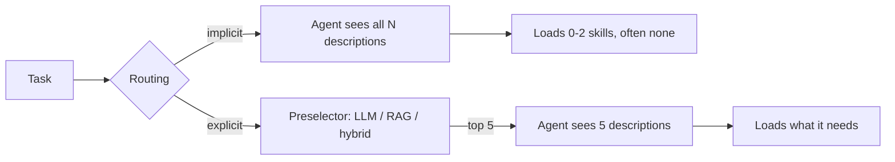

Here's a number that should make you check your agent traces. Take an agent with the right skill installed and add 1,000 irrelevant ones. The share of runs where it loads *no skill at all* goes from 9.3% to 51.6%.

The task pass rate dropped too, but much less than you'd fear. That's the nasty part. A strong model can often muddle through without the skill, so your dashboard stays mostly green while the thing you built, the skill library, quietly stops being used.

A 13 October paper, [Lost in Implicit Routing: How LLM Agents Fail to Load Relevant Skills at Scale](https://arxiv.org/abs/2610.18522) (Liu, Chen, Zhang), puts measurements on this. Code is [on GitHub](https://github.com/jinlinll/lost-in-implicit-routing).

## The setup

Agent Skills use progressive disclosure: the agent sees only each skill's name and description, and opens the full file if it decides the skill is relevant. The authors call that decision *implicit routing*, because it happens inside the normal execution turn with no separate selection step.

They took SkillsBench (82 usable tasks, each with known "golden" skills) and padded the library with sampled distractors from a pool of 20,000+ market skills, at 0, 10, 100, 1,000 and 10,000. Main executors were GLM-5, Kimi K2.5 and MiniMax M2.5, three runs each; Claude Opus 4.6, Gemini 3.1 Pro and GPT-5.4 were checked on a 37-task subset. In total, 15,000+ trajectories.

## What they found

Loaded-skill recall, across the main study:

| Irrelevant skills | Avg. skills loaded | Zero-load runs | Recall |
|---|---|---|---|
| 0 | 1.72 | 9.2% | 73.5% |
| 10 | 1.54 | 13.0% | 67.8% |
| 100 | 1.20 | 27.9% | 52.9% |
| 1,000 | 0.66 | 50.8% | 27.6% |

```chart
{
 "title": "Recall falls as irrelevant skills pile up",
 "type": "line",
 "x": [
  "0",
  "10",
  "100",
  "1,000"
 ],
 "series": [
  {
   "name": "Recall",
   "values": [
    73.5,
    67.8,
    52.9,
    27.6
   ]
  },
  {
   "name": "Zero-load runs",
   "values": [
    9.2,
    13.0,
    27.9,
    50.8
   ]
  }
 ],
 "unit": "%",
 "xLabel": "Irrelevant skills installed",
 "yLabel": "Share of runs",
 "note": "Main study, from the table above (Liu, Chen, Zhang, 2026)."
}
```

Three details change how you'd design around this.

**It's under-loading, not confusion.** Loading a wrong skill happened in only 2.32% of evaluations. Precision when the agent does load stays high (76–89% at 1,000 distractors). The agent isn't picking the wrong tool. It's not reaching for any.

**Recognition isn't the problem.** Ask the same models to choose explicitly from the same library and recall stays at 73.9%. Per model, explicit selection at 1,000 skills ranges from 58% to 83%, against 21–41% implicit.

**The descriptions are the interference.** In a 10-task diagnostic at 1,000 distractors, hiding all distractor metadata lifted recall from 18.6% to 63.9%. Masking only the description field got 63.3%; masking only names got 43.7%. The authors read this as descriptions both advertising a skill and competing with the task for attention. They say that's an interpretation of behaviour, not a measurement of internals.

The frontier models weren't immune. On the 37-task check, Opus 4.6's recall went from 81.3% to 30.9% while its Pass@3 moved only from 64.9% to 62.2%. Small subset, so treat it as a consistency check, not a ranking.

## The mitigation, and what it costs

Don't ask the executing agent to route. Add a **preselector** that narrows the library to at most five skills before execution starts.

- **LLM preselection:** best around 100 skills. Recall 53.3% → 73.0%, Pass@3 49.4% → 54.9%.
- **RAG (embedding top-5):** cheap, but weaker at scale.
- **Hybrid:** an LLM writes several queries, retrieval gathers candidates per query, an LLM makes the final pick. At 10,000 skills: 55.2% recall and 50.4% Pass@3, against 48.5% and 41.5% for plain RAG.

A "plan which skills to use first" prompt helped, but less than preselection (39.9% vs 70.6% recall in the isolated comparison). The authors' reading: routing and task execution compete inside the same response.



Costs the paper reports, with its own caveats: at 1,000 skills, implicit routing used about 1,952k agent input tokens versus 547k total for LLM preselection (routing included). Median routing time rose from 8 to 19 seconds for LLM preselection and 33 to 41 for hybrid, but those came from different time periods, so don't read them as a controlled benchmark. And the preselected set is fixed: skills the agent needs *later* may not be in it.

## What I'd take from it

If you run a skill or tool registry, three design consequences:

1. **Log what was loaded, not just whether the task passed.** Loaded-skill recall and zero-load rate are the metrics here. Pass rate is the lagging one.
2. **Treat description text as a routing surface with a budget.** Every installed skill costs every other skill some attention. Pruning and sharpening descriptions is worth more than adding.
3. **Move selection out of the executing turn once you're past roughly a hundred skills.** That's the paper's threshold, on its benchmark; yours may differ.

Worth checking before you trust it: the executors were open-weight models, the benchmark's golden skills are curated, and real libraries have overlapping skills that make "relevant" fuzzier. The direction is credible; the exact numbers won't transfer.

## The one table worth remembering

Table 7, the diagnostic: original implicit 18.6% recall, plan-first prompt 44.6%, LLM preselection 50.4%, RAG 56.4%, hybrid 61.1%, descriptions masked 63.9%, no extra skills 73.5%. Nothing recovers the clean baseline except removing the clutter, which is the whole point.

## Try it in 10 minutes

Take your agent traces. For 20 tasks where you know which skill or tool should fire, count how often it was actually loaded. Then rerun them with your registry cut to the top five by embedding similarity. If recall moves a lot, you've found your own routing collapse.

Skipping a day of this is fine. The registry will still be there tomorrow, slightly too big, as usual.
