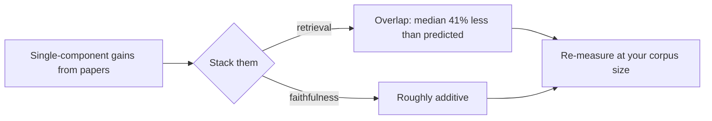

Add a cross-encoder reranker. Turn off MMR diversification. Prefix every chunk with document context. Measured one at a time, each of these lifts NDCG@10 on a typical retrieval benchmark, and together they add up to +46.6%.

Built into one pipeline, the same three techniques gave +17.2%. A 63% shortfall, from changes most teams would approve in a design review without a second thought.

That's the headline of [Retrieval Augmented Generation Compositionality](https://arxiv.org/abs/2610.29722) (Levy, Shlomov and Choshen, IBM and the Weizmann Institute, submitted 21 October 2026). It's this week's most relevant paper for [Monday's retrieval post](/dives/models-agentic/2026-10-26), the freshest on the theme, and it comes with an Apache-2.0 [code release](https://github.com/dolev31/lasagna). I'd rate it as a strong, careful study with a small test bed, and the authors say so themselves.

## What they did

The authors built *lasagna*, an open-source RAG evaluation framework in which every stage (embedding, chunking, index-time enrichment, retrieval, query augmentation, reranking, context compression, agentic quality gate) is a typed, swappable component, with five automated tests that check one stage doesn't leak into another.

They pre-declared three hypotheses, then ran 450 configurations in total: 167 from a D-optimal fractional factorial design (out of 30,720 possible), 138 targeted ablations, and a scaling sweep from 5K to 200K documents. Cost: about $5,200 in cloud compute and 310 wall-clock hours.

The corpus mixes eight benchmarks (BEIR NFCorpus, FiQA, SciFact, ArguAna and HotpotQA for retrieval; SQuAD v2 and MuSiQue for end-to-end) into one shared pool so distractors come from other domains. Faithfulness is scored with RAGAS and a GPT-5.1 judge.

## What they found

Three results, each against a hypothesis.

**Retrieval gains don't add.** The three strongest single techniques (cross-encoder reranking, MMR off, document-aware prefixes) predicted +46.6% over the 0.412 baseline; the combined pipeline reached +17.2%. Across 17 tested combinations the shortfall ran from 7% to 72%, median 41%. The authors' explanation for one pair: reranking already does the filtering job MMR was doing.

**Faithfulness mostly does.** One-factor-at-a-time predicted +28%; the best full pipeline got +32%. And the two metrics barely correlate: pooled Pearson r = -0.01 (p = 0.91). About 5% of configurations had high faithfulness with weak retrieval, 6% the reverse.

**Different knobs matter for each.** For retrieval, embedding (η² = 0.164), enrichment (0.144) and reranking (0.090) carried the variance. For faithfulness it was query augmentation (0.224) and the agentic gate (0.217).

```chart
{
 "title": "Predicted versus realised gain (NDCG@10 and faithfulness)",
 "type": "bar",
 "x": ["Retrieval, top 3", "Faithfulness, best pipeline"],
 "series": [
  {"name": "Predicted from single components", "values": [46.6, 28]},
  {"name": "Realised in the pipeline", "values": [17.2, 32]}
 ],
 "unit": "%",
 "xLabel": "Gain over default pipeline",
 "yLabel": "Relative gain",
 "note": "Source: Levy, Shlomov and Choshen, 2026, Section 5 and D.14. Retrieval baseline NDCG@10 = 0.412."
}
```

## Simple versus heavy, and scale

Four operating profiles on a SQuAD v2, MuSiQue and HotpotQA mixture, three seeds:

| Profile | NDCG@10 | Faithfulness | Mean latency | Joint score (30 s ref.) |
|---|---|---|---|---|
| standard | 0.860 | 0.739 | 5.30 s | 0.523 |
| balanced | 0.840 | 0.911 | 12.25 s | 0.453 |
| max-reliable | 0.804 | 0.916 | 14.16 s | 0.389 |
| speed | 0.541 | 0.524 | 0.70 s | 0.277 |

The "max-reliable" profile adds three agentic verification iterations on top of "balanced" and buys 0.005 faithfulness. It costs about 13% more latency and 4.5% lower NDCG@10, which is the sort of trade a design review should notice. The authors report that on three other benchmarks at 100K to 200K documents, lighter pipelines held similar measured quality at 10 to 20 times lower latency.

Scale reshuffles the order. Standard leads at 5K and 15K documents; balanced leads from 25K. At 200K it is 13.7% better (p = 0.003, three seeds). The 25K and 100K gaps point the same way but are underpowered.



One more data point: GraphRAG variants were dropped from the factorial. In an isolated ablation, NDCG@10 went 0.4780 (no graph, 486 ms), 0.4774 (1 hop, 1,021 ms), 0.4664 (2 hops), 0.4661 (3 hops), and ingestion took about 14 hours per combination. Generation-side effects weren't evaluated, so that's a retrieval-only verdict.

## What the paper claims vs what we checked

| Claim | Paper says | We checked | Reproducible? |
|---|---|---|---|
| Retrieval gains compose sub-additively | +46.6% predicted, +17.2% realised (Section 5, D.14) | Read the text and the README table; the paper's full tables (68) and per-query results were not rerun | Code, but no per-query results yet (README says none are shipped) |
| Faithfulness composes roughly additively | +28% predicted, +32% realised | Read Section 5; the judge is GPT-5.1, and a third judge agreed only at r = 0.44, κ = 0.35 | Code but no data |
| Best pipeline flips with scale | Standard leads at 5K and 15K, balanced from 25K, +13.7% at 200K | Read Section 5 and Appendix A.6; p-value is 0.003 in the text and 0.004 in the appendix, and corpus sizes are six in the text and seven in the appendix | Code but no data |
| Heavy agentic pipelines buy little faithfulness for their latency | 0.005 faithfulness for about 13% more latency, balanced versus max-reliable | Read Table 2 | Code but no data |
| Pre-declared hypotheses | Three hypotheses, one threshold missed (interactions explain under 20% of faithfulness variance) | The five-benchmark H2 test was not run, and the pre-registration was hashed internally, not filed with a registry | Not tried |

The repository shipped on 26 October (a shallow clone shows one commit; licence Apache-2.0). Its own README says it ships no prebuilt index and none of the paper's per-query results yet, so as of 27 October the headline numbers can be checked against the paper but not re-derived from released data. The README does report reproducing BEIR and MTEB numbers for its built-in components on SciFact and NFCorpus, within 0.002 to 0.004 NDCG@10 for most of them.

## What I'd take from it

If you own a RAG stack:

1. **Treat component results as hypotheses about your pipeline.** A paper's +8 points for a reranker was measured with the rest of the stack held at some default. Yours isn't that default.
2. **Measure retrieval and answer quality separately.** They moved independently here. A change that lifts NDCG@10 can leave faithfulness flat, and the reverse.
3. **Re-run your choices at 5x and 10x the corpus.** The leader flipped between 15K and 25K documents on this test bed. Yours may flip elsewhere, or not at all.

The honest limits, from the paper: one constructed English test bed, at most 93 retrieval and 200 generation queries per experiment, the follow-up experiment ran on 43 queries instead of the planned 200, and absolute faithfulness depends on the judge. The direction is believable, and it matches what Anthropic's [stacked contextual-retrieval numbers](/dives/models-agentic/2026-10-26) already hinted at: each added stage buys less than the one before. Don't carry the exact percentages into your business case.

## How it's done now

In 2023 most teams tuned one stage at a time (chunk size, then top-k, then a reranker) and quoted the gain from each. The standard now is hybrid search plus a reranker, with contextual chunks as the newer, cheaper addition. This paper adds the missing discipline: re-measure the whole stack after each change, on a labelled set at your corpus size. Its authors released the harness to help (an Apache-2.0 library with Holm-corrected significance tests in the README demo), but any ablation script on your own queries does the job.

## Threat model and failure modes

- **Leaderboard-driven adoption.** Adding a component because it topped a single-stage benchmark can add latency and cost for little gain, as with the agentic loop here. Fail-safe: require an ablation on your own stack before each addition.
- **Judge bias.** A single LLM judge scores faithfulness; the paper's third judge agreed with the main one at r = 0.44. A change that only your judge likes can ship wrong answers. Use two judges and a human spot check, and treat disagreement as a signal.
- **Tenant leakage in evaluation corpora.** The study mixes eight benchmark corpora so distractors cross domains. The same trick with real tenants' documents in one index can leak data between them. Keep per-tenant indexes or enforce filters at query time, and test the filter.
- **Evaluation data in logs.** Labelled sets built from real traffic contain PII. Redact before storing, and keep eval stores under the same access rules as production.
- **Stale conclusions.** An ablation run at 10K documents can be wrong at 100K. Re-run on a schedule or when the corpus grows by about an order of magnitude.

## Alternatives and when to switch

| Option | What it is | When to switch |
|---|---|---|
| [lasagna](https://github.com/dolev31/lasagna) (Apache-2.0, first release) | Stage-isolated harness with factorial designs and significance tests | You need to defend a stack choice with interaction effects, and can live with a first release |
| FlashRAG and BERGEN | Research toolkits with prebuilt indexes and published-method baselines (per lasagna's README comparison; licences MIT and CC BY-NC-SA 4.0) | You want quick baselines of published methods, and for BERGEN, your use is non-commercial |
| Your own ablation script plus RAGAS-style metrics | Remove one stage at a time on a labelled set | Your team is small, the stack has three or four stages, and a full factorial is overkill |

## Numbers

- +46.6% predicted versus +17.2% realised NDCG@10 for the top three retrieval techniques over a 0.412 baseline ([paper, Section 5](https://arxiv.org/abs/2610.29722), 21 October 2026).
- Median shortfall across 17 combinations: 41% (range 7% to 72%) ([paper, Section D.14](https://arxiv.org/abs/2610.29722), 21 October 2026).
- Faithfulness: +28% predicted, +32% realised; retrieval–faithfulness correlation r = -0.01 ([paper, Section 5](https://arxiv.org/abs/2610.29722), 21 October 2026).
- Balanced versus max-reliable: 0.911 versus 0.916 faithfulness, 12.25 s versus 14.16 s mean latency ([paper, Table 2](https://arxiv.org/abs/2610.29722), 21 October 2026).
- Study cost: about $5,200 and 310 wall-clock hours for 450 configurations ([paper, Section 3](https://arxiv.org/abs/2610.29722), 21 October 2026).

## Try it in 10 minutes

Take your current pipeline and a labelled set of 30 questions. Remove one stage at a time (reranker, then query rewriting, then contextual prefixes) and record recall@10 and answer correctness for each. Then compare the sum of the single-stage gains with the full pipeline's gain over a bare dense retriever. The gap is your own composition shortfall.

```quiz
{
 "title": "Check yourself",
 "questions": [
  {"q": "Why can three techniques that each add 10 to 20 points of NDCG@10 alone add far less together?", "a": "Their gains overlap: they fix the same failures. In the paper, reranking already did much of the filtering that turning MMR off bought, so stacking them realised +17.2% against +46.6% predicted."},
  {"q": "Which metric composed roughly additively in the study, and what does that mean for how you test changes?", "a": "Faithfulness (+28% predicted, +32% realised). Test retrieval changes in the whole pipeline, and don't assume a retrieval gain implies better answers, since the two were uncorrelated (r = -0.01)."},
  {"q": "What would you check before adopting the paper's 'heavier pipeline wins from 25K documents' result?", "a": "Whether it holds on your corpus: the test bed is one English multi-domain set, the 25K and 100K gaps are underpowered, and only the 200K gap (p = 0.003) is clearly significant."}
 ]
}
```

## Evidence

| Source | Type | Date | What we checked |
|---|---|---|---|
| [arXiv 2610.29722, abstract page](https://arxiv.org/abs/2610.29722) | primary | 21 October 2026 | Authors, comments field (103 pages, 68 tables), links to code and project page |
| [arXiv 2610.29722, HTML text](https://arxiv.org/html/2610.29722) | primary | 21 October 2026 | Read the method, Section 5, Table 2, limitations and appendix map; the last third of the appendix text was not read |
| [lasagna repository](https://github.com/dolev31/lasagna) | primary | 26 October 2026 | Cloned it: Apache-2.0 licence, README comparison and reproduction claims, no per-query result files shipped |
| [Monday's retrieval post](/dives/models-agentic/2026-10-26) | secondary | 26 October 2026 | Cross-checked the contextual-retrieval numbers it cites |

Next time a blog post promises a clean +10 points, put it in your own stack first. A day without an experiment loses nothing.
