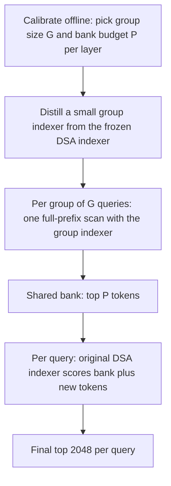

At 128K tokens of context, 54.2% of prefill GPU time on DeepSeek-V3.2 isn't attention. It's the part that decides which tokens attention gets to look at ([paper](https://arxiv.org/abs/2611.12956), Figure 1a).

That's the odd outcome of DeepSeek Sparse Attention (DSA). It made attention cheap by letting each query read only its top 2,048 tokens, then left the selector, the "indexer", scoring the whole prefix for every query. This week's building block is retrieval, and the indexer is retrieval inside the model: a scoring pass, a top-K, and a downstream consumer that only sees what you picked.

This is the queue's pick for the week, not a theme paper: ADIndex (Nanjing University and Alibaba, 7 November 2026) is the most useful recent change to how sparse-attention models are served. It's relevant if you self-host DSA models such as DeepSeek-V3.2 or GLM-5.1, and as a design pattern if you don't.

## What the paper actually is

DSA's indexer sums ReLU-gated dot products from several small indexing heads and keeps the top K=2,048 positions per query. The attention itself then costs O(LK). The indexer stays O(L²) in prefill and O(L) per decoded token.

ADIndex rests on two observations. Neighbouring queries pick heavily overlapping tokens, and how much they overlap varies a lot by layer. Across 128K sequences, the largest union of top-2048 sets for a group of 16 queries ranged from 4,486 to 22,688 tokens by layer. The no-overlap ceiling is 32,768.

So the method is a two-stage retrieve-then-rerank:



The group indexer pools the queries (max, min and mean) and uses one eighth as many heads as the original: 8 on DeepSeek-V3.2 and 4 on GLM-5.1. It's trained with a KL loss against the max-aggregated top-P distribution of the frozen indexer, and only those small layers are trained. Per query, the original indexer then re-scores the bank plus any tokens newer than the group's anchor. If the bank holds all the true top-K tokens, the result is exact. That's a property worth keeping in mind for any candidate pool.

Calibration picks each layer's G from {4, 8, 16} and P from {4K, 8K, 16K} to maximise scoring speedup, subject to the largest observed union fitting in P. It was fitted on 100 sequences of 128K tokens from FineWeb-Edu and Cosmopedia V2.

Try the cost model. It's the paper's Appendix A formula for one 16-query verification round, and it reproduces Table 5(b) exactly (we recomputed 16 entries). It counts scoring operations, not time:

```calc
{
 "title": "Scoring-operation speedup for one 16-query round (paper's cost model)",
 "inputs": [
  {"id": "ctx", "label": "Context (K tokens, 1K = 1,024)", "min": 16, "max": 256, "step": 16, "value": 128, "unit": "K"},
  {"id": "g", "label": "Group size G as a power of 2 (2 = 4, 3 = 8, 4 = 16)", "min": 2, "max": 4, "step": 1, "value": 4, "unit": ""},
  {"id": "bank", "label": "Bank budget P (K tokens)", "min": 4, "max": 16, "step": 4, "value": 8, "unit": "K"}
 ],
 "outputs": [
  {"label": "Scoring speedup vs full scans", "formula": "(16*ctx*1024+120) / ((16/(2^g))*ctx*1024 + 8*(16/(2^g)-1) + 16*bank*1024 + 8*(2^g-1))", "decimals": 2, "unit": "x"}
 ],
 "note": "Appendix A of arXiv 2611.12956. Below the bank budget the method falls back to the original indexer (1.0x). Real kernel speedups are lower than these counts."
}
```

## What they found

```stats
54.2% | of prefill GPU time spent in the indexer at 128K (DeepSeek-V3.2)
6.22x | best prefill indexer kernel speedup at 256K across four configs
1.54x | end-to-end serving speedup at 128K
0.86x | end-to-end at 16K, slower than stock DSA
```

On quality, ADIndex stays close to stock DSA. RULER averages 95.28 and 95.35 against 95.37 and 95.45 on DeepSeek-V3.2 and GLM-5.1. LongBench averages are 56.23 and 56.18 against 56.07 and 56.10. LongBench v2 overall is 52.68 and 53.68 against 51.89 and 53.88.

The comparison that matters is at the longest length, where the other accelerators split from stock DSA:

```chart
{
 "title": "RULER at 128K on DeepSeek-V3.2, by indexer",
 "type": "bar",
 "x": ["DSA (stock)", "ADIndex", "PIVOT", "IndexCache", "MISA", "HISA"],
 "series": [{"name": "RULER 128K", "values": [93.69, 93.34, 92.18, 90.13, 84.93, 47.91]}],
 "unit": "%",
 "xLabel": "Indexer",
 "yLabel": "RULER score at 128K",
 "note": "Source: Table 1 of arXiv 2611.12956 (authors' reproductions of the baselines in SGLang)."
}
```

Look at HISA. Its LongBench average is 56.47, above stock DSA's 56.07, and at 128K its RULER score is 47.91. An average over tasks that mostly don't need the far end of the context won't catch an indexer that drops needles. If you adopt any retrieval shortcut, evaluate it on tasks that need the exact thing you might have dropped.

The ablations hold up. Training the group indexer lifts RULER at 128K by 1.68 points on DeepSeek-V3.2 and 1.10 on GLM-5.1 over using the frozen indexer for the bank. Per-layer configurations reach 1.54x end to end at 128K, against 1.11x and 1.30x for the two uniform settings tried. Head count barely matters: 4 to 64 heads spread the V3.2 average by 0.62 points.

## What the paper claims vs what we checked

| Claim | Paper says | We checked | Reproducible? |
|---|---|---|---|
| Indexer cost | 54.2% of prefill GPU time at 128K | Read Figure 1a and the text; not rerun | no code |
| Quality | RULER within 0.09 and 0.10 points on average; within 0.48 at 128K | Read Table 1 for both models; scores are single numbers, and a search of the PDF text found no seeds or confidence intervals | no code |
| Speed | Up to 6.22x prefill and 3.40x decode kernel at 256K; 1.54x end to end at 128K | Recomputed all 16 Table 5(b) entries from the Appendix A formulas: they match. Measured times (Figure 3) not reproducible here | no code |
| Distillation helps | +0.81 and +0.45 average RULER over the frozen indexer | Read Table 3; the gain is largest at 128K, small at 16K | no code |

All four share one caveat. The baselines are the authors' own reproductions in SGLang, and Appendix C.5 notes settings such as IndexCache running with `index_topk_freq=4` and no calibration. A different baseline configuration could move the ranking in the middle of the chart.

## What to do with it

If you consume DSA models through an API, nothing: the provider owns this. If you self-host DeepSeek-V3.2 or GLM-5.1 for long prompts (agents carrying 100K+ tokens of history), indexing is probably the first thing to profile. Prefill at 128K is where the paper's gain is.

Three design lessons carry beyond this paper:

- **Candidate coverage is the quality knob.** Exactness depends on the shared bank containing the true top-K. The paper measures coverage directly (Figure 4 and Appendix B.4), and it's the number to track for any approximate stage in front of a reranker, including an ANN index feeding a cross-encoder.
- **Calibrate on the worst case, per layer.** The authors compared a mean, a P90 and a maximum criterion for sizing the bank, and defaulted to the maximum. Layers differ by 5x in how much their queries overlap, so a uniform setting is either wasteful or lossy.
- **Know your break-even.** Reuse only pays above a minimum context. At 16K ADIndex is slower than stock DSA end to end (0.86x), and the method falls back to the original indexer when the prefix is no longer than the bank budget. Route short prompts to the stock path.

How it's done now: DSA moved selection into a learned indexer (introduced with [DeepSeek-V3.2](https://arxiv.org/abs/2512.02556), December 2025). In 2026 the work is shrinking the indexer: IndexCache reuses indices across layers (March 2026), and PIVOT shares one scan across a query group without training (July 2026). ADIndex combines the group idea with distillation and per-layer settings. As of 24 November 2026, the paper links no code, and the arXiv Comments field lists only the page and figure counts. No named organisation reports running ADIndex in production, though the work comes from Alibaba and was built in SGLang.

## Limits worth knowing

- Only DSA models were tested: DeepSeek-V3.2 and GLM-5.1, in non-thinking mode, on NVIDIA B300 GPUs. Reasoning-mode traffic, other GPUs and other sparse-attention families are untested.
- Calibration and training data are web and educational text at 128K. Code, tool-call transcripts and long agent histories have different overlap patterns, and the bank budget is sized from the data.
- Each model needs per-layer group indexers trained on 1,000 sequences, plus custom kernels. PIVOT needs neither, and on DeepSeek-V3.2 it is 1.51 RULER points behind stock DSA at 128K (92.18 vs 93.69), against ADIndex's 0.35.

## Threat model and failure modes

The paper doesn't discuss security. These are design implications of what it describes.

- **Silent loss of the token that matters.** Selection is now approximate. A guardrail instruction or a single contract clause might not make a query's top-K that stock DSA would have chosen. Evaluate on needle and exact-recall tasks at your real context length, and test that your system prompt and tool schemas still reach the model.
- **Cross-request leakage.** The shared bank is computed from a group of queries. In a batched server, groups must be within one sequence. A bug that groups across requests would let one tenant's tokens shape another's attention, a logic bug rather than a data copy, and still one to test.
- **Supply chain.** Group indexers are extra weights, with custom kernels, on top of an upstream model. Pin their provenance, hash them, and treat a fine-tuned indexer like any other model artifact.
- **Fails safe how?** Below the bank budget the method already falls back to the original indexer. Keep that fallback switchable per deployment so you can turn ADIndex off when quality alarms fire.
- **Cost surprises.** At 16K it was 0.86x, so a workload dominated by short prompts pays more for the bank scan than it saves. Track speedup per context bucket, not a fleet average.

## Alternatives and when to switch

| Option | What it is | When to switch |
|---|---|---|
| Stock DSA indexer | Full-prefix scoring per query, exact top-K | Most prompts under about 32K, or you can't ship custom kernels or trained layers |
| PIVOT | Training-free proxy query per group, one shared scan (arXiv 2607.24593) | You can't train per-layer modules and accept a lower RULER score (V3.2 average 94.71 vs 95.37, and 92.18 vs 93.69 at 128K) |
| ADIndex | Distilled group indexer, per-layer settings, exact refinement | Long prompts dominate, the RULER-at-128K gap matters, and you can maintain trained indexers |

## Numbers

- Indexer share of prefill GPU time: 54.2% at 128K, DeepSeek-V3.2 ([arXiv 2611.12956](https://arxiv.org/abs/2611.12956), Figure 1a, v1 of 7 November 2026, checked 24 November 2026).
- Per-layer maximum union of top-2048 sets for G=16 on 128K inputs: 4,486 to 22,688 tokens; no-overlap bound 32,768 (same paper, Figure 1b).
- Kernel speedups at 256K: 3.15x to 6.22x prefill, 2.46x to 3.40x decode, across four configurations (same paper, Section 5.2.2).
- End to end: 1.54x at 128K, 0.86x at 16K, per-layer configuration (same paper, Table 2).
- RULER at 128K, DeepSeek-V3.2: DSA 93.69, ADIndex 93.34, PIVOT 92.18, IndexCache 90.13, MISA 84.93, HISA 47.91 (same paper, Table 1).
- Break-even per group from the cost model: reuse reduces scoring when the anchor context N exceeds GP/(G-1) (same paper, Appendix A, Eq. 25). For G=8, P=8K that is about 9,400 tokens.

## Try it in 10 minutes

Before adopting any shared-candidate scheme, measure how much your queries overlap. This script computes the paper's calibration statistic on your own retrieval logs (one JSON line per query: `{"session": "...", "ids": [doc ids]}`) or on synthetic data:

```python
import json, random, sys
from collections import defaultdict

def max_union(sessions, g):
    """Largest union of top-k id sets over consecutive groups of g queries."""
    worst = 0
    for qs in sessions.values():
        for i in range(0, len(qs) - g + 1, g):
            worst = max(worst, len(set().union(*qs[i:i + g])))
    return worst

def load(path):
    s = defaultdict(list)
    for line in open(path):
        r = json.loads(line)
        s[r["session"]].append(r["ids"])
    return s

def synthetic(k=20, sessions=50, queries=64):
    random.seed(0)
    out = {}
    for n in range(sessions):
        topic = random.sample(range(5000), 60)
        out[n] = [random.sample(topic, k) for _ in range(queries)]
    return out

s = load(sys.argv[1]) if len(sys.argv) > 1 else synthetic()
k = len(next(iter(s.values()))[0])
for g in (4, 8, 16):
    u = max_union(s, g)
    print(f"G={g:2d}: worst union {u:3d} ids vs no-overlap bound {g * k}")
```

On the synthetic data the worst union is far below the bound, which is the property the paper exploits. On your own logs, an agent session that re-queries the same corpus will look like that, and a stream of unrelated users won't. The gap between those two tells you whether a shared candidate pool is worth building.

```quiz
{
 "title": "Check yourself",
 "questions": [
  {"q": "Why does a shared bank give exact per-query top-K when the original indexer refines it?", "a": "Because the original indexer scores every token in the bank plus the newest tokens. If the bank contains all K true top tokens for that query, nothing is lost; coverage of the bank is the quality knob."},
  {"q": "Why can't you judge an indexer accelerator from its LongBench average alone?", "a": "HISA scores 56.47 on the LongBench average against 56.07 for stock DSA, yet gets 47.91 against 93.69 on RULER at 128K. Averages over tasks that rarely need far-context recall hide the loss."},
  {"q": "At which context lengths would you not use ADIndex, and why?", "a": "Short ones. It measured 0.86x end to end at 16K because bank construction costs more than it saves, and below the bank budget it falls back to the original indexer anyway."}
 ]
}
```

## Evidence

| Source | Type | Date | What we checked |
|---|---|---|---|
| [arXiv 2611.12956, abstract page](https://arxiv.org/abs/2611.12956) | primary | 24 November 2026 | Abstract, authors, Comments field (27 pages, 13 figures), submission date 7 November 2026 |
| [arXiv 2611.12956, PDF](https://arxiv.org/pdf/2611.12956) | primary | 24 November 2026 | Read the method, experiments, ablations, Tables 1 to 5 and appendices A to C; searched the text for seeds, variance and code links |
| Cost model recomputation | our run | 24 November 2026 | Recomputed 16 Table 5(b) entries from Appendix A; all matched. Prefill continuous approximation not used |
| [PIVOT, arXiv 2607.24593](https://arxiv.org/abs/2607.24593) and [IndexCache, arXiv 2603.12201](https://arxiv.org/abs/2603.12201) | primary | 24 November 2026 | Read the abstracts only; bodies not read |
| [DeepSeek-V3.2, arXiv 2512.02556](https://arxiv.org/abs/2512.02556) | primary | 24 November 2026 | Read the abstract for DSA's introduction; body not read |

Pick one number from this post to track on your own system, and leave the rest for another day.
