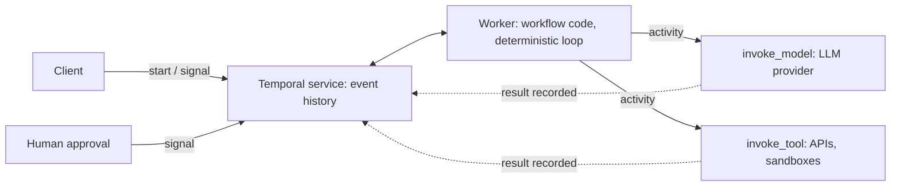

Picture an agent forty minutes into a task. It has called a model eleven times, run six tools, and charged an external API once. Then Kubernetes reschedules the pod.

What happens next is the whole topic. With an in-memory loop, you start over and pay again, and the external charge may happen twice. With durable execution, a different worker picks up where the first one died.

## Requirements that force the issue

Most agents are fine without this. A single-turn tool call that finishes in seconds doesn't need a workflow engine. The need shows up when you have some of these:

- Runs that last minutes to days, including waits on a human approval.
- Side effects that must not repeat (payments, emails, ticket creation).
- Rate limits and provider outages you want to wait out instead of failing.
- Deploys that happen while runs are in flight.

Checkpointing the agent's state to a database covers part of this. What it doesn't give you is a record of which side effects already happened, so you end up rebuilding that by hand.

## The architecture

Durable execution splits your code in two. A **workflow** is deterministic orchestration: the loop, the branching, the parallelism. **Activities** do everything non-deterministic: the LLM call, the tool call, the HTTP request. The engine records each activity's result in an append-only event history. After a crash, a new worker replays the workflow code against that history, and completed activities return their recorded results instead of running again.

An agent loop fits this almost embarrassingly well. Temporal's own write-up shows the loop as a `while True` in the workflow that calls an `invoke_model` activity, then an `invoke_tool` activity, with timeouts on each.



The engine is one component. Your workers run in your own environment, and the service holds state in Cassandra or PostgreSQL, or you use Temporal Cloud.

```steps
{
 "title": "What happens when a worker dies mid-run",
 "nodes": [
  "Workflow",
  "Event history",
  "invoke_model",
  "invoke_tool"
 ],
 "steps": [
  {
   "node": 0,
   "text": "The workflow loop starts turn 1 and schedules an `invoke_model` activity."
  },
  {
   "node": 2,
   "text": "The model answers. The result is written to the event history before the loop continues."
  },
  {
   "node": 3,
   "text": "The tool call (say, a refund) runs and its result is recorded too."
  },
  {
   "node": 0,
   "text": "The worker crashes during turn 2. Nothing in memory survives."
  },
  {
   "node": 1,
   "text": "A new worker replays the workflow code against the history. Completed activities return their **recorded** results, so the refund is not sent again."
  },
  {
   "node": 0,
   "text": "The loop is back where it died and carries on with turn 2."
  }
 ]
}
```

## The case study: Codex, and the SDK integration

Temporal's blog states that "OpenAI's Codex web agent is built on Temporal" and calls it "an AI coding agent running on Temporal in production, handling millions of requests." That's the vendor describing a customer, with no architecture detail behind it. Treat the adoption as a credible pointer and the "millions" as unverified.

The more concrete evidence is the [OpenAI Agents SDK integration](https://temporal.io/blog/announcing-openai-agents-sdk-integration). OpenAI made the SDK's `Runner` an abstract base class, so Temporal could supply an implementation that turns every agent invocation into an activity. Launched in public preview in July 2025; the page notes the Python integration reached general availability on 23 March 2026. Tracing still goes to OpenAI's dashboard, so you don't lose the tooling you had.

Temporal has also published an early, pre-preview [Agent Harness](https://temporal.io/blog/temporal-agent-harness-durable-agent-infrastructure) that runs each agent as a workflow and adds a policy layer for human approval: reads allowed, refunds paused until someone signs off, even if that takes days. Pre-preview means the abstractions may move. I wouldn't build on it yet, but it shows where the ecosystem is heading.

## Trade-offs worth knowing

**The model call lives in an activity, always.** Put an LLM call inside workflow code and replay will produce a different answer, which breaks determinism. The recorded decision is what makes recovery cheap: the restarted agent follows the same path instead of re-rolling the dice.

**Retries are a policy, not a default.** Activities retry on failure. A model call is usually safe to retry. A tool that sends money isn't, unless you give it an idempotency key. The engine guarantees the activity result is recorded once; it can't know your side effect is idempotent.

```compare
{
 "title": "A retried payment activity",
 "options": [
  {
   "label": "Without a key",
   "text": "The activity times out after the provider charged the card but before it replied. The engine retries, and the provider sees a **new** request: the customer is charged twice."
  },
  {
   "label": "With a key",
   "text": "The activity sends `Idempotency-Key: run-42-turn-7`. The retry carries the same key, the provider returns the first charge, and the customer is charged once."
  }
 ]
}
```

**Deploys get harder, not easier.** Replay means new workflow code must be compatible with histories from old code. Long-running agents make that bite. Temporal offers worker versioning for this, and you'll want a plan before the first long-lived run is in flight.

**Large payloads.** Every prompt and response goes into history unless you store it elsewhere. The usual answer is to keep documents and media in blob storage and put references in the workflow.

## The number to remember

Temporal's [limits page](https://docs.temporal.io/workflow-execution/limits) says event history is limited to 51,200 events or 50 MB, with a warning after 10,240 events or 10 MB.

Do a back-of-envelope. An activity typically writes about three events (scheduled, started, completed). A turn with one model call and one tool call is therefore around six, before timers, signals or child workflows. That puts a single workflow somewhere in the thousands of turns, and lower if payloads are large, since the 50 MB cap can hit first. Check the real count in your own history before trusting my arithmetic.

```calc
{
 "title": "How many turns fit in one workflow?",
 "inputs": [
  {
   "id": "events",
   "label": "Events per turn",
   "min": 2,
   "max": 30,
   "step": 1,
   "value": 6,
   "unit": ""
  },
  {
   "id": "kb",
   "label": "Payload per turn",
   "min": 1,
   "max": 200,
   "step": 1,
   "value": 20,
   "unit": "KB"
  }
 ],
 "outputs": [
  {
   "label": "Turns before the event limit",
   "formula": "floor(51200 / events)",
   "decimals": 0,
   "unit": "turns"
  },
  {
   "label": "Turns before the 50 MB limit",
   "formula": "floor(50 * 1024 / kb)",
   "decimals": 0,
   "unit": "turns"
  },
  {
   "label": "The limit you hit first",
   "formula": "min(floor(51200 / events), floor(50 * 1024 / kb))",
   "decimals": 0,
   "unit": "turns"
  }
 ],
 "note": "Limits from Temporal's docs: 51,200 events or 50 MB per history. Payload is everything stored per turn (prompts, responses, tool results)."
}
```

An agent loop with a fat context passed through every activity can hit the byte limit well before the event limit. The standard escape is **Continue-As-New**: close the workflow and start a fresh one carrying forward a compact state (summary, plan, pointers). It pairs nicely with context compaction, because you're already deciding what to carry.

## Explain it to a CTO in three sentences

Our agents run for minutes to days and touch systems where a repeated action costs money. A workflow engine records every model and tool result, so a crashed or redeployed worker resumes instead of restarting. The price is a new piece of infrastructure and a discipline: deterministic orchestration, idempotent tools, and a versioning plan.

## When not to use it

Short, read-only, stateless agent calls. A retry with backoff is cheaper than a workflow service. Also skip it if nobody on the team will own the operational side: an engine you can't debug during an incident is worse than none.

## Try it (36 minutes)

1. Install the Temporal CLI and run `temporal server start-dev`.
2. Write a workflow with a three-step loop: an activity that fakes an LLM call, one that fakes a tool call, and a sleep.
3. Kill the worker during the sleep, restart it, and watch it resume without rerunning completed activities.
4. Make the fake tool non-idempotent (append to a file). Force a retry and see the duplicate. Then add an idempotency key.
5. Loop 5,000 times and watch the event count in the UI. Add Continue-As-New at a threshold you choose.

Step 4 teaches the most. If a run fails halfway through your afternoon, that's the system working as designed; it's allowed to pick up tomorrow.
