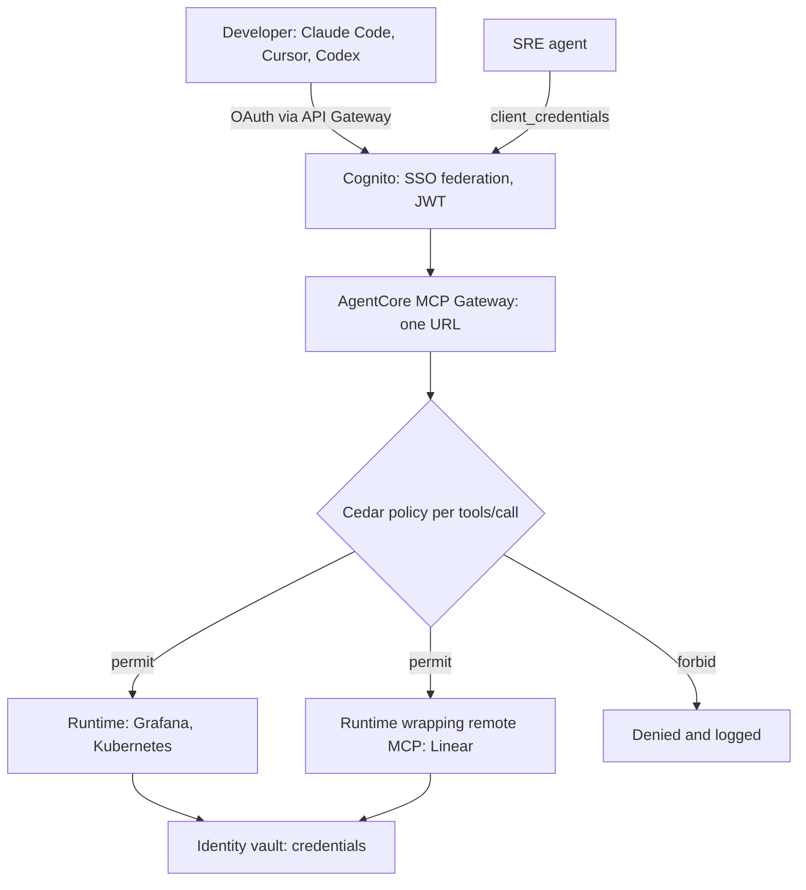

Count the MCP servers on a typical platform engineer's laptop. Kubernetes, GitHub, Grafana, a ticketing tool, a couple of cloud accounts. Each one is a local process, and each one has its own credential.

Eon, a cloud backup company, described exactly this in an [AWS write-up](https://aws.amazon.com/blogs/machine-learning/how-eon-built-multi-cloud-investigation-with-an-mcp-gateway-on-amazon-bedrock-agentcore/): about 10 local MCP processes per developer, a separate credential set per system, and roughly 2 days for a new hire to get it all working. Then their autonomous SRE agent needed the same tools with different permissions than a human.

That's the situation where a tool gateway earns its keep. It's also where the design choices matter more than the product name.

## What had to be true

Four requirements drove it:

- One entry point for humans using Claude Code, Cursor or Codex, and for an autonomous agent.
- Identity that traces to a person or a specific agent, not a shared key.
- Permissions that differ between humans and agents, enforced on every call.
- Reach into tool servers spread across many AWS accounts, without a networking project per account.

Eon looked at two options. A custom reverse proxy with its own auth would have covered credential consolidation but only for remote MCP servers, and they'd have built protocol translation, session management and authorization themselves. They picked Amazon Bedrock AgentCore Gateway, which supplies identity federation, Cedar-based authorization and runtime hosting as managed pieces.

## The architecture



Eon describes five layers: clients, an identity plane, the gateway, policy, and targets. The targets are dozens of MCP servers exposing hundreds of tools, hosted on AgentCore Runtimes across several AWS accounts. A Runtime converts a stdio-based MCP server into Streamable HTTP, so you don't have to rewrite servers that were built to run on a laptop.

```steps
{
 "title": "One investigation, end to end",
 "nodes": ["Developer", "Cognito", "Gateway", "Cedar", "Runtime"],
 "steps": [
  {"node": 0, "text": "The developer signs in through corporate SSO once."},
  {"node": 1, "text": "Cognito issues a JWT that carries group memberships."},
  {"node": 2, "text": "The gateway merges `tools/list` from every target into one manifest, and the agent picks a tool."},
  {"node": 3, "text": "Cedar evaluates the `tools/call` against the caller's group before anything is forwarded."},
  {"node": 4, "text": "The Runtime in the right account runs the call with a credential from the identity vault. The developer never holds it."},
  {"node": 0, "text": "The agent correlates Kubernetes, GitHub and Grafana results without re-authenticating."}
 ]
}
```

## Three decisions that carry the design

### 1. Agents get their own identity

Humans arrive through SSO and get a JWT. The SRE agent uses an OAuth `client_credentials` grant, so it is a principal in its own right. That matters for audit ("which agent did this?") and for policy ("this agent may comment on a ticket; no human group may").

Borrowing a developer's token for an autonomous agent is the shortcut to avoid. You lose the ability to give the two different rights.

### 2. Policy runs on every call, and lives in Git

Eon uses Cedar, evaluated in ENFORCE mode on each `tools/call`. Their pattern: humans in approved SSO groups get read access mapped to job role; production tools are read-only, granted just-in-time with approval and auditing; write access is limited to low-impact actions such as commenting on PRs or tickets, and only for specific agent identities. Policies are managed as code through GitHub pull requests, so a permission change gets a reviewer.

A short `permit` for one agent on one comment tool and a `forbid` for the human group on write tools covers a lot of ground. The post gives the pattern, not full policies, so treat the exact syntax as something to check in the AgentCore docs.

### 3. Cross-account reach through IAM, not networking

The gateway reaches each Runtime by assuming an IAM role. The Runtime's trust policy trusts the gateway's execution role in the other account. Eon says this removed VPC peering and per-account PrivateLink and cut per-account setup from days to minutes. That's the vendor's customer talking about their own result, but the mechanism is plausible: you swapped a network topology problem for a trust-policy problem, which is easier to review.

## The numbers

```stats
~10 | local MCP processes per developer, before
2 days → 2 minutes | new-engineer onboarding (Eon's report)
100+ | developers, about 10,000 sessions
0 | latency figures reported in the post
```

Read the last card as a warning. Credentials, onboarding and networking got better. The post doesn't say what the extra hop costs per tool call. Measure that before you promise anything about latency.

## Where it strained

Eon's own lessons are the useful part.

**Policy size.** Pre-indexed tool schemas pushed their Cedar policy toward its size quota. For large-catalog targets they switched to DYNAMIC listing mode, which adds no bytes to the policy but gives up semantic tool search. They keep DEFAULT mode for targets that need per-user OAuth.

The trade-off is real. [AgentCore's semantic search](https://docs.aws.amazon.com/bedrock-agentcore/latest/devguide/gateway-using-mcp-semantic-search.md) is a built-in tool, `x_amz_bedrock_agentcore_search`, that returns tools relevant to a natural-language query. It must be enabled when you create the gateway, and it's how you keep hundreds of tool schemas out of the prompt. Giving it up means the agent sees more of the catalog, or you filter some other way. This is the same pressure we saw in [the skill-routing paper](/deep-dives/research/2026-10-20/): the bigger the registry, the worse selection gets.

**OAuth compatibility.** Claude Code, Cursor and Codex expect the OAuth `state` parameter. AgentCore binds sessions with a session URI. Eon built an API Gateway shim to bridge them. Expect some glue like this whenever clients and gateways follow the spec slightly differently.

**Noisy manifests.** A Runtime wrapper filters tool lists, which cuts accidental invocations and lets targets stay in DEFAULT mode. It's also one more component to run.

Notice the pattern: each fix adds a small service. A gateway moves complexity into one place, but it doesn't remove it.

## Estimating the prompt cost of your catalog

Before choosing a listing mode, find out what the catalog costs when it's all visible. The defaults below are placeholders for illustration, not measurements: replace them with your own schema sizes.

```calc
{
 "title": "Prompt overhead of listing every tool (illustrative defaults)",
 "inputs": [
  {"id": "tools", "label": "Tools visible to the agent", "min": 10, "max": 1000, "step": 10, "value": 300, "unit": ""},
  {"id": "tok", "label": "Tokens per tool schema", "min": 50, "max": 800, "step": 10, "value": 200, "unit": "tokens"},
  {"id": "calls", "label": "Model calls per investigation", "min": 1, "max": 100, "step": 1, "value": 20, "unit": ""}
 ],
 "outputs": [
  {"label": "Schema tokens per call", "formula": "tools * tok", "decimals": 0, "unit": "tokens"},
  {"label": "Schema tokens per investigation", "formula": "tools * tok * calls", "decimals": 0, "unit": "tokens"}
 ],
 "note": "Defaults are assumptions. Prompt caching changes the price of repeated schema tokens, but not the context they occupy."
}
```

## When not to build this

Fewer than a handful of tools, one team, no autonomous agents? A gateway is overhead. Local servers with scoped tokens are fine. The pattern pays off when credentials sprawl, when agents and humans need different rights, or when auditors will ask who called what.

Also check the lock-in. Cedar, Cognito and AgentCore Runtime are AWS pieces. The MCP surface that clients see is portable; the policy and identity layers behind it are not.

## Explain it to a CTO in 3 sentences

Every engineer was running ten tool servers and holding ten sets of credentials. We put one gateway in front of them, so people sign in once, agents get their own identity, and every tool call is checked against a policy that goes through code review. The cost is a few small glue services and an AWS dependency, and nobody has published the latency yet.

## Try it in 10 minutes

List the tools your agents can reach today, and next to each, write who holds the credential and whether it's read-only. Any row where an agent uses a human's token, or a write tool with no policy in front of it, is your first gateway requirement.

If the list stays on your desk for a week, that's fine too. Good plumbing is mostly patience.
